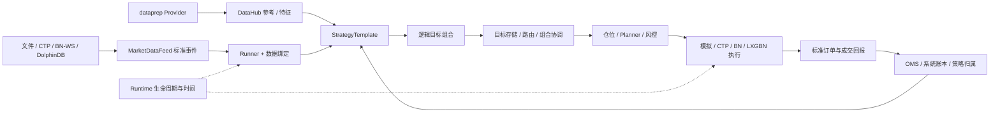

# Bomber Framework：积木化量化交易框架

更新日期：2026-11-02，Asia/Shanghai。按当前源码提交 `6fef106` 静态核对；本文说明现有结构、装配入口和适配边界。本次文档维护未运行测试、编译、数据库或柜台连接；验收结果引用已有专项，不能把组件存在等同于所有组合均已通过。

Bomber Framework在Nautilus数据模型、指标和回测内核之上，把行情、参考资料与特征、策略、组合、仓位、风控、执行和运行生命周期组织为可独立组合的组件。同一策略处理标准事件和逻辑目标，通过装配选择文件回测、在线Recording、参考价模型或柜台执行；新数据源和交易端通过适配器接入，业务算法不承担厂商连接与协议转换。框架强调组件复用、输入契约和执行事实一致，灵活性来自明确的接口与绑定。

## 1. 积木化设计与适配方式

| 设计点 | 当前代码中的实现 | 装配时需要明确的内容 |
| --- | --- | --- |
| 策略与行情解耦 | [StrategyTemplate](trader/template.py)、[DataBinding](trader/contracts.py)、[MarketDataFeed](market/basic/base.py) | 逻辑data_key、Feed、真实标的、数据类型及周期；相同业务输入切换来源可保留算法 |
| 行情与执行分离 | [行情工厂](market/sources.py)、[ExecutionRoute](trader/contracts.py)、[执行组件构建器](trader/execution/builders.py) | 行情在哪里取得、目标发给哪个执行账户分别选择；指数等信号输入可以没有交易路由 |
| 目标与订单分离 | TargetPortfolio → TargetStore／PortfolioCoordinator → ExecutionRequest → Planner | 策略表达希望持有的数量；公共执行层处理差额、在途、风险、开平及订单状态 |
| 时间与执行分离 | [RuntimePort](trader/runtime/base.py)、[UnifiedHistoricalRuntime](trader/runtime/historical.py)、[ManagedLiveRuntime](trader/runtime/managed.py) | 模拟时钟或Live调度、事件顺序和资源生命周期 |
| 市场规则可组合 | [VenueSimulationProfilePort](trader/execution/ports.py)、模拟Profile、CTP Planner／Ledger、[费用契约](fees.py) | 合约条款、账户模式、费用、保证金、撮合模型、开平政策；Profile不能替代真实柜台事实 |
| 策略与账户仓位分离 | [PositionManager](trader/portfolio.py)、[成交归属](trader/execution/attribution.py)、[ExecutionPolicy](trader/execution/policy.py) | 策略自有份额、物理总仓、外部基线，以及是否读取／核对物理账户 |
| 公共机制与业务钩子分离 | [assemble_strategy](trader/assembly.py)、[Live公共生命周期](trader/runtime/live/lifecycle.py) | 策略参数、选约、模型、历史价格口径和业务恢复由应用提供，公共层负责调用顺序及一致性 |

**配置选择已实现的组件，适配器实现尚不存在的协议。** 来源可替换不表示任意标的等价：BN-WS不提供国内MO／IM合约；需要完整成交额的模型不能只给OHLCV；新增期权系列也必须提供真实条款和会话规则。当前没有一个已完成的总配置工厂，可以把全部策略×行情源×执行端×平台任意组合成可运行系统。

## 2. 模块地图

| 模块 | 主要职责 | 不在该层处理的事情 |
| --- | --- | --- |
| [market](market) | 文件Replay／在线Stream、Reader／Parser／Converter、标准Tick／Bar／CustomBar、聚合与时效 | 策略选约、仓位归属和报单 |
| [dataprep](dataprep/README.md) | 文件路径／索引／规范化、参考来源工厂、历史Provider、特征导入导出、场景输入与诊断 | 策略信号、模拟撮合和持仓决策 |
| [datahub](datahub/README.md) | 不可变条款、合约角色／因子、外部目标计划、as-of参考查询、特征版本与对齐快照 | 直接连接行情柜台或控制订单 |
| [calendars](calendars/README.md) | 交易日Provider、时段／夜盘归属、特殊日期例外、交易窗口及完整分钟枚举 | 凭合约代码猜品种、价格或开平规则 |
| [trader](trader) | 策略模板、Runner、逻辑绑定、目标组合、仓位、规划风控、执行回报与持久化 | 把某个demo的模型或品种固定进公共协议 |
| [trader/runtime](trader/runtime) | 历史／Live运行、就绪、预热、恢复提交、授权、停止及窗口常驻 | 自动修复未知交易事实或补造业务输入 |
| [trader/execution](trader/execution) | 模拟Backend、CTP与BN执行适配、LXGBN后端、共享账户与IPC、OMS／归属／风险 | 把模型成交当成真实柜台成交 |
| [fees.py](fees.py) | 期货费用单位、标准金额、系数和逐笔计算契约 | 自动推断未提供的费率或把普通手续费当交割费 |
| [cli.py](cli.py) | `ConfigArgumentParser`与`load_config`，把YAML实验参数接入原有argparse校验 | 策略计算、组件实例化、柜台连接或参数值自动打印 |
| [dolphindb.py](dolphindb.py) | DolphinDB连接配置与market／reference用途区分 | 在策略算法内隐式访问数据库 |
| [lxgbn.py](lxgbn.py) | Windows宿主调用的SDK门面、绑定／命令／值快照及HostPort | 创建第二个交易环境、额外网络桥或另一份厂商SDK |

Python负责协议、装配和调度；原生行情对象、数值构造与部分交易日历使用Cython／原生扩展。导入完整trader或运行模拟内核需要相应安装依赖；轻量LXGBN契约门面采用延迟加载，不能据此认定整个framework均不需要原生模块。

### 公共启动参数配置

应用可用`from bomber.framework.cli import ConfigArgumentParser`替换`argparse.ArgumentParser`，其余`add_argument()`和`parse_args()`保持不变。通过`--config-file 文件.yaml --config-id 配置ID`选择`experiment_setups`下的一组参数；优先级为显式CLI、配置文件、原有默认值。配置必须使用已声明的选项，保留type、choices、required及互斥组校验，`description`仅为说明。命令行覆盖可重复参数时替换整组配置值；选择互斥组中的另一选项时覆盖配置中的原选择。YAML中的`null`表示沿用默认值，`true/false`用于开关，参数值不自动打印。

配置是独立参数集合，不增加实验继承、批量调度或组件工厂。相对路径按进程运行目录解析。首次读取YAML需安装`requirements-config.txt`中的PyYAML；不使用文件配置时不导入该依赖。08回测与Live共用一个文件：[strategy.yaml](../../demos/08_option_vega/config/strategy.yaml)，各入口按配置ID读取自身参数，继续执行原有业务校验。

应用可用`parser.add_json_config_argument("--strategy-config", fields=允许字段, sequences=逗号列表字段)`注册受限JSON参数文件，由YAML或CLI指定路径。JSON为参数映射，`description`仅为说明；重复键、非法JSON或未允许字段会报错。`sequences`把JSON列表适配到已有逗号列表选项，其余复用原CLI的type、choices及互斥校验。优先级为显式CLI、YAML、JSON、默认值；JSON不能自行增加启动参数或控制连接/授权，具体字段由应用显式声明。08的策略JSON与行情JSON示例在`demos/08_option_vega/config/`。

## 3. 一条主链，分别选择运行与执行

图中为组件职责关系；具体Backend按当前适配器能力选择。参考／特征和行情分别接入，行情字段与业务键通过DataBinding送入策略，target_key再由ExecutionRoute解析到执行账户与真实合约。研究复权价格用于信号，真实订单价格仍来自可交易合约行情。

正式装配入口是[StrategyBindings／assemble_strategy](trader/assembly.py)与[ExecutionComponents及构建器](trader/execution/builders.py)：

1. 准备真实合约条款、日历、来源身份及策略需要的参考／特征；回测资料来自显式文件，Live按已声明用途连接数据源。
2. 选择Feed及标准事件类型，注册合约与周期。文件解析、在线转换和分钟聚合各用已有组件。
3. 选择执行组件：如build_simulation_execution、build_ctp_execution、build_ctp_portfolio_execution或相应独立SDK装配；提供Planner、价格、风险和账户政策。
4. 创建Runner与原策略，声明data bindings及execution routes，再调用assemble_strategy。Runner和执行积木须共享同一个PositionManager；固定角色场景另显式提供RoleGuard。
5. 用历史Runtime或Live生命周期驱动启动和停止。构建器只完成装配，连接、恢复核对和下单授权由生命周期负责。

应用层选择这些积木；框架不反向导入demo。新增策略需要实现算法和声明业务输入，已有策略切换兼容来源主要调整装配；换算法、输入含义或交易规则时仍需对应业务实现。

## 4. 当前可复用的运行组合

| 组合 | 实际组件／入口 | 当前边界 |
| --- | --- | --- |
| 本地信号回放 | FileReplayFeed＋SimpleReplayRuntime／统一Runner | 可检查信号、目标与路由；不能以此替代正式撮合 |
| 正式文件回测 | [UnifiedHistoricalRuntime](trader/runtime/historical.py)＋[NautilusSimExecutionBackend](trader/execution/simulation/backend.py)＋Profile | 唯一模拟时钟，处理原生订单、账户、成交和结果；依赖已安装的引擎与合约／费用模型 |
| 在线目标记录 | Stream Feed＋RecordingExecutionClient | 输出实时目标，不产生物理柜台成交；具体应用应使用Recording生命周期 |
| 在线参考价模型 | Stream Feed＋[ReferencePriceExecutionBackend](trader/execution/model.py) | 显式model来源、独立策略账本；不等同订单簿撮合或真实交易 |
| 受控CTP | CTP或匹配的DDB行情＋CTP执行／生命周期 | 已有SimNow局部真实成交；会话、源时效、对账和风险门禁仍适用 |
| Binance接入 | BNWSStreamDataFeed＋[Binance DEMO执行工厂](trader/execution/live/binance_joint.py) | 适用于匹配BINANCE标的；已有适配不代表当前所有demo或共享CTP入口都可切换BN |
| LXGBN内嵌 | [create_session](trader/runtime/lxgbn.py)＋宿主HostPort／值快照回调 | Windows宿主驱动行情、poll和回报；首期测试绑定、单策略／单合约，宿主实交易待验 |

[RuntimeMode](trader/contracts.py)只有historical和live；Recording、Model、SimNow及进程布局是装配／执行政策，不是新增RuntimeMode枚举。各demo的CLI只开放已经接线的组合；不能把端口存在解释为所有CLI均支持。

### 回测时钟、撮合与费用

- Backend的`execution_timing="native"`保留原生提交行为；同时间戳的后续事件仍可能成交，不能笼统宣传所有回测都严格N→N+1。
- `execution_timing="next_market"`等待**订单自身合约**严格晚于信号及提交时钟的新行情。Bar模式可用`execution_delay_bars`选择等待根数；其他合约、同时间戳重复事件不会替该订单累计有效Bar。该模式需UnifiedHistoricalRuntime逐事件回放。
- GenericVenueProfile组合撮合、费用、保证金、延迟等模型。CtpFuturesBasicProfile为基础NETTING模拟；CTP双向／今昨高保真记账使用对应Ledger／HedgingProfile，不能从基础Profile推断所有柜台规则已实现。
- [FuturesFee／CommissionConfig](fees.py)支持元／手、成交金额百分比与全局／品种／合约系数；按实际成交量价计算，输出标准费用及实际扣费。[费用说明](../../doc/data/FUTURES_FEES.md)记录优先级、固定费兼容及验收范围。
- [OptionCashSettlementModule](trader/execution/simulation/option_expiry.py)支持显式期权到期现金结算，结合[最终结算资料加载](dataprep/option_settlements.py)与[结算契约](trader/execution/option_settlement.py)处理实际残仓、撤销到期委托和原生账户入账。须显式配置CASH_SETTLEMENT及真实最终价；不以最后一根行情close猜终值，也不等同所有市场的实物交割／自动行权均已支持。
- 同一公共流程的`FutureCashSettlementModule`支持显式IF/IH/IM到期现金交割，使用[期货最终结算资料加载](dataprep/future_settlements.py)及`FutureSettlement`正终值契约。到期回报通过原生账户和共享归属账本了结真实残仓，业务再清理对应期货目标；不把旧月仓位直接记到新合约，不处理商品实物交割。08可在启动YAML中分别设置option_settlements与future_settlements。

### 标准Bar与完整期货分钟

[MarketSourceConfig](market/sources.py)区分file／ctp／bn-ws／dolphindb；[CompletedMinuteBarFeed](market/stream/completed.py)处理完成分钟，[FuturesMinuteBarFeed](market/stream/futures_minute.py)显式处理CTP深度增量或DDB分钟。完整分钟可保留原始OHLCV、成交额、持仓量和模型标签，经CustomBar传递；DDB的completed与state流有各自明确标签／量口径约束。

需要原始模型字段时，使用[显式Parser映射](market/replay/parsers/bar/fixed.py)和[futures_bar_values](market/futures.py)，按真实乘数核验数值。不会用末价×成交量补造成交额，或把累计量默认当本周期量。完整期货分钟目前限定CTP／DDB；普通OHLCV路径继续可用。

## 5. 多策略、独立仓位与公共Live

[SharedAccountExecutionService](trader/execution/shared.py)让同一物理账户拥有唯一执行写入端，策略保留独立Runner、目标版本、信号状态和成交份额。同进程使用共享宿主；同机独立进程使用[账户协议／Unix服务](trader/execution/ipc.py)和[远程策略客户端](trader/execution/ipc_client.py)，不让多个worker各自抢占TD连接。

- **netted**：汇总目标并允许已声明政策下的内部抵消，transfer单独审计，不伪造柜台成交。
- **independent**：各策略实际订单和归属独立，不跨策略内部转移；同一合约可以持有同向或反向份额。
- **仓位来源与账户观测分开**：fills／model、strict／observe／off有显式合法组合；model要求off，off报告物理账户为None，不能将系统账本伪称柜台总仓。
- **外部基线与归属分开**：preserve_external用于明确的独立执行政策；候选路由不等于仓位所有权。未知外部变化、活动单和未决发送仍按恢复规则核对，不能自动吸收到某策略。
- **协议范围明确**：事件日志、请求幂等和ack／游标支持补交；Unix IPC为同机能力，不代表跨主机或Windows传输已经实现。

[公共Live生命周期](trader/runtime/live/lifecycle.py)统一关闭决策→校验绑定／恢复→启动订阅与就绪→准备历史→复查健康→提交检查点→授权与实时决策；账户权威核验及停机由对应渠道生命周期负责。[历史协调](trader/runtime/live/history.py)复用HistoryService完成交易分钟窗口、同步覆盖、查询期缓冲与放行，业务钩子保留EMA、原始价差、跨品种复权或模型的各自口径；历史只初始化窗口，不回放历史报单。

[run_continuous／ContinuousPositionRuntime](trader/runtime/live/continuous.py)管理休市等待、交易窗口、停止信号及当日报单额度；它不使未知执行故障自动恢复。当前01／10已接新增高层常驻入口，08已有公共常驻链路但高层入口待统一，03／04尚未因此新增常驻模式。接线和最新离线／远程状态见[Live公共能力台账](../../doc/architecture/LIVE_COMMON_PROGRESS.md)。

[RuntimeStateManager／JsonStateStore](trader/persistence.py)复用原子保存、CAS代次、接入对象校验、目标／组合一致性和暂存恢复提交。恢复策略指标或模型状态需在state_components中接入真实业务组件；恢复目标版本不等于恢复全部算法状态。跨日、换约和持仓迁移按现有适用范围处理，不承诺任意断点自动接管。

## 6. 参考数据、特征与会话扩展

| 扩展内容 | 可复用接口 | 接入要求 |
| --- | --- | --- |
| 新期货／期权条款 | FutureBasic／OptionBasic、dataprep资料适配、trader合约工厂 | 提供真实交易所、生命周期、乘数、跳价及期权关系；模型可表达的条款范围与具体执行工厂支持范围分别核验 |
| 主次力／远期、复权研究 | SectorRoleStore、RolePriceStore及dataprep角色／因子Provider | 真实角色身份、源日、发布时间／可见性和逐日因子；研究价不作为物理报单价 |
| 现货／指数／外部因子 | DatasetSpec／ExternalDataRecord、FeatureProviderFactory、DataHub.feature_snapshot | 声明Schema、计算版本、键、频率、时间、映射及EXACT／WINDOW／ASOF；已有计算结果可配置导入，需新计算的因子仍由算法提供 |
| 新历史行情源 | HistoryProvider、HistoryService、公共HistoryFrameLoader | 标准HistoryBar、真实完整窗口／覆盖审计、阶段及缺失政策；不能靠枚举分钟代替价格 |
| 新品种／期权系列会话 | SessionBinding、SessionCalendar、时段／例外Provider | calendar_id、hours_code、时区、交易日覆盖及已确认例外；不在公共代码加入品种专属时段分支 |

特征来源已有标准文件、DolphinDB、DolphinDB原表映射及MongoDB适配。Schema、数据修订和计算版本分别管理，按业务时间与实际可见时间查询；未知历史发布时间不能用今天导出的时间伪造。普通因子直接读取DataHub，仅需OHLCV行情输入的消费者才投影为Bar。标准特征包、manifest和映射契约见[特征说明](dataprep/features/README.md)。

08回测已在[demos/08_option_vega/feature](../../demos/08_option_vega/feature/README.md)与默认DFS Live共用指数契约，通过标准文件Provider和模拟可见时钟接入原策略帧接口；不再属于“缺接入代码”。真实现货场景、其他来源和完整回测／Live组合各按业务证据验收，不以通用Provider存在推定全部完成。

会话核心支持跨午夜、夜盘交易日、特殊日期覆盖、窗口与分钟枚举；交易日历覆盖有限，规则／例外需真实资料。静态快照身份校验与完整历史规则发布版本是不同能力，见[calendars说明](calendars/README.md)。

## 7. 新增积木时修改哪里

1. **新策略**：在应用／demo实现StrategyTemplate，声明输入、目标键、状态组件及业务预热钩子；用已有装配连接Feed和执行端。
2. **新行情源**：实现MarketDataFeed及转换／订阅／健康契约，再在适用工厂注册；保留标准时间、精度与来源身份。
3. **新特征**：已有Provider能表达时增加数据声明与映射；新存储协议实现FeatureProvider并注册。特征计算与存储适配分开。
4. **新交易端**：实现Backend／Driver或宿主HostPort，把真实受理、拒绝、成交、撤单及查询转成标准回报，保留稳定ID、去重和发送不确定状态。
5. **新运行或市场规则**：优先组合Runtime、Profile、Planner、Ledger、日历与费用模块；核对该规则是否同时影响回测、Live及状态身份。

LXGBN当前是**Windows交易程序内嵌Python调用Bomber SDK**。宿主注入报撤单／一致绑定查询和回调复制，驱动owner线程与poll；不使用已撤回的HTTP跨机桥。Windows wheel及与原生库同进程导入／数值验证已有记录，真实宿主字段、线程／GIL、绑定快照和报撤单回报仍待现场验收。见[SDK指南](../../doc/integration/LXGBN_SDK_INTEGRATION_GUIDE_2026-10-21.md)及[原生接线分析](../../doc/integration/LXGBN_EXPORTED_LIBRARY_REVIEW_2026-10-29.md)。

## 8. 阅读与验证入口

| 目的 | 文档 |
| --- | --- |
| 产品功能概览 | [平台功能介绍](../../doc/architecture/PRODUCT_OVERVIEW.md) |
| 历史设计／实现台账 | [统一策略架构](../../doc/architecture/STRATEGY_ARCHITECTURE.md)；历史段落按日期阅读 |
| 数据准备与逐函数参数 | [dataprep](dataprep/README.md)、[API_USAGE](dataprep/API_USAGE.md)、[项目函数索引](../../doc/functions/README.md) |
| 公共运行流程接线与验证 | [LIVE_COMMON_PROGRESS](../../doc/architecture/LIVE_COMMON_PROGRESS.md) |
| M01—M06、D1—D5及整体GAP | [既有审计快照](../../doc/audits/ARCHITECTURE_GAP_REVIEW_2026-10-09.md)；本页不更改需求、验收条款或关闭状态 |
| 按策略查看实际入口 | [demos](../../demos)、[行情配置示例](../../demos/market_sources/README.md) |

测试源码可从[行情工厂专项](../../tests/test_market_sources.py)、[特征回放专项](../../tests/test_option_feature_backtest.py)、[生命周期](../../tests/run_live_lifecycle_offline.py)、[历史](../../tests/run_live_history_offline.py)、[常驻](../../tests/run_live_continuous_offline.py)及[共享IPC](../../tests/test_shared_ipc.py)定位。调用前确认原生依赖、测试夹具与当前环境；本次未执行这些入口，不新增通过数量。已有本机／远端离线、真实数据、Recording、SimNow和Windows宿主结果按对应专项的版本与范围分别阅读。
