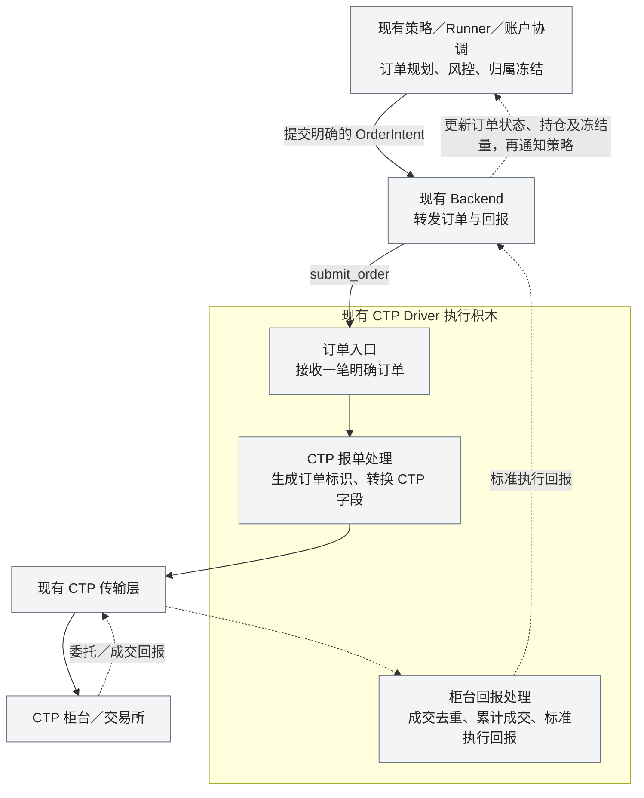
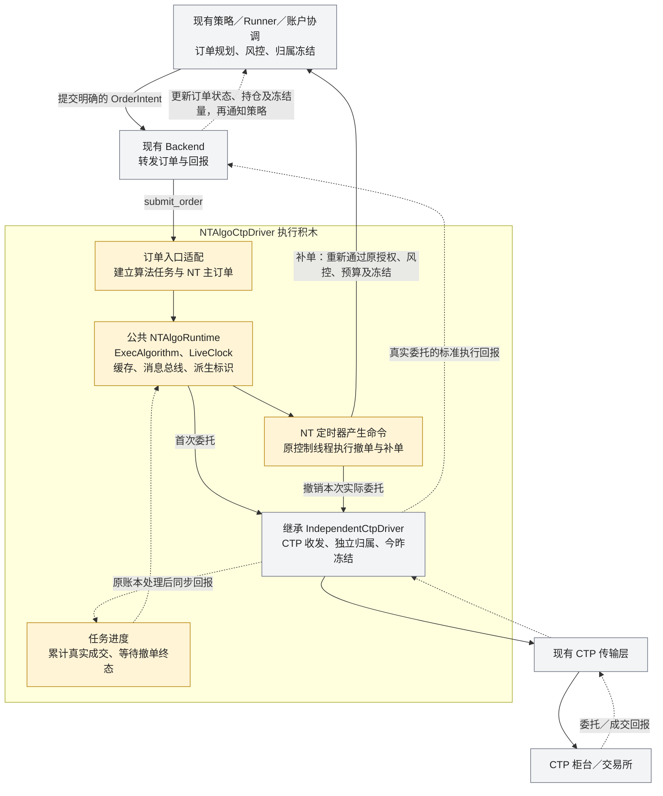

# CTP 现有执行与 NT 算法执行流程对照

更新日期：2026-11-23。

两张图使用相同的上层入口、Backend、Driver 边界和 CTP 传输层，便于比较新增 NT 算法后 Driver 内部的变化。第二张图已按本次 `NTAlgoCtpDriver` 实现更新；原生 SDK 与联机验证需在远程运行环境完成。

策略决定合约、方向、数量、开平、平仓和反手；执行算法只管理收到的订单如何成交。策略改变交易决策时，另行提交取消、替换或新订单。

## 图例

- 实线箭头：报单、撤单等命令；图中主干展示报单。
- 虚线箭头：订单、成交或执行结果回报，不表示轮询。
- 灰色节点：现有能力。
- 黄色节点：本次新增或适配的能力。
- Driver 大框：同一个执行积木对外暴露的边界；箭头直接连接框内入口。

## 当前 CTP 执行流程

当前流程没有超时或价格偏离追单轮询，没有 NT 算法主订单和派生委托层。目标变化、批次到期、停止等原有撤单流程继续运行。

Driver 基类为 `CtpNativeTraderDriver`；独立策略归属路径使用其派生类 `IndependentCtpDriver`。原执行客户端会在报单前调用规划器，再执行风控、额度检查和归属冻结；一笔 `OrderIntent` 对应一张实际 CTP 委托。

柜台回报经 Driver 和 Backend 返回执行客户端，先更新订单状态、真实持仓和冻结量，再通过共享服务的策略端口队列或事件日志通知 Runner 和策略。订单状态更新本身不等于已经成交。

## NT 派生 Driver 执行流程

`NTAlgoCtpDriver` 继承 `IndependentCtpDriver`，内部组合公共 `NTAlgoRuntime`。采用轻量 NT 算法宿主，复用原受控执行客户端和账户账本；没有另建 NT 风控/执行引擎。每张真实委托及其成交仍通过原路径记账。

NT 主任务记录在检查点的 `nt_algo` 组件；实际 CTP 订单分别保留自己的订单 ID、冻结和成交记录，以 `nt_algo_task_id` 关联主任务。首次委托复用已经完成的原风控和冻结；后续补单重新通过原受控入口。NT 主订单不额外记持仓或冻结数量。

本期规则为超时撤单、确认终态后按有效参考价重报剩余量，支持等待秒数和最大尝试次数。没有价格偏离触发。超时由原生 NT 时钟触发，原服务只排空已产生的命令，不扫描挂单年龄。

## 两种流程的对应关系

| 对比项 | 当前 CTP 流程 | NT 派生 Driver 流程 |
| --- | --- | --- |
| 策略职责 | 决定交易、目标和退出 | 相同 |
| Driver 收到的输入 | 明确的 `OrderIntent` | 明确的 `OrderIntent`，另由配置提供算法及执行约束 |
| 实际委托 | 一笔订单对应一张 CTP 委托 | 一笔主订单可对应多次实际委托 |
| 超时、价格偏离 | 不自动撤单追价 | 超时撤单并重报；本期无价格偏离触发 |
| 对外回报 | 原实际委托的状态和成交 | 仍是实际委托回报；主任务进度单独持久化 |
| 成交记账 | 实际成交去重后入账 | 每笔实际成交只入账一次，主单和派生单不重复冻结 |
| 撤单 | 对具体实际订单去重 | 区分取消主任务与撤销某次实际委托 |
| 恢复 | 原 CTP 订单、成交和归属恢复 | 增加主订单、派生委托映射和算法进度恢复 |

例如，策略交给算法“卖开2手”：第一张委托成交1手后撤销，第二张委托执行剩余1手。对外累计成交为2手。第一张实际委托撤销不等于整个主订单取消，五分钟后是否平仓仍由策略决定。

装配时选择普通 `IndependentCtpDriver` 或算法 `NTAlgoCtpDriver`。参数、切换条件和远程验证命令见 [运行说明](NT_ALGO_CTP_RUN_GUIDE.md)。

## 代码与接口参照

- [执行客户端接口](../../bomber/framework/trader/ports.py)
- [现有执行客户端及回报处理](../../bomber/framework/trader/execution/live/client.py)
- [共享执行服务](../../bomber/framework/trader/execution/shared.py)
- [CTP Driver](../../bomber/framework/trader/execution/ctp/native_driver.py)
- [独立归属 Driver](../../bomber/framework/trader/execution/ctp/independent.py)
- [归属冻结及订单绑定](../../bomber/framework/trader/execution/attribution.py)
- [NT 执行算法说明](https://nautilustrader.io/docs/latest/concepts/execution/algorithms/)
- [NT 执行路由说明](https://nautilustrader.io/docs/latest/concepts/execution/)
