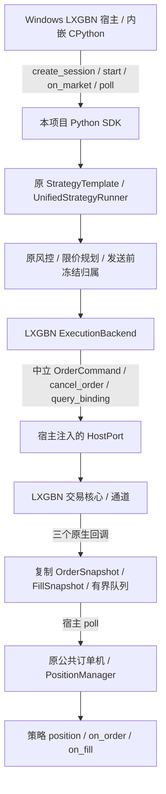

# M02：LXGBN 宿主调用 Bomber SDK

更新：2026-10-20。用户确认 LXGBN 与 DXBM-LXG 是同一套 Windows 交易程序，**本项目作为 Python SDK 被 LXGBN 内嵌解释器加载和调用**。本文取代此前误将项目作为 Linux 调用端的设计；HTTPS、双进程桥接、独立 LXGBN SDK 加载与部署方案已撤回。

依据：[DXBM-LXG 对接说明](../integration/DXBM_LXG_INTEGRATION_SPEC.md)，特别是 §3、§7、§8.3、§9、§11.3。当前实现是离线可验证的项目 SDK 接口及执行适配，Windows 实际加载与交易事实尚待联调。

## 1. 本期范围与 D5 / GAP10

| 项目 | 本期处理 | 状态边界 |
| --- | --- | --- |
| CTP | 复用已走通的实际链路；公共改动做回归 | 不重复开发或要求重做已有实单证据 |
| LXGBN | Windows 宿主加载项目 SDK；一个策略、一个绑定、一个合约 | 先普通限价 Normal、投机、宿主负责底层开平转换 |
| BN | 本期延后 | 保留原路径，不增加新 BN 执行实现 |
| D5 | LXGBN 子项复用同一批链路证据 | 实际连接、受理、撤单、成交、稳定 ID 验收前不关闭 |
| GAP10 | 复用路由、冻结归属、订单机、持久化和故障闸门 | 多端联动、多策略共享净额、多账户及未知单自动恢复继续开放 |

不复制 GAP-01 已有归属账本，不借本期关闭 GAP-09 或宣称已更新 NT Cache/Portfolio。整体状态仍以[架构审计](../audits/ARCHITECTURE_GAP_REVIEW_2026-10-09.md)为准。

## 2. 最小调用关系

宿主拥有解释器、原生绑定、交易登录、合法交易线程、行情转换、事件调度及最终退出。项目不导入 LXGBN 厂商包，不启动交易进程、网络服务或工作线程。宿主传入 `HostPort` 是 SDK 的执行依赖；由 SDK 通过该端口交还交易请求，并不改变“LXGBN 调用项目 SDK”的产品边界。

## 3. SDK 接口

入口为 `bomber.framework.lxgbn`。只导入该契约模块不加载原生交易引擎；调用 `create_session` 时装配现有引擎及框架组件。

| 接口/类型 | 职责 |
| --- | --- |
| `Binding` | 账户、策略、绑定、合约、交易日、原生会话、测试环境身份 |
| `HostPort` | 由宿主实现 `send_order`、`cancel_order`、`query_binding` |
| `OrderCommand` / `SubmitResult` | 中立普通限价请求；区分已入队、确定未发送拒绝、不确定 |
| `BindingSnapshot` | 当前策略绑定快照；完整性、初始化、执行状态、能力和交付水位 |
| `CallbackCopies` | 宿主原生对象到只含值的快照转换；确认枚举、单位、时间和身份 |
| `create_session(...)` | 组合原策略、Runner、风控、Planner、Backend 和现有 JSON 状态保存 |
| `start(resume=...)` / `authorize()` | 默认只读启动；核对完整绑定及本地归属后显式开放测试报单 |
| `on_market(feed_id, event)` / `poll()` | 宿主线程发布标准行情、消费执行队列；业务策略算法无需厂商分支 |
| `onOrderAck(id, order)` / `onOrderFill(id, order, fill)` / `onOrderFinished(id, order)` | 保留原生签名的 2/3/2 个参数；只复制入队，不直接执行业务策略 |
| `on_disconnect(reason)` | 宿主通知失联或交易不可用，关闭新增命令 |
| `begin_stop()` / `finish_stop()` | 闭闸并撤本策略活动单；继续收回报，确认终态和保存后结束会话 |

生命周期、行情和 `poll` 固定在宿主指定的同一线程，禁止重入；三个原生回调可从其他线程进入。项目不获取 GIL 或销毁解释器；这些由原生宿主绑定负责。回调转换异常、未知 ID、队列满会返回 False 并锁存故障，不让 Python 异常越过原生边界。宿主必须检查返回值并保留原生事实供查询/重放。

## 4. 数量、关联、恢复约束

- 发送前分配整数 `clientOrderId` 和带会话命名空间的字符串请求号，将冻结归属、PENDING、ID 映射一起落入现有检查点，再调用宿主；允许发送函数返回前同步回调。
- 函数返回入队不代表受理；`Blank`、`Submited` 不生成 ACCEPTED。只有宿主明确确认 Acked 层次后才启用受理转换。
- 成交使用稳定原生成交 ID，按账户/绑定/交易日/原生会话命名空间去重；成交数量是增量。原生订单号不冒充交易所委托号。
- Finished 的累计量超过已知逐笔成交时先缓存终态；不伪造成交。终态后出现新成交、身份冲突、缺失稳定成交 ID、未知状态必须闭闸。
- 撤单命令不代表撤销成功；拒绝必须标明是报单还是撤单。撤单被拒绝保留原工作单和在途。
- 普通限价仅发 `Attribute=Normal(1)`，不另传 TIF。框架生成通用 OPEN/CLOSE；宿主必须明确支持通用 CLOSE 和底层今昨转换，否则不授权。反手先平，后续目标更新再推进开仓，不自动增加重试循环。
- 绑定快照只核对本策略归属，不冒充全账户快照。框架的执行账本采用 `off/fills`，真实账户风控及底层可平校验由 LXGBN 完成。
- `delivery_sequence` 与 `boundary` 是**宿主必须提供的连续交付及快照边界契约**，不是对现有 C++ 接口字段的声明。宿主须保证水位内事件已转发、查询与增量可核对；不能用时间或队列空来伪造完整性。
- 首期自动恢复只接受同一绑定身份、全部已知单终态、交付水位/归属一致的检查点，并恢复目标版本。带活动单、发送结果不确定、缺失成交、交易日/原生会话改变时闭闸，需只读恢复；不自动重发或清零账本。
- 指标/信号窗口的检查点通过可选 `state_components` 复用策略已有实现；仅恢复目标版本不等于恢复完整策略状态。

## 5. 代码改动清单

| 文件 | 改动 |
| --- | --- |
| `bomber/framework/lxgbn.py`（新增） | 宿主可导入的 SDK 契约和延迟装配入口 |
| `bomber/framework/trader/execution/lxgbn.py`（新增） | 宿主端口、发送前关联、回调队列、回报转换、去重、终态协调、检查点 |
| `bomber/framework/trader/runtime/lxgbn.py`（新增） | 单策略装配、绑定核对、授权、线程约束、两阶段停止 |
| `bomber/framework/trader/execution/planner.py` | 基于原净目标 Planner 增加普通限价包装 |
| `bomber/framework/trader/execution/live/client.py` | Backend 注解接受已有基础协议，与 off 分支实际需求一致 |
| `bomber/framework/trader/execution/contracts.py` | 通用订单上限异常文案去除 CTP 专属名称 |
| `bomber/framework/trader/persistence.py` | 通用执行组件的写前/回报后保存钩子，沿用原 JSON schema |
| `tests/test_lxgbn_execution.py`（新增） | 宿主调用 SDK 到原 Runner/OMS/归属/检查点的离线链路测试 |
| `scripts/integration/lxgbn/`（新增） | 内嵌调用示例、宿主端口和 Windows 联调说明 |
| `doc/integration/DXBM_LXG_INTEGRATION_SPEC.md` | 补充 SDK 交付与宿主调用方向，保留原生语义待确认项 |

既有共享 CTP CLI、Unix IPC、行情装配、业务策略及 Nautilus 上游不因本期新增厂商分支。

## 6. 交付边界

[宿主调用说明](../../scripts/integration/lxgbn/README.md)、[交接记录](../HANDOFF/gaps/HANDOFF_M02_LXGBN_2026-10-20.md)和[离线证据](../evidence/live/M02_LXGBN_OFFLINE_20261020.json)记录当前结果。

Windows 现场仍需确认已部署 Bomber 原生引擎及 CPython/CPU/Boost.Python/运行库 ABI，宿主字段复制、交易线程和快照水位契约，再验证真实受理/成交/撤销与退出顺序。本期没有移植整个原生引擎，也没有将标准库契约可导入等同于 Windows 完整 SDK 已加载成功。这里需要核对的是**宿主接入本项目的实现与环境**，不是让项目寻找并引用另一份 LXGBN SDK。
