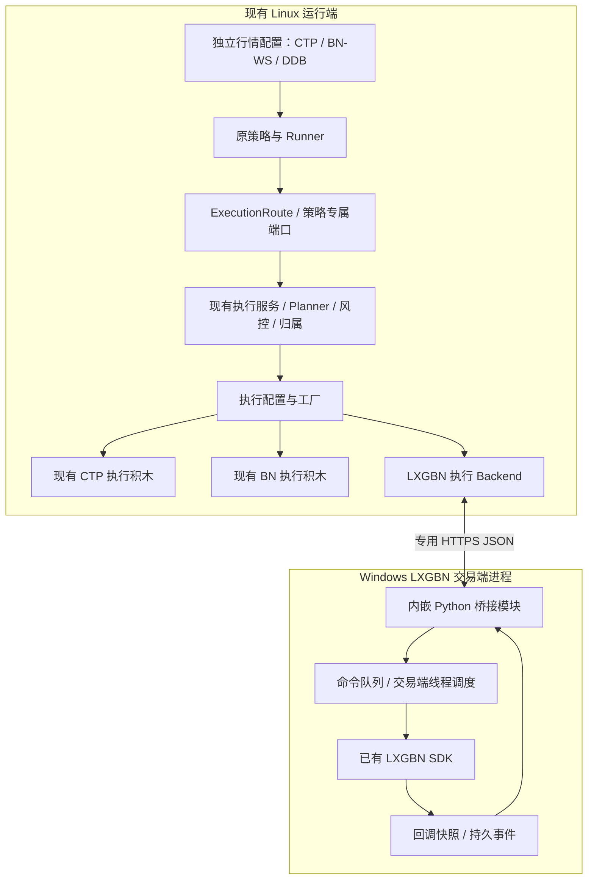

# M02 执行客户端替换：设计与代码改动清单

日期：2026-10-19，Asia/Shanghai。状态：**设计稿；本轮不修改运行代码，不登记接通或验收通过。**

源码核对基准：`pro` 的 `9ee9ba0190287f9254d1afc8fc1eb7786c06d569`。用户本轮确认：**LXGBN 就是现有 DXBM-LXG 系统，运行于 Windows，SDK 只能由交易端内嵌 Python 调用。** 下文新增文件、类型和函数名均为拟实现项。

## 1. 交付目标与范围

M02 只做一套执行选择与适配：策略输出目标，由配置选择 CTP、Binance 或 LXGBN，行情配置独立。复用公共订单、状态机、成交去重和策略归属，不增加厂商策略版本。

| 对应项 | 本设计承担的内容 | 完成边界 |
| --- | --- | --- |
| M02 | 执行配置／工厂、报撤单、标准回报、稳定订单 ID | CTP、BN、LXGBN 分别取得对应实际链路证据 |
| D5 | 一个匹配 BN 标的的原策略实例；LXGBN 一个策略绑定、一个账户、一个支持标的 | 原验收中的真实连接、受理、撤单、成交、稳定 ID；异常采用公共组件＋受控传输验证 |
| GAP10 | 沿用按客户端路由、单写、冻结归属、故障闭闸与未决单不重发规则 | 本次只补执行替换子项；不据此关闭多端联合、多账户及全部共享验收 |

CTP 保留现有同／跨进程多策略路径。**BN、LXGBN 首期各限定一个策略实例**，通过共享正式入口装配；不要求三个原策略同时跨厂商运行。D5 复用 [EmaCrossTargetStrategy](../../examples/single_ema/strategies/ema_cross.py)，该类已用于 CTP／BN 示例；不把国内主力角色策略的标的直接改成 BTC，也不修改其算法制造信号。

沿用 [M01—M06／D1—D5 基线](../audits/ARCHITECTURE_GAP_REVIEW_2026-10-09.md)。用户本轮 Windows 要求仅补充 **LXGBN 内嵌接入所需的 Windows 部分**，不扩展为整个 Bomber／原生 CTP 的 Windows 移植。D1—D4 的范围、顺序和完成状态保持；本轮仅交付设计。

## 2. 当前代码中必须处理的耦合

| 位置／符号 | 已有行为 | 本次处理 |
| --- | --- | --- |
| [run.py](../../scripts/integration/shared_account/run.py) `build_host` | 固定 SimNow Transport、CTP Driver／Builder／生命周期，报告也读取 CTP 字段 | 将厂商准备、执行构建、生命周期选择交给工厂；报告注明查询范围 |
| [factories.py](../../scripts/integration/shared_account/factories.py) `strategy_arguments` | 强制追加 `--mode simnow` 和 SimNow 授权参数 | 旧四类策略保留兼容路径；增加原单标的 EMA 的通用装配分支 |
| [shared.py](../../bomber/framework/trader/execution/shared.py) `SharedAccountExecutionService.__init__` | `independent` 显式要求 CTP Planner／Risk | 首期不改其算法；非 CTP 的 independent／多策略组合在配置阶段拒绝 |
| [ctp_shared.py](../../bomber/framework/trader/runtime/live/channels/ctp_shared.py) `CtpSharedAccountLifecycle` | 包含今昨仓、外部仓基线、CTP Driver 检查点和 SimNow 就绪规则 | 原实现保留；BN／LXGBN 各用小型专用生命周期，不伪造 CTP 账本 |
| [binance_joint.py](../../bomber/framework/trader/execution/live/binance_joint.py) `build_binance_joint_execution` | BN 执行积木已有，但身份固定且用于联合入口 | 参数化为可复用 BN 构建函数，原函数作为兼容包装 |
| [gateway.py](../../bomber/framework/trader/execution/simulation/gateway.py) `NautilusOrderGateway._submit` | 发单前没有接入框架写前保存；原生 ID／意图映射保存在内存 | Live Driver 先分配／保存 ID，Gateway 使用显式 ID 创建原生订单；模拟路径保留默认生成方式 |
| [persistence.py](../../bomber/framework/trader/persistence.py) `RuntimeStateManager` | 最完整的写前钩子目前是 `enable_ctp_autosave` | 新增非 CTP 的小型钩子绑定，借用 `state_components` 保存关联，不重写 CTP 检查点格式 |
| [ipc.py](../../bomber/framework/trader/execution/ipc.py)、[ownership.py](../../bomber/framework/trader/runtime/ownership.py) | 同机 AF_UNIX、flock | 保留 Linux 本地 worker 通道；不把它开放成跨主机协议或复制到 Windows |

## 3. 最小结构与 Windows 部署



**Windows 侧没有独立 Python 交易进程，也不要求安装 Bomber／Nautilus 原生引擎。** 交易端加载桥接模块，拥有 CPython、SDK、登录及退出生命周期。模块仅使用该内嵌解释器的标准库和已有 SDK 绑定，不创建第二个解释器或第二个 SDK 实例。

- 网络监听与日志写入由桥接模块自己的工作线程处理。网络线程不直接调用 SDK。
- 报撤单／查询通过交易端允许的调度入口交回合法线程。该入口的实际名称、回调线程和退出顺序须核对 SDK；不能自行假定有 `onTimer` 或 SDK 可跨线程调用。
- 原生回调在对象有效期间复制必要字段并入队，随后返回；Linux 不持有 C++ 指针。队列溢出或持久化失败关闭新单并标记需要核查，不能丢回报后继续运行。
- 模块停止先禁新单、按本绑定处理撤单与未决状态、保存回报，再停止自身网络线程；不销毁交易端拥有的 SDK／解释器。交易端退出或崩溃后，Linux 保留未决订单，重启不自动重发。

只建设一个固定 LXGBN 执行连接，不增加通用 RPC 平台、服务发现、集群调度或消息中间件。HTTPS 使用标准库及固定证书校验／客户端证书，证书路径由部署配置指定；不设置跳过证书验证的生产分支。

## 4. 配置、工厂与策略装配

共享配置新增 v2，必须声明 `execution` 区块；v1 缺省仍按原 CTP 解析，不改已有文件。`account.client_id` 继续是框架客户端名，`execution.account_id` 是待实际连接核验的账户身份，两者不能混用。

以下仅是新增区块示意，**不是可以直接启动的完整会话配置**：

```json
{
  "version": 2,
  "execution": {
    "provider": "lxgbn",
    "environment": "test",
    "account_id": "<实际核验的账户>",
    "binding_id": "<LXGBN 策略绑定>",
    "endpoint": "https://<Windows交易端>:<配置端口>",
    "ca_file": "<证书路径>",
    "cert_file": "<客户端证书路径>",
    "key_file": "<客户端私钥路径>"
  },
  "execution_mode": "netted"
}
```

`netted` 在 BN／LXGBN 的单策略实例中只复用现有服务，**不代表已支持多策略跨来源净额**。解析器对策略数量和厂商能力做强校验。CTP 的 v2 配置使用 `provider=ctp/environment=simnow`；BN 使用 `provider=binance/environment=demo` 及凭据环境变量名。实际环境身份必须由连接返回核验，不能只信配置字符串。

命令行先解析参数和配置，再校验与所选执行端匹配的授权：保留 CTP 的 `--enable-orders --confirm-simnow`；v2 BN／LXGBN 使用 `--enable-orders --confirm-execution binance:demo`／`lxgbn:test`。授权选项不写入配置、不能由工厂自动追加。桥接模块自身默认禁新单，仅允许交易端已配置的测试绑定，再接受该会话授权。只读查询／离线校验均不能触发授权。

公共 `execution/sources.py` 提供 `ExecutionSourceConfig`、`prepare_execution`、`build_execution`、`build_execution_lifecycle`；采用三个明确分支和延迟导入，不建动态插件注册系统：

1. 离线解析行情／执行／策略声明，拒绝标的、环境、账户、订单能力及模式不匹配。
2. 显式连接后，`prepare_execution` 只读确认选定执行端身份／会话。继续按原输入接口准备参考资料和 Feed，汇总合约条款。
3. `build_execution` 使用条款、限额和只读准备结果构造既有 `ExecutionComponents`；其构造本身不授权或发送订单。
4. 构造原 `SharedAccountExecutionService`，按厂商选择生命周期及执行就绪 Channel，再交给原 `SharedAccountLiveHost`。策略不读 `provider`、Windows 地址或 SDK 对象。

工厂不通过行情来源推导执行端。同一受支持合约可用 CTP／DDB 行情配 LXGBN；BN-WS 只给匹配的 BINANCE 标的供数。D5 使用新增的单标的 EMA 装配入口，固定原策略类及 EMA 信号参数，按资产规格配置数量／条款／绑定。需要历史窗口时复用既有 DDB 预热规则，不以切换执行端为由绕过 M06。

01／03／04／08 原入口继续使用已有 CTP 装配；本期不要求全部策略／行情／厂商组合可用。独立 worker 的 Unix 协议继续服务现有 CTP：`server.py` 对尚未支持的非 CTP 模式提前拒绝，不能把成功解析配置当成已支持启动。

## 5. LXGBN 接口与状态边界

沿用 [DXBM-LXG v0.8 草案](../integration/DXBM_LXG_INTEGRATION_SPEC.md) 的已知回调和身份语义；用户已确认是同一系统，但实际发布 SDK 的签名、枚举、查询和线程约束仍须核验。

**首期选择一策略一绑定、框架持有归属、LXGBN 负责最终底层交易校验的接法。** LXGBN 策略范围快照只用于核验本绑定，不转换成 `AccountPositionSnapshot`。不默认索取全账户资金／持仓，也不从策略净仓推算柜台可平量。

| 执行端 | 框架组合 | 核验与下单闸门 |
| --- | --- | --- |
| CTP | 原 Controlled Client、CTP Planner／Ledger／生命周期 | 原账户／今昨仓及执行就绪规则 |
| BN | 原 Controlled Client、NetTarget Planner、权威资金／活动单读取 | DEMO 实际身份、账户查询、显式授权及行情就绪 |
| LXGBN | 原 `BackendExecutionClient`＋专用 Backend；固定 `off/fills`，通用目标 Planner 加限价转换 | 本绑定完整快照／订单／成交覆盖、实际执行可用状态、显式授权和逐笔发送检查 |

LXGBN 的 `off` 只表示不查询物理账户仓位；**不跳过本绑定核验、订单关联、持久化或授权**。专用 Backend 每次实际发送都检查授权及当前连接／会话，生命周期未开放前不能借 `is_reconciled=True` 绕过它。撤单通道在禁新单后仍须可用。资金及物理账户观测、现有报告的 `final_gross` 为 `None`；另列 `binding_positions`、完整性边界及绑定范围活动单数量，不把它们标为全账户事实。

`BackendExecutionClient` 的 Backend 类型收窄到其实际需要的基础 `ExecutionBackendPort`；仅 strict／observe 分支要求账户查询能力。LXGBN 不冒充支持账户级 `LiveExecutionBackendPort`；CTP／BN 的原对账语义保持。

本次先验普通 `LIMIT + Normal`；已有 `NetTargetOrderPlanner` 默认生成 MARKET，须增加基于参考价／跳价的薄限价包装，不能直接把 MARKET 静默改为 Normal。Market、FAK、FOK、TWAP／VWAP 等未纳入本批的能力在入口拒绝，后续按原草案单列验收。

开平采用草案模式 B：框架提交通用 OPEN／CLOSE 意图，LXGBN 负责底层可平及今昨处理，回传真实执行事实。**这仍是待 SDK 确认的前提**；若 SDK 强制明确 CloseToday／CloseYd，或会拆出无法关联的多张子单，先登记接口阻塞，不发送猜测的 Offset、不新增一套 CTP 账本。首期不实现算法父子单或通用自动拆单恢复。

## 6. 专用跨端协议与订单安全

桥接接口只提供六类操作：建立／核验绑定、只读查询、报单、按本绑定撤单、拉取回报并确认游标、心跳／停止。JSON 含 `protocol_version`、实际账户／绑定身份、当前写入会话标识和请求 ID；金额、价格、数量传十进制字符串。报单还含稳定 `client_order_id`、标准意图及绝对发送期限，双方在真正调用 SDK 前校验期限。

Windows 模块仅接受一个活动写入会话，持有按实际环境／账户身份生成的 Windows 本机锁；新会话不能绕过旧会话的未决状态接管。同一 SDK 绑定的报撤单必须经过这一个模块。旧写入会话的命令被拒绝，心跳失效后禁新单并按绑定处理已知活动单，连接恢复不自动重新授权。Linux 的 `flock` 只保护其本地资源，不能证明 Windows 侧单写。

这只保护本桥接路径及协作部署，不宣称可阻止柜台人工操作、其他 LXGBN 实例或其他主机绕过本桥写入；通用跨主机账户 fencing 仍属 GAP10 剩余范围。两端时钟须在部署时核对；不能在未校时情况下用远端时间差证明订单仍有效。

订单 ID 和发送顺序固定如下：

1. Linux 生成并保存框架 `client_order_id`，冻结归属、登记 PENDING，再发送。框架字符串与 SDK `int clientOrderId` 分开。
2. Windows 在本地持久记录中原子分配 SDK 整数 ID、建立映射、记录请求内容与“待调用 SDK”状态，然后调度 SDK。记录可用内嵌 Python 的标准库 SQLite；不另设数据库服务。整数耗尽、映射冲突或写盘失败拒绝发单，重启不清零复用。
3. SDK 调用前关联已存在，因此同步回调、Fill 早于 Ack 都能定位。请求重复且内容一致只返回原记录；同 ID 不同内容拒绝。处于“可能已调用 SDK”的记录必须查询，不能再调用一次。
4. HTTP 成功／SDK 函数返回不等于柜台受理；只有真实回报产生 ACCEPTED。网络超时或进程中断不能证明未发时，按现有 `AmbiguousOrderSubmission` 语义闭闸、保留在途及映射。
5. Windows 保存不可变原生事件和稳定事件序号；Linux 转成 `ExecutionReport`，由原状态机、PositionManager、归属账本处理并保存后，才确认游标。确认前允许重投，重投保持相同事件身份／序号。

Windows 的记录只保存请求、ID 映射和回报，不维护第二套框架策略仓位。Linux 是框架归属与订单状态的持久化方；SDK／柜台提供真实执行事实。任一端保存失败禁新单，不能跨端宣称 exactly-once 发送。

| 原生事实 | 标准处理 |
| --- | --- |
| `Blank`／`Submited` | 记录原生状态，不据此生成 ACCEPTED |
| `onOrderAck`／`Acked` | 核验身份、数量与 SDK 确认语义后生成 ACCEPTED |
| `onOrderFill` | 以稳定 `ExecutionMsg.ID` 去重；`filled_quantity` 是本笔增量，按累计量生成 PARTIALLY_FILLED／FILLED |
| `FullFilled` 早于完整 Fill | 缓冲并查齐明细，不能用累计量再伪造一笔成交 |
| `Cancelled`／`Rejected` | 确认此前成交明细已齐后发终态；保留原生原因，不把撤单请求成功当撤单终态 |
| 缺 `venue_order_id` | 保持 `None`；以框架 ID、SDK clientOrderId、原生 Order ID 关联和撤查 |
| 未知 ID／数量冲突／终态后新成交／超出承诺的乱序 | 保存原始事实并闭闸核查，不猜归属、不静默忽略 |

现有 `OrderReportStateMachine` 会忽略终态后的回报，因此**顺序收敛必须在 LXGBN 适配器完成**：终态的原生成交总量与已知明细不齐时不投递终态；若 SDK 没有可靠顺序或完整性边界，也查不齐明细，保持闭闸。适配器须在调用公共状态机前识别异常迟到的新成交，不能依赖状态机忽略它。

## 7. 启动、停止与恢复

启动：离线校验 → 只读连接核验身份／协议 → 查询本绑定完整状态并建立事件边界 → 恢复并核对本地账本 → 准备行情／所需 DDB 历史 → 显式授权 → 开放策略决策。新绑定要求确认空仓且无活动订单；已有仓位不能通过新建状态文件重新归给策略。

停止：关闭策略新目标 → 撤销本绑定已知活动单 → 等待终态及回报落盘 → 核对绑定事实／归属 → 保存并释放本次写入会话。撤单超时、未决发送或事实冲突登记停止失败，保留状态与接管限制；不顺带退出整个 LXGBN 交易端。

首期只开放**同会话日、已知订单全终态、完整事实可核验**的原文件恢复。执行绑定、账户、协议版本或 provider 不一致时拒绝使用旧文件；CTP 文件不能直接切成 LXGBN 文件。断线期间可能漏成交、查询不完整或存在未知订单时只读核查并闭闸，不实现通用自动重建，也不把“活动列表为空”当成全部已撤。未知外部成交不自动归属当前策略。

BN 同样补发送前 ID／意图关联和回报后保存；保留其已有权威查询及受控授权。Live Driver 在调用线程先分配符合厂商格式的稳定 ID、登记并完成写前保存，再排入 TradingNode 事件循环；Gateway 用 NT 现成的 `client_order_id` 参数创建订单，真正提交前再次检查期限／闸门。提交锁内不能同步等待另一个需要同一锁的事件循环任务。异步构造／调度失败须回到公共失败处理路径，区分确定未发与可能已发，不能只记日志留下无法释放的在途量。模拟路径仍按原方式生成 ID，无需修改 Nautilus 引擎。恢复窗口与未决状态采用上述保守边界，不扩成 GAP10 通用恢复。

## 8. 逐文件改动清单

路径相对 `pro/`。只实现本表所需职责；标为“新增”的文件当前不存在。测试和交付说明另列。

| 文件 | 拟修改内容与原因 |
| --- | --- |
| **新增** `bomber/framework/trader/execution/sources.py` | 三厂商配置解析、只读准备、组件及生命周期选择；延迟加载厂商依赖，输出标准 `ExecutionComponents` |
| `bomber/framework/trader/execution/live/binance_joint.py` | 提取参数化 `build_binance_execution`，原联合函数兼容调用；配置 client/account/instrument/risk，保持 DEMO 限制 |
| `bomber/framework/trader/execution/live/driver.py` | Live ID 分配／写前保存、按原生事件循环调度、失败归类及关联持久化钩子，连接失效沿原链路闭闸 |
| `bomber/framework/trader/execution/simulation/gateway.py` | Live 接收指定 ID 与意图并在发送前复查；支持恢复已知关联和异步失败通知。模拟调用不启用新钩子 |
| `bomber/framework/trader/persistence.py` | 增加非 CTP 写前钩子绑定，保存 ID 映射／消费游标组件；统一提交锁顺序，沿用 JSON 原子保存及现有 schema |
| `bomber/framework/trader/execution/live/client.py` | Backend 类型与 off 分支能力一致；strict／observe 保持账户查询校验。复用现有状态与归属处理 |
| `bomber/framework/trader/execution/planner.py` | 增加薄限价包装：通用目标差额 → 按条款取整的限价意图；不复刻 CTP 今昨仓规划 |
| `bomber/framework/trader/runtime/live/channels/binance.py` | 加单策略 BN 生命周期：账户核验、授权、保存、停止确认及已终态恢复，复用现有 Channel／读取器 |
| **新增** `bomber/framework/trader/execution/lxgbn.py` | Linux 专用 Backend、HTTPS 客户端、身份／ID／回报转换、终态排序与发送闸门；不加载 Windows SDK |
| **新增** `bomber/framework/trader/runtime/live/channels/lxgbn.py` | 绑定范围就绪与生命周期：完整性核验、授权、消费保存／确认、停机和受限恢复 |
| **新增** `scripts/integration/lxgbn/windows_bridge.py` | 交易端内嵌加载入口、专用 HTTPS、命令／回报队列、SQLite 记录、Windows 本机锁；不导入 Bomber 框架 |
| **新增** `scripts/integration/lxgbn/sdk_binding.py` | 对接实际内嵌 SDK、合法线程调度和回调快照；与桥接模块一起部署到交易端模块路径，唯一使用原生接口的位置 |
| `scripts/integration/shared_account/config.py` | v1 兼容／v2 execution、厂商环境与能力校验；新增单标的 EMA kind；非 CTP 首期强制单策略 |
| `scripts/integration/shared_account/run.py` | `build_host` 改为工厂装配，CTP 兼容行为保留；按选定执行端校验授权，报告账户／绑定范围。CTP 专属预算迁移等命令对其他端提前拒绝 |
| `scripts/integration/shared_account/factories.py` | 原四种策略工厂保留；加入 single_ema 装配，不再给该分支强塞 SimNow 参数，接入工厂返回的执行 Channel |
| `scripts/integration/shared_account/server.py` | 解析后提前拒绝本期未支持的非 CTP worker 服务配置，避免误用 CTP 授权、估值和 Unix 服务路径；不扩展 worker 跨主机部署 |
| **新增** `examples/single_ema/ema_live.py` | 复用原 `EmaCrossTargetStrategy` 的配置装配模块，满足 Shared Host 的参考／行情／历史接口；不新增策略算法 |

**首期不改**业务 `strategy.py`、Runner 路由／归属算法、CTP Planner／Ledger／Shared 生命周期、现有 Unix IPC 协议，也不改 `nautilus_trader` 上游代码。`ExecutionReport` 及公共事件契约沿用现有字段，厂商 ID 放 metadata。如实现中确有现有契约承接不了的事实，先记录具体字段缺口，不预建统一能力 DSL 或新状态权威层。

## 9. 实施顺序与验证

1. **配置／CTP 兼容／BN 正式装配。** 先补工厂、single_ema、写前保存与 BN 生命周期，针对已有路径回归。不因 BN 单端通过登记 M02 全部完成。
2. **LXGBN 受控传输与 Windows 内嵌桥。** 公共组件用受控传输验证；拿实际 SDK 落实绑定，交易端内先只读加载与退出验证，再做测试环境实际交易。
3. **逐端验收与交付。** 一个配置、一份当前操作说明及一份逐条证据表，关联 M02／D5／GAP10，不复制三套任务。真实 CTP 兼容证据可复用，受影响处针对复验。

| 验证组／拟文件 | 必须证明的行为 |
| --- | --- |
| **新增** `tests/test_execution_sources.py` | v1 CTP 不变；v2 显式选端；行情不决定执行；未知字段、错误标的／环境、非 CTP independent／多策略提前失败；离线解析不联网 |
| 扩展 `tests/test_shared_account.py`、`tests/test_execution_composition.py` | 原归属与停止行为保持；off 不查账户；LXGBN 闸门关闭时不能发单；受控真实公共链收到回报后策略读取已更新仓位 |
| 扩展 `tests/run_live_backend.py` 及 Gateway 相关用例 | BN 发送前已保存 ID／归属；保存失败不发送；受理前进程退出、发送不确定、已知终态恢复与 ID 关联可核验；模拟行为不变 |
| **新增** `tests/test_lxgbn_execution.py` | 拒单、部分成交、重复／迟到回报、Fill 早于 Ack／Finished、累计量不齐、未知 ID、确认游标重投、断线／超时、未决发送不重发、停机未确认；不替换公共 OMS／归属实现 |
| Windows 交易端中的桥接验收 | 模块可加载／停止；SDK 只在合法线程调用；不创建解释器／SDK；两个写入会话互斥；整数 ID 跨加载保留；终端退出、事件积压及记录失败闭闸 |
| D5 实际 BN／LXGBN | 各有真实连接、受理、撤单、成交、稳定 ID，目标→订单→逐笔成交→归属可追溯；同算法匹配标的，记录实际环境及版本，不用 Recording 或受控异常冒充真实柜台 |

新增 `scripts/integration/lxgbn/README.md` 说明交易端模块加载、配置、正常停机和受限恢复；新增 BN／LXGBN 最小会话模板及 M02 验收汇总。Windows 内嵌验证与 Linux 离线测试分开登记；没有对应主机结果就明确待验，不增加原 D5 观察时长或异常发单门槛。

## 10. 编码前仍需落实的 SDK 资料

“同一系统／Windows／内嵌 Python”已确认，不再作为待问项。以下是具体绑定与实际验收的依赖，不妨碍先完成公共工厂及受控传输实现：

| 依赖 | 必须取得的内容 | 缺失时的边界 |
| --- | --- | --- |
| 内嵌加载及线程 | 模块加载／卸载方法、CPython／SDK 版本与位宽、SDK 对象获取、合法线程调度入口、交易端退出通知；确认 ssl／sqlite3 可用 | 不编造独立进程或任意线程调用；缺可用调度时不能发送 |
| 报撤单及身份 | 实际签名、返回／异常、三个回调的 clientOrderId、原生 ID／成交 ID 的唯一范围与跨加载稳定性 | 不猜枚举数值，不截断字符串 ID，不以网络受理代替柜台受理 |
| 查询及完整性 | 本绑定仓位、活动单、终态／成交、查询分页及结束标记、快照与增量边界、执行可用状态 | 不把查询失败／不完整当空仓；不能证明完整就保持闭闸 |
| 开平及标的 | 模式 B 能否成立，普通限价的实际 Offset 处理、一个受支持标的及条款 | 不假定 AUTO／通用 CLOSE 可用；缺语义时第三方真实路径阻塞 |
| 测试环境 | 实际 Windows 终端、测试账户／绑定／标的、端点证书及已有测试授权方式 | 仅登记公共离线通过；不登记 LXGBN 已接通或 D5／M02 完成 |

本设计以最小可验证链路为结束边界：**配置选端 → 原策略目标 → 真实报撤单 → 标准回报 → 原策略归属**。Windows 接入限定在 LXGBN 交易端内嵌模块，未决情况沿用闭闸／保留状态，不扩展为平台迁移或通用自动恢复工程。
