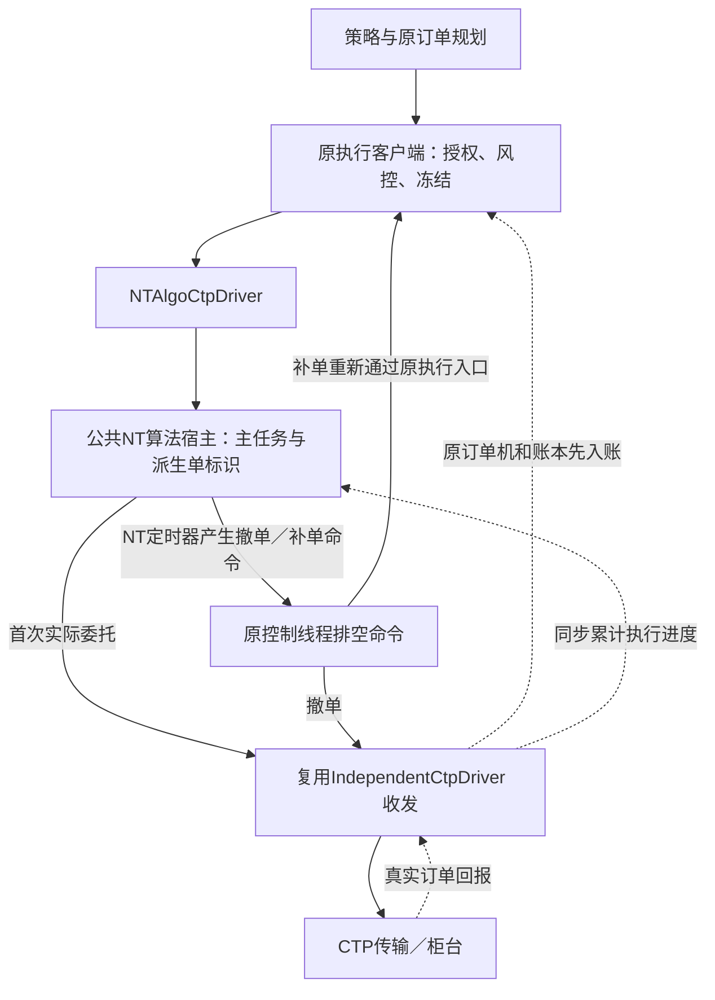

# NT 算法模块与 CTP 执行积木

本期新增公共 `NTAlgoRuntime`，以及继承 `IndependentCtpDriver`、内部持有 runtime 的 `NTAlgoCtpDriver`。只实现一种显式限价的超时撤单重报算法；普通 CTP Driver 仍为默认值。BN、LXGBN 尚未接入。

## 实现边界

策略及原订单规划器决定合约、方向、数量、开平和退出。算法只执行这笔明确订单：等待指定秒数，未完成则撤单；柜台终态和已声明成交全部入账后，用有效参考价重报剩余量。

公共宿主真正使用 Bomber SDK 中的 NT `ExecAlgorithm`、`LiveClock`、`Cache`、`MessageBus` 和 `spawn_limit`。采用轻量算法托管模式，不另起 TradingNode，不创建第二套账户资金、仓位或成交账本。每次实际委托继续经过原受控客户端的授权、资金查询等待、风控、预算、归属冻结和写前保存。没有自动切回普通 Driver 的兜底发送。



NT 主任务只保存在 `component_states.nt_algo`，每张真实 CTP 委托继续使用自己的订单 ID、冻结记录和订单状态。`nt_algo_task_id` 将真实委托关联到原执行任务，`nt_algo_child_id` 是原生 NT 派生标识。真实成交只记一次，子单撤销不等于整个任务立即完成。

NT 定时器只产生命令；实际柜台调用由账户控制线程执行。原来已移除的“共享服务扫描挂单年龄”的追单轮询没有恢复。慢查询仍可能延迟实际撤单，10秒是触发期限，不是实时成交保证。

## 选择积木

直连入口增加三个可由命令行或原启动 YAML 配置的参数：

```yaml
execution_driver: nt_algo_ctp
algo_wait_seconds: 10
algo_max_attempts: 3
```

`execution_driver` 默认为 `ctp`；`max_attempts` 包含首次报单，默认每个任务最多3次实际报单。重报价格继续使用原 `limit_offset_ticks` 保护限价，不是市价单，也不保证成交。

达到次数上限、执行到期或收到拒单后，未完成任务结束，原策略贡献冻结在已成交归属，等待新的策略目标版本。避免 Runner 为相同旧目标立即重建任务，绕过次数上限。策略主动取消或目标变化会停止原任务；持仓周期仍由策略控制。

同账户共享配置在装配内部使用 `execution_driver` 和 `nt_algo: {wait_seconds: 10, max_attempts: 3}`。本期仅在 `run_direct` 的独立归属路径装配，不支持旧独立账户服务入口或净额共享模式。

代码装配直接选择 `IndependentCtpDriver(...)` 或 `NTAlgoCtpDriver(..., algo_runtime=NTAlgoRuntime(...))`。随后沿用 `build_ctp_portfolio_execution`、`SharedAccountExecutionService` 和 `IndependentCtpLifecycle`；算法 Driver 不能省略原服务和持久化绑定。

## 远程服务器验证

本地没有完整 Bomber 编译 SDK，离线测试使用原生宿主与柜台替身。本地通过不代表远程 SDK 接口、原生定时器或 SimNow 已验证。同步整组文件后，在远程原交易环境依次执行：

```bash
cd /workspace/worker/pj/Chrono/nautilus_trader_demo/pro

# 第一项：实际原生NT算法、时钟、派生单与离线CTP账本闭环，不连接柜台。
PYTHONPATH=. /workspace/worker/env/chs-live/bin/python -B -m tests.run_nt_algo_native

# 第二项：任务状态、撤单、成交归属、恢复和普通执行回归，不连接柜台。
PYTHONPATH=. /workspace/worker/env/chs-live/bin/python -B -m unittest \
  tests.test_nt_algo_ctp tests.test_order_cancellation tests.test_shared_account -v
```

第一项必须成功；SDK缺失或API不兼容会明确报错，不自动替换为模拟算法。

原直连命令不带连接开关，先检查参数和配置：

```bash
PYTHONPATH=.:/workspace/worker/pj/KiChaos IMPLUSE_VERSION=all \
/workspace/worker/env/chs-live/bin/python -u demos/10_hybrid_transformer/run_direct.py \
  --execution-driver nt_algo_ctp --algo-wait-seconds 10 --algo-max-attempts 3
```

前两项和配置检查成功后，在原授权交易命令末尾加同样三个参数，进行 SimNow 联机验证。观察真实委托/成交及 `NTAlgoExecution` 日志；不要为测试追单而绕过策略风控或删除状态文件。

## 切换与恢复

同日恢复联合保存真实 CTP 委托和算法任务进度；柜台核验之前不补单。后续报单仍受原策略恢复闸门、最新目标、授权和有效报价约束。

切换 Driver 或改变算法参数前，先正常停机，备份原账本，并确认没有活动委托、待执行任务及待处理结束通知。程序仅在这些状态清空时增删 NT 状态组件，保留原持仓、归属、目标版本和策略批次。已有持仓不要求强制平仓。有未决状态时拒绝切换，应使用原模式完成核验和处理。

跨交易日的活动委托和未决任务继续受原跨日恢复限制，不能将本期同日恢复视为跨日未知订单自动接管。
