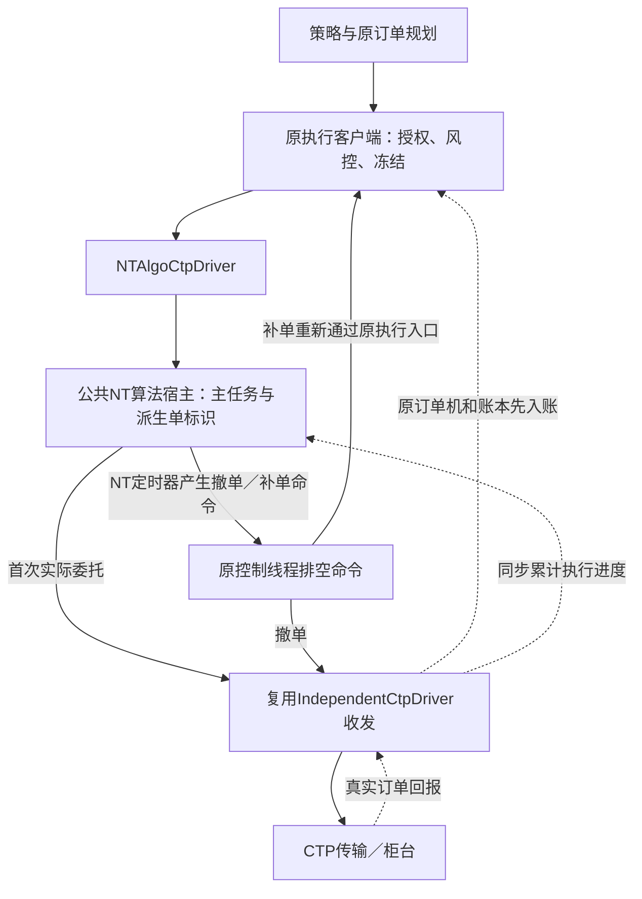

# NT 算法模块与 CTP 执行积木

本期新增公共 `NTAlgoRuntime`，以及继承 `IndependentCtpDriver`、内部持有 runtime 的 `NTAlgoCtpDriver`。只实现一种显式限价的超时撤单重报算法；普通 CTP Driver 仍为默认值。BN、LXGBN 尚未接入。

## 实现边界

策略及原订单规划器决定合约、方向、数量、开平和退出。算法只执行这笔明确订单：等待指定秒数，未完成则撤单；柜台终态和已声明成交全部入账后，在行情仍有效的前提下，按上次实际委托价调整后重报剩余量。

公共宿主真正使用 Bomber SDK 中的 NT `ExecAlgorithm`、`LiveClock`、`Cache`、`MessageBus` 和 `spawn_limit`。采用轻量算法托管模式，不另起 TradingNode，不创建第二套账户资金、仓位或成交账本。每次实际委托继续经过原受控客户端的授权、资金查询等待、风控、预算、归属冻结和写前保存。没有自动切回普通 Driver 的兜底发送。



NT 主任务只保存在 `component_states.nt_algo`，每张真实 CTP 委托继续使用自己的订单 ID、冻结记录和订单状态。`nt_algo_task_id` 将真实委托关联到原执行任务，`nt_algo_child_id` 是原生 NT 派生标识。真实成交只记一次，子单撤销不等于整个任务立即完成。

NT 内部策略标识统一为 `NTAlgo-原策略ID`，满足原生 `StrategyId` 必须包含连字符的要求；例如 `one` 转为 `NTAlgo-one`。原执行端的策略 ID、持仓归属和检查点仍使用原值。

NT 定时器只产生命令；实际柜台调用由账户控制线程执行。原来已移除的“共享服务扫描挂单年龄”的追单轮询没有恢复。慢查询仍可能延迟实际撤单，10秒是触发期限，不是实时成交保证。

## 选择积木

Driver选择执行积木，算法名称选择具体执行规则。直连入口可由命令行或启动 YAML 配置：

```yaml
execution_driver: nt_algo_ctp
execution_algorithm: limit_reprice
algo_wait_seconds: 10
algo_max_attempts: 3
algo_retry_step_ticks: 1
# Tick流表在原market_dolphindb.json中配置tick_table。
```

`execution_driver: nt_algo_ctp` 表示选择NT算法CTP执行积木，`execution_algorithm: limit_reprice` 才表示采用项目自定义的限价超时撤单重报规则。对应命令行参数为 `--execution-algorithm limit_reprice`。

当前只实现 `limit_reprice`；TWAP及组合算法尚未接入，填写其他算法名会在启动前明确报错。旧NT配置省略算法名时，仍默认 `limit_reprice`；普通 `ctp` Driver不接受算法名称。算法任务及持仓按下文的切换与恢复条件核验。

`demos/10_hybrid_transformer/config/strategy.yaml` 已提供 `direct_nt_algo` 启动配置，沿用原直连账本和策略文件，包含常驻、连接及 SimNow 报单授权开关。在远程项目根目录执行：

```bash
PYTHONPATH=.:/workspace/worker/pj/KiChaos IMPLUSE_VERSION=all \
/workspace/worker/env/chs-live/bin/python -u demos/10_hybrid_transformer/run_direct.py \
  --config-file demos/10_hybrid_transformer/config/strategy.yaml \
  --config-id direct_nt_algo
```

此配置用于 `run_direct.py`；原 `workers_hybrid` 配置仍对应 `run_shared.py`。显式命令行参数优先于 YAML，可临时覆盖等待时间或尝试次数。

`execution_driver` 默认为 `ctp`；`max_attempts` 包含首次报单，默认每个任务最多3次实际报单。首次偏移沿用账户JSON的 `account.limit_offset_ticks`；重报步长使用 `algo_retry_step_ticks`，仅接受0或1。仍为显式限价单，不保证成交。

## 执行报价与逐次跳价

NT直连执行Tick与策略Bar统一从DolphinDB订阅。请移除旧启动YAML中的 `execution_tick_source: ctp`；不再为执行报价直连CTP MD。Tick配置预留在原 `market_dolphindb.json` 中，不另建配置文件：

```json
{
  "source": "dolphindb",
  "table": "stream_cffex_1min",
  "timestamp_label": "end",
  "volume_mode": "cumulative",
  "max_age_seconds": 120,
  "tick_table": null,
  "tick_max_age_seconds": 10
}
```

`table`仍是原Bar流表；`tick_table`填实际共享Tick流表名后启用执行报价，`null`或省略则沿用Bar close。10的RB、P已按服务器发布状态及schema截图共同配置为 `ctp_market`，分别保留各自原Bar流表。08、z01/08仍预留为null，按对应DDB服务器实际流表填写。Tick表须为实时共享流表，不能填DFS历史Tick路径。

执行Tick直接复用对应Bar Feed已经解析好的DDB服务器、账号、端口、streaming_port等连接配置，使用同一官方DDB驱动和原生订阅接口，不读取另一组CTP MD连接。同连接及有效期的Tick表合并到一个执行Feed，同表同合约不重复订阅。仅注册本次策略执行路由的合约；没有策略绑定到执行Tick Feed。Bar和模型检查点身份不包含这两个执行报价字段，不改变原信号、选约和持仓期限。

流表字段顺序与Bar一样由服务端schema解析。Tick合约标识支持标准流的 `Code` 或原始CTP流的 `InstrumentID`，报价需要 `LastPrice`、`BidPrice1`、`AskPrice1`。缺少这两个标识字段时在订阅前报错；Bar仍使用原Code规则。`ctp_market`的49列可以直接按实际schema解析，无需另建标准化流表。时间沿用 `ActionDay/date/TradingDay` 与 `UpdateTime/tradeTime`，可带 `UpdateMillisec`；已覆盖DATE、SECOND及INT毫秒，夜盘优先使用ActionDay组合自然时间，不将TradingDay误当作夜盘自然日期。

每合约独立保留Bar参考价和最新Tick快照（last/bid/ask、行情时间、接收时间）。DDB原始Tick行回调只覆盖最新快照，缓存的Decimal转换与价格计算在读取时完成，不累计历史Tick，不扫描执行任务、不写文件或逐Tick日志。价格和累计成交量未变化的Tick行仍刷新快照时间；去重或排队后的QuoteTick不会覆盖原始执行快照。`tick_max_age_seconds`须为(0,120]内有限数，报价按行情时间检查有效期。

首次定价：配置Tick的合约，买入基准为ask1、卖出基准为bid1；未配置Tick的合约以Bar close为基准。首次买入加 `limit_offset_ticks` 跳、卖出减相同跳数，并按合约最小报价单位对齐。Tick配置后尚未收到、盘口无效或过期时阻止报单/重报，不静默改用Last或Bar。风控使用同一报价缓存中的Tick中间价与行情时间，继续执行原时效和预算检查。

算法重报：买价 = 上次实际委托价 + `algo_retry_step_ticks × tick_size`；卖价 = 上次实际委托价 - 同等步长。重报前仍要求有效行情，但不按新行情重新起算阶梯。步长为0时维持上次委托价；步长为1时每次主动前进一跳。首次偏移1跳、最多3次报单时，相对首次基准依次为1、2、3跳；从首笔实际委托价计算则最多再前进2跳。行情移动较大时仍可能不成交，本模式不是每次追随最新盘口。

上次实际委托价随任务一起写入原联合检查点。配置Tick不表示录制历史Tick；执行快照与行情录制相互独立。本地验证不代表远程满订阅负载已验证，远程需观察报价时效和分钟策略耗时。

达到次数上限、执行到期或收到拒单后，未完成任务结束，原策略贡献冻结在已成交归属，等待新的策略目标版本。避免 Runner 为相同旧目标立即重建任务，绕过次数上限。策略主动取消或目标变化会停止原任务；持仓周期仍由策略控制。

同账户共享配置在装配内部使用 `execution_driver`、`execution_algorithm` 和 `nt_algo: {wait_seconds: 10, max_attempts: 3, retry_step_ticks: 1}`。本期仅在 `run_direct` 的独立归属路径装配，不支持旧独立账户服务入口或净额共享模式。

代码装配直接选择 `IndependentCtpDriver(...)` 或 `NTAlgoCtpDriver(..., algo_runtime=NTAlgoRuntime(...))`。随后沿用 `build_ctp_portfolio_execution`、`SharedAccountExecutionService` 和 `IndependentCtpLifecycle`；算法 Driver 不能省略原服务和持久化绑定。

## 08期权与期货组合

08继续提交完整目标组合。选用算法Driver时，只停止目标发生变化的合约任务；期权部分成交触发期货对冲，不会撤掉数量未变的期权任务，也不会重置其累计成交和尝试次数。重报前同样只核对该任务合约的目标，其他交易腿的更新不阻塞它。普通CTP路径保持原行为。

真实撤单回报仍先经过原订单状态机、冻结释放、归属账本和事件日志。算法额外写入`nt_algo_cancel_reason`：`retry`表示算法已实际发出追价撤单，`target_update`表示策略已更新该合约目标。08仅放行这两种有算法任务关联的取消；外部撤单、拒单、过期以及次数耗尽仍保留原报错处理。定时器仅排队、尚未发撤单时收到的外部取消，不标为内部追价。

无需修改08策略JSON、交易参数或10配置。正常停止08并满足下文的切换条件后，沿用原v4账户和信号检查点，在远程项目根目录启动：

```bash
PYTHONPATH=.:/workspace/worker/pj/KiChaos IMPLUSE_VERSION=all \
/workspace/worker/env/chs-live/bin/python -u demos/08_option_vega/run_direct.py \
  --account-state-file demos/08_option_vega/results/direct/v4/state.json \
  --state-file demos/08_option_vega/results/direct/v4/signal.json \
  --execution-driver nt_algo_ctp --execution-algorithm limit_reprice \
  --algo-wait-seconds 10 --algo-max-attempts 3 \
  --connect --enable-orders --confirm-simnow --run-forever
```

保留已有持仓、成交归属、信号进度和每日报单计数；每次真实重报照常消耗原每日额度。没有删除或重建原检查点。升级前须使用旧版本正常停止，确认没有未决算法任务；旧任务未记录上次实际委托价，不能猜测恢复。无未决任务时，原生命周期会更新算法参数状态，保留账户及策略的其他账本。完整SDK验证通过后再启用。

## 远程服务器验证

本地没有完整 Bomber 编译 SDK，离线测试使用原生宿主与柜台替身。本地通过不代表远程 SDK 接口、原生定时器或 SimNow 已验证。同步整组文件后，在远程原交易环境依次执行：

```bash
cd /workspace/worker/pj/Chrono/nautilus_trader_demo/pro

# 第一项：实际原生NT算法、时钟、派生单与离线CTP账本闭环，不连接柜台。
PYTHONPATH=. /workspace/worker/env/chs-live/bin/python -B -m tests.run_nt_algo_native

# 第二项：任务状态、撤单、成交归属、恢复和普通执行回归，不连接柜台。
PYTHONPATH=. /workspace/worker/env/chs-live/bin/python -B -m unittest \
  tests.test_execution_quotes tests.test_option_nt_algo tests.test_nt_algo_ctp \
  tests.test_order_cancellation tests.test_shared_account -v
```

第一项必须成功；SDK缺失或API不兼容会明确报错，不自动替换为模拟算法。

原直连命令不带连接开关，先检查参数和配置：

```bash
PYTHONPATH=.:/workspace/worker/pj/KiChaos IMPLUSE_VERSION=all \
/workspace/worker/env/chs-live/bin/python -u demos/10_hybrid_transformer/run_direct.py \
  --execution-driver nt_algo_ctp --algo-wait-seconds 10 --algo-max-attempts 3
```

前两项和配置检查成功后，在原授权交易命令末尾加同样三个参数，进行 SimNow 联机验证。观察真实委托/成交及 `NTAlgoExecution` 日志；不要为测试追单而绕过策略风控或删除状态文件。

## 切换与恢复

同日恢复联合保存真实 CTP 委托和算法任务进度；柜台核验之前不补单。后续报单仍受原策略恢复闸门、最新目标、授权和有效报价约束。

切换 Driver 或改变算法参数前，先正常停机，备份原账本，并确认没有活动委托、待执行任务及待处理结束通知。程序仅在这些状态清空时增删 NT 状态组件，保留原持仓、归属、目标版本和策略批次。已有持仓不要求强制平仓。有未决状态时拒绝切换，应使用原模式完成核验和处理。

跨交易日的活动委托和未决任务继续受原跨日恢复限制，不能将本期同日恢复视为跨日未知订单自动接管。
