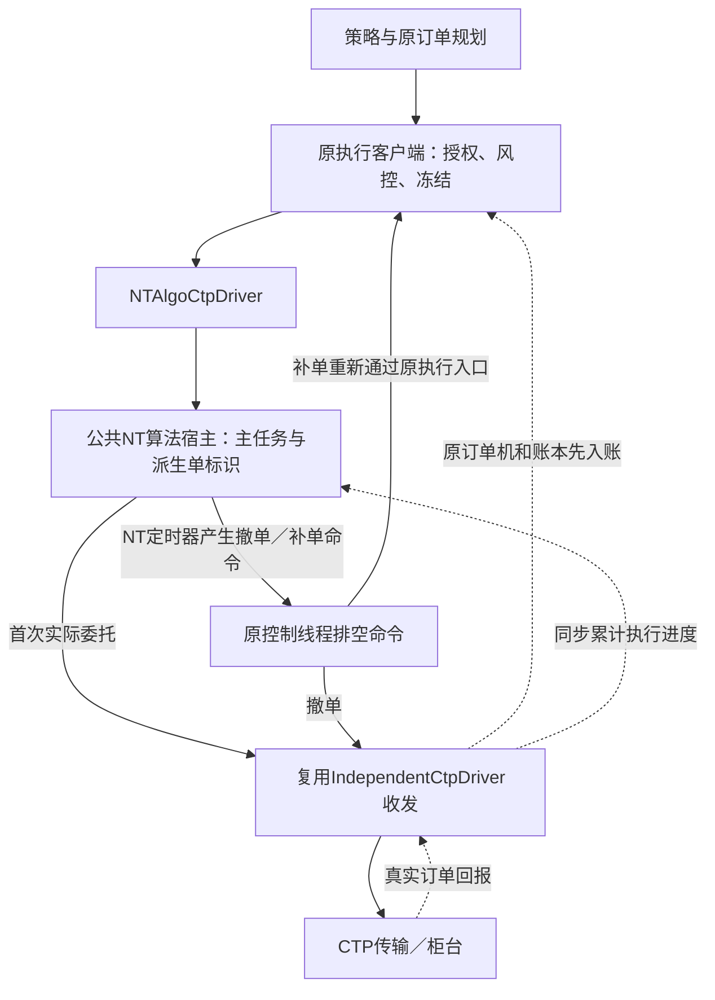

# NT 算法模块与 CTP 执行积木

本期新增公共 `NTAlgoRuntime`，以及继承 `IndependentCtpDriver`、内部持有 runtime 的 `NTAlgoCtpDriver`。只实现一种显式限价的超时撤单重报算法；普通 CTP Driver 仍为默认值。BN、LXGBN 尚未接入。

## 实现边界

策略及原订单规划器决定合约、方向、数量、开平和退出。算法只执行这笔明确订单：等待指定秒数，未完成则撤单；柜台终态和已声明成交全部入账后，在行情仍有效的前提下，按上次实际委托价调整后重报剩余量。

公共宿主真正使用 Bomber SDK 中的 NT `ExecAlgorithm`、`LiveClock`、`Cache`、`MessageBus` 和 `spawn_limit`。采用轻量算法托管模式，不另起 TradingNode，不创建第二套账户资金、仓位或成交账本。每次实际委托继续经过原受控客户端的授权、资金查询等待、风控、预算、归属冻结和写前保存。没有自动切回普通 Driver 的兜底发送。



NT 主任务只保存在 `component_states.nt_algo`，每张真实 CTP 委托继续使用自己的订单 ID、冻结记录和订单状态。`nt_algo_task_id` 将真实委托关联到原执行任务，`nt_algo_child_id` 是原生 NT 派生标识。真实成交只记一次，子单撤销不等于整个任务立即完成。

NT 内部策略标识统一为 `NTAlgo-原策略ID`，满足原生 `StrategyId` 必须包含连字符的要求；例如 `one` 转为 `NTAlgo-one`。原执行端的策略 ID、持仓归属和检查点仍使用原值。

NT 定时器只产生命令；实际柜台调用由账户控制线程执行。原来已移除的“共享服务扫描挂单年龄”的追单轮询没有恢复。慢查询仍可能延迟实际撤单，10秒是触发期限，不是实时成交保证。

## 选择积木

Driver选择执行积木，算法名称选择具体执行规则。直连入口可由命令行或启动 YAML 配置：

```yaml
execution_driver: nt_algo_ctp
execution_algorithm: limit_reprice
algo_wait_seconds: 10
algo_max_attempts: 3
algo_initial_offset_ticks: 0
algo_retry_step_ticks: 1
# Tick流表及连接用途在原market_dolphindb.json中配置tick_table、tick_source。
```

`execution_driver: nt_algo_ctp` 表示选择NT算法CTP执行积木，`execution_algorithm: limit_reprice` 才表示采用项目自定义的限价超时撤单重报规则。对应命令行参数为 `--execution-algorithm limit_reprice`。

当前只实现 `limit_reprice`；TWAP及组合算法尚未接入，填写其他算法名会在启动前明确报错。旧NT配置省略算法名时，仍默认 `limit_reprice`；普通 `ctp` Driver不接受算法名称。算法任务及持仓按下文的切换与恢复条件核验。

`demos/10_hybrid_transformer/config/strategy.yaml` 已提供 `direct_nt_algo` 启动配置，沿用原直连账本和策略文件，包含常驻、连接及 SimNow 报单授权开关。在远程项目根目录执行：

```bash
PYTHONPATH=.:/workspace/worker/pj/KiChaos IMPLUSE_VERSION=all \
/workspace/worker/env/chs-live/bin/python -u demos/10_hybrid_transformer/run_direct.py \
  --config-file demos/10_hybrid_transformer/config/strategy.yaml \
  --config-id direct_nt_algo
```

此配置用于 `run_direct.py`；原 `workers_hybrid` 配置仍对应 `run_shared.py`。显式命令行参数优先于 YAML，可临时覆盖等待时间或尝试次数。

`execution_driver` 默认为 `ctp`；`max_attempts` 包含首次报单，默认每个任务最多3次实际报单。首次偏移可用 `algo_initial_offset_ticks` 显式配置为0或1；省略时沿用账户JSON的 `account.limit_offset_ticks`。重报步长单独使用 `algo_retry_step_ticks`，仅接受0或1。10的 `direct_nt_algo` 已配置为首次0跳、重报1跳，无需修改共用账户JSON。对应命令行参数为 `--algo-initial-offset-ticks 0`。仍为显式限价单，不保证成交。

## 执行报价与逐次跳价

NT直连执行Tick与策略Bar统一从DolphinDB订阅。请移除旧启动YAML中的 `execution_tick_source: ctp`；不再为执行报价直连CTP MD。Tick配置预留在原 `market_dolphindb.json` 中，不另建配置文件：

```json
{
  "source": "dolphindb",
  "table": "stream_cffex_1min",
  "timestamp_label": "end",
  "volume_mode": "cumulative",
  "max_age_seconds": 120,
  "tick_table": "CFFEX",
  "tick_source": "tick",
  "tick_max_age_seconds": 10
}
```

`table`仍是原Bar流表；`tick_table`填实际共享Tick流表名后启用执行报价，`null`或省略则沿用Bar close。原08按部署确认使用 `CFFEX`，z01/08保留其独立配置 `mCFFEX`；`tick_source: "tick"`选择独立Tick节点，不能填`ctp`。10的RB、P仍使用原配置 `ctp_market`，分别保留各自原Bar流表及连接。Tick表须为目标节点上已发布的实时共享流表，不能填DFS历史Tick路径。`CFFEX`与`mCFFEX`是不同名称，须与服务端完全一致。

`tick_source`省略、null或`market`时，执行Tick复用对应Bar Feed已经解析好的连接；填`tick`时，读取该策略原`.env`中的独立连接：

```dotenv
DDB_TICK_HOST=实际Tick节点地址
DDB_TICK_PORT=8848
DDB_TICK_USERNAME=实际用户名
DDB_TICK_PASSWORD=实际密码
DDB_TICK_STREAMING_PORT=0
```

端口按部署填写；`STREAMING_PORT`省略时为0，由SDK选择本地订阅端口。原08填写 `demos/08_option_vega/config/.env`，z01填写自己的 `demos/z01_08_option_vega/config/.env`。独立Tick连接不回退`DDB_*`、`DDB_MARKET_*`或Bar的streaming_port；缺少地址或凭据时在订阅前明确报错。若Tick恰好在参考资料节点，也可显式填`reference`，沿用现有`DDB_REFERENCE_*`连接规则。

使用同一官方DDB驱动和原生订阅接口，不读取另一组CTP MD连接。按实际解析的连接及有效期合并Tick表，同表同合约不重复订阅；相同表名位于不同节点时分别订阅。启动先输出 `执行Tick连接: host=... port=... tables=...`，不输出账号或密码。仅注册本次策略执行路由的合约；没有策略绑定到执行Tick Feed。Bar和模型检查点身份不包含执行报价字段，包括新增的`tick_source`；原持仓、信号、每日计数及检查点继续恢复，无需重建Bomber wheel。同步Python文件和配置后使用原启动命令重启即可。

流表字段顺序与Bar一样由服务端schema解析。Tick合约标识支持标准流的 `Code` 或原始CTP流的 `InstrumentID`，报价需要 `LastPrice`、`BidPrice1`、`AskPrice1`。缺少这两个标识字段时在订阅前报错；Bar仍使用原Code规则。`ctp_market`的49列可以直接按实际schema解析，无需另建标准化流表。时间沿用 `ActionDay/date/TradingDay` 与 `UpdateTime/tradeTime`，可带 `UpdateMillisec`；已覆盖DATE、SECOND及INT毫秒，夜盘优先使用ActionDay组合自然时间，不将TradingDay误当作夜盘自然日期。

10的P实流样本显示：11月25日晚21:55的Tick，其ActionDay和TradingDay都填为11月26日。为此，10的两份行情JSON已显式启用 `tick_dce_use_receive_date: true`。该选项仅对DCE/XDCE生效：当声明日期等于交易日且不早于接收自然日时，用北京时间接收日前后最近的自然日组合原时分秒和毫秒。TradingDay原值保留；明确的旧日期仍按源日期处理，旧时分秒仍受10秒有效期限制。SHFE按源日期处理。RB配置相同选项是为了与P共用同一Tick订阅，不会改写RB的时间。

此选项默认false，仅用于已核实存在上述日期语义的实时流，不用于历史重放。08、z01/08尚未核验，不自动启用。它不改变原Bar解析、策略身份或持仓期限。启动日志会输出 `dce_use_receive_date=True`，生效需要重建进程内行情Feed。

每合约独立保留Bar参考价和最新Tick快照（last/bid/ask、行情时间、接收时间）。DDB原始Tick行回调只覆盖最新快照，缓存的Decimal转换与价格计算在读取时完成，不累计历史Tick，不扫描执行任务、不写文件或逐Tick日志。价格和累计成交量未变化的Tick行仍刷新快照时间；去重或排队后的QuoteTick不会覆盖原始执行快照。`tick_max_age_seconds`须为(0,120]内有限数，报价按行情时间检查有效期。

Tick参考价同时记录本次读取的本地时间；风控及预算检查使用不早于该读取时间的检查时刻。避免请求已创建、最新Tick随后到达时，用较早请求时间误判有效Tick“来自未来”。真实超前于本地读取时钟的Tick和过期Tick仍被拒绝；Bar保留原显式事件时间语义。读取时间仅属于内存报价，不改变策略目标时间、期限或恢复账本格式。

首次定价：配置Tick的合约，买入基准为ask1、卖出基准为bid1；未配置Tick的合约以Bar close为基准。首次买入加 `algo_initial_offset_ticks` 跳、卖出减相同跳数，并按合约最小报价单位对齐；该参数省略时才使用账户的 `limit_offset_ticks`。设置为0时，首次直接使用对手价或Bar close，不额外加减一跳。Tick配置后尚未收到、盘口无效或过期时阻止报单/重报，不静默改用Last或Bar。风控使用同一报价缓存中的Tick中间价与行情时间，继续执行原时效和预算检查。

算法重报：买价 = 上次实际委托价 + `algo_retry_step_ticks × tick_size`；卖价 = 上次实际委托价 - 同等步长。重报前仍要求有效行情，但不按新行情重新起算阶梯。步长为0时维持上次委托价；步长为1时每次主动前进一跳。首次偏移0跳、重报1跳、最多3次报单时，相对首次基准依次为0、1、2跳；首次偏移1跳时则为1、2、3跳。行情移动较大时仍可能不成交，本模式不是每次追随最新盘口。

每次实际委托在柜台发送前输出 `NT算法报单准备`：`price_source=ask/bid/bar_close` 表示首次使用的卖一/买一/Bar收盘价，`reference_price` 是当时实际用于计算的基准价，`offset_ticks` 是偏移跳数，`tick_size` 是合约最小报价单位，`order_price` 是本次委托限价。重报记录 `price_source=previous_order`，其 `reference_price` 为上次委托价。日志同时带策略、合约、买卖方向、任务及真实委托标识；它表示发送准备，是否成交仍看真实回报。价格依据随订单保存，记录时不重新读取行情。

`NT算法执行结束` 增加 `strategy`、`instrument`、`side`、`initial_price_source`、`initial_reference_price` 和 `last_order_price`，便于直接查看首次报价来源及最后委托价；最后委托价不是成交均价。旧任务若没有报价依据，来源显示 `unknown`，不猜测或改变其执行进度。

上次实际委托价随任务一起写入原联合检查点。配置Tick不表示录制历史Tick；执行快照与行情录制相互独立。本地验证不代表远程满订阅负载已验证，远程需观察报价时效和分钟策略耗时。

达到次数上限（`attempt_limit`）是本次交易点的执行结果，不暂停策略或停止程序。只将耗尽任务所属合约的剩余目标收回到实际已成交归属，其他合约任务继续执行，等待后续新信号。原交易点不自动开启新一轮三次报单；已成交仓位继续保留和管理，不记为全部成交。执行服务在原目标元数据中保存每合约的结束时间，恢复后仍阻止旧信号及排队中的旧成交回调重开该任务，后续新信号可以再次提交同一数量。

执行到期或收到拒单仍沿用原停止保护。策略主动取消或目标变化会停止原任务；持仓周期仍由策略控制。

同账户共享配置在装配内部使用 `execution_driver`、`execution_algorithm` 和 `nt_algo: {wait_seconds: 10, max_attempts: 3, initial_offset_ticks: 0, retry_step_ticks: 1}`；其中 `initial_offset_ticks` 可省略，沿用账户配置。本期仅在 `run_direct` 的独立归属路径装配，不支持旧独立账户服务入口或净额共享模式。

代码装配直接选择 `IndependentCtpDriver(...)` 或 `NTAlgoCtpDriver(..., algo_runtime=NTAlgoRuntime(...))`。随后沿用 `build_ctp_portfolio_execution`、`SharedAccountExecutionService` 和 `IndependentCtpLifecycle`；算法 Driver 不能省略原服务和持久化绑定。

## 08期权与期货组合

08继续提交完整目标组合。选用算法Driver时，只停止目标发生变化的合约任务；期权部分成交触发期货对冲，不会撤掉数量未变的期权任务，也不会重置其累计成交和尝试次数。重报前同样只核对该任务合约的目标，其他交易腿的更新不阻塞它。普通CTP路径保持原行为。

真实撤单回报仍先经过原订单状态机、冻结释放、归属账本和事件日志。算法额外写入`nt_algo_cancel_reason`：`retry`表示算法已实际发出追价撤单，`target_update`表示策略已更新该合约目标。08正常运行时放行这两种有算法任务关联的取消；外部撤单、拒单和过期仍保留原报错处理。定时器仅排队、尚未发撤单时收到的外部取消，不标为内部追价。

08收到有关联任务的 `attempt_limit` 撤单结果后，将该合约业务目标接续到真实仓位，记录 `EXECUTION_ATTEMPTS_EXHAUSTED` 和警告“NT算法次数耗尽，本交易点已执行，等待后续信号”。不清除已执行开仓日或对冲时点标记；期货任务耗尽时同步清理该月旧的待补对冲目标。部分成交仍按真实期权仓位计算对冲，其他月份任务继续执行。若回调消费前已有更新信号，不覆盖新目标。

恢复可能保留旧会话尚未消费的 `strategy_cancel`（策略停止撤单）事件。账户先核验归属与真实订单，首个恢复帧按已成交持仓接续目标；若该事件属于较早交易日，或同交易日但发生在本次执行会话开始之前，并且该合约当前目标等于真实归属持仓、没有在途委托，08记录 `HISTORICAL_ORDER_CANCELED` 后消费历史结果，不重发旧任务。没有明确执行交易日、目标仍有缺口、仍有在途、本次会话的异常撤单、外部或未知取消原因时不使用此规则。游标仍逐条推进，并由信号检查点保存后确认；不清空账本、事件或报单计数。

原08和z01统一使用各自 `config/strategy.yaml` 中的 `direct_nt_algo`，均配置首次0跳、重报1跳、等待10秒、最多3次报单。每份启动项完整声明自己的账户、env、信号、执行检查点、报告和计数路径；原08沿用v4检查点，z01沿用自己的results/direct检查点。CLI仍可覆盖部署实际使用的原路径，连接/报单授权开关默认关闭。z01入口省略配置参数时也读取本账号strategy.yaml，不再隐式读取z01_shared_account/startup.yaml；旧startup.yaml保留供显式旧命令兼容。

正常停止08并满足下文的切换条件后，沿用原v4账户和信号检查点，在远程项目根目录启动：

```bash
PYTHONPATH=.:/workspace/worker/pj/KiChaos IMPLUSE_VERSION=all \
/workspace/worker/env/chs-live/bin/python -u demos/08_option_vega/run_direct.py \
  --config-file demos/08_option_vega/config/strategy.yaml \
  --config-id direct_nt_algo \
  --connect --enable-orders --confirm-simnow --run-forever
```

z01在另一个终端使用同样的启动形式：

```bash
PYTHONPATH=.:/workspace/worker/pj/KiChaos IMPLUSE_VERSION=all \
/workspace/worker/env/chs-live/bin/python -u demos/z01_08_option_vega/run_direct.py \
  --config-file demos/z01_08_option_vega/config/strategy.yaml \
  --config-id direct_nt_algo \
  --connect --enable-orders --confirm-simnow --run-forever
```

保留已有持仓、成交归属、信号进度和每日报单计数；每次真实重报照常消耗原每日额度。没有删除或重建原检查点。升级前须使用旧版本正常停止，确认没有未决算法任务；旧任务未记录上次实际委托价，不能猜测恢复。无未决任务时，原生命周期会更新算法参数状态，保留账户及策略的其他账本。完整SDK验证通过后再启用。

## 远程服务器验证

本地没有完整 Bomber 编译 SDK，离线测试使用原生宿主与柜台替身。本地通过不代表远程 SDK 接口、原生定时器或 SimNow 已验证。同步整组文件后，在远程原交易环境依次执行：

```bash
cd /workspace/worker/pj/Chrono/nautilus_trader_demo/pro

# 第一项：实际原生NT算法、时钟、派生单与离线CTP账本闭环，不连接柜台。
PYTHONPATH=. /workspace/worker/env/chs-live/bin/python -B -m tests.run_nt_algo_native

# 第二项：任务状态、撤单、成交归属、恢复和普通执行回归，不连接柜台。
PYTHONPATH=. /workspace/worker/env/chs-live/bin/python -B -m unittest \
  tests.test_execution_quotes tests.test_option_nt_algo tests.test_nt_algo_ctp \
  tests.test_order_cancellation tests.test_shared_account -v
```

第一项必须成功；SDK缺失或API不兼容会明确报错，不自动替换为模拟算法。

原直连命令不带连接开关，先检查参数和配置：

```bash
PYTHONPATH=.:/workspace/worker/pj/KiChaos IMPLUSE_VERSION=all \
/workspace/worker/env/chs-live/bin/python -u demos/10_hybrid_transformer/run_direct.py \
  --execution-driver nt_algo_ctp --algo-wait-seconds 10 --algo-max-attempts 3
```

前两项和配置检查成功后，在原授权交易命令末尾加同样三个参数，进行 SimNow 联机验证。观察真实委托/成交及 `NTAlgoExecution` 日志；不要为测试追单而绕过策略风控或删除状态文件。

## 切换与恢复

同日恢复联合保存真实 CTP 委托和算法任务进度；柜台核验之前不补单。后续报单仍受原策略恢复闸门、最新目标、授权和有效报价约束。

切换 Driver 或改变算法参数前，先正常停机，备份原账本，并确认没有活动委托、待执行任务及待处理结束通知。程序仅在这些状态清空时增删 NT 状态组件，保留原持仓、归属、目标版本和策略批次。已有持仓不要求强制平仓。有未决状态时拒绝切换，应使用原模式完成核验和处理。

跨交易日的活动委托和未决任务继续受原跨日恢复限制，不能将本期同日恢复视为跨日未知订单自动接管。

## 同日零成交后的一次重新选约

当今天已选约、报单全部结束且零成交时，可由操作者明确指定新的未来时点。
这不是算法自动重试，也不删除旧报单或重新计算每日额度。重新选约仍按新时点行情
生成新增数量，原持仓继续保留。普通同日重启仍保留`sent_days`，不会自动重复选约。

先正常停止原08，保留10和z01。维护入口默认只处理原08的
`results/direct/v4/state.json`、`results/direct/v4/signal.json`及`config/vega_live.json`，
也可显式传入`--account-state-file`、`--signal-file`、`--strategy-config`。
以下示例只适用于北京时间2026-11-26的13:40之前：

```bash
cd /workspace/worker/pj/Chrono/nautilus_trader_demo/pro || exit 1

# 只读预检，不加载凭据、不连接柜台、不修改文件。
PYTHONPATH=. /workspace/worker/env/chs-live/bin/python -B \
  -m demos.08_option_vega.rearm_entry --trading-day 2026-11-26 --option-slot 13:40

# 预检通过后，备份三份原文件并保存；程序会再次执行全部检查。
PYTHONPATH=. /workspace/worker/env/chs-live/bin/python -B \
  -m demos.08_option_vega.rearm_entry --trading-day 2026-11-26 --option-slot 13:40 --apply
```

维护要求今天零成交、全部原委托终态、无冻结/在途/算法任务、无未消费回报，
信号版本与账户一致。正常停机可能已将执行目标冻结到持仓，但业务仍保存旧未成交目标。
对今天有已撤销/拒绝/过期、零成交委托依据的合约，维护先将业务、执行源及组合贡献中的
旧目标差额对齐到原归属持仓，避免重选后再叠加一遍。差异按层写入`target_adjustments`。
有成交、无法由今天终态零成交订单解释的差额、执行停止或其他策略身份时拒绝维护，
并输出差额所在层、合约及前后数量。仅零数量历史键超出当前路由不会被误判为未完成目标。
维护只删除业务状态中指定当天的`sent_days`标记，将两份检查点恢复身份及策略JSON的
`option_slot`同步为13:40；其他参数、原持仓、订单/成交历史、源信号版本、游标、业务计数、
对冲进度及每日额度均保留。JSON时点会保留为13:40，后续启动仍沿用该参数。
需要对齐执行贡献时，仅按正常冻结流程推进内部组合版本，不重置版本或报单计数。

备份名为原文件名加`.before-entry-rearm-<操作编号>.bak`，
审计记录为`signal.json.entry-rearm-2026-11-26.json`，同一天不允许再次应用此维护。
写入失败会回滚已写文件；中断或失败留下的prepared审计须先核对备份，不能直接重复应用。
维护自身不报单，随后使用本指南原08的`direct_nt_algo`启动命令，仍经过正常柜台、行情和风控核验。
若已错过13:40，维护明确拒绝，不立即补开、不自行顺延。
