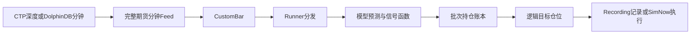
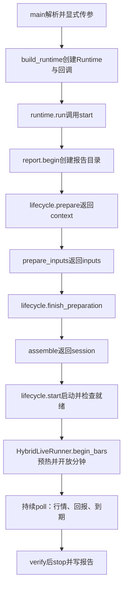

# Hybrid Live 新手导读：从启动入口到目标执行

这份说明针对当前的 [run_live.py](../../../demos/10_hybrid_transformer/run_live.py)，按实际调用顺序解释组装过程。建议一边打开源码，一边按本文顺序阅读。

核对日期：2026-10-28，Asia/Shanghai。

源码中先出现一个函数或类，只表示它已定义；它什么时候被调用，要看 `main()` 和 `ManagedLiveRuntime` 的执行顺序。

## 1. 先看这个程序最终要做什么

程序持续接收当前主力合约的完整分钟，把原始行情交给模型工作流，取得 `predicted_z` 和 `signal`，再计算应持有的批次和目标仓位。最后由执行层决定是否需要提交委托，并处理执行回报。



例如，模型给出的 `signal=1` 先进入批次预算；它不是“立即买一手”的命令。策略产生“目标应为2手”之后，执行层还要结合实际仓位、在途订单和风险限制决定如何实现。

| 名称 | 具体含义 |
| --- | --- |
| `predicted_z` | 模型的预测输出，随后用于信号函数 |
| `signal` | 信号函数给出的方向/强度，要求为有限值且在 `[-1, 1]` 内 |
| `HoldingBatch` | 一批持仓义务，保存合约、数量和绝对到期时间 |
| 目标仓位 | 策略希望执行层达到的仓位 |
| 委托 | 执行层为调整仓位发送的订单 |
| 成交 | 柜台实际确认的交易事实；不能由目标或委托数量代替 |

## 2. 两个选择分别控制什么

行情来源和执行模式是两个独立维度。

| 行情来源 | 执行模式 | 会发生什么 |
| --- | --- | --- |
| CTP | Recording | 连接CTP行情，运行模型，记录目标请求 |
| DolphinDB | Recording | 订阅数据库分钟流，运行模型，记录目标请求 |
| CTP | SimNow | 使用CTP行情和SimNow交易通道 |
| DolphinDB | SimNow | 使用数据库分钟流和SimNow交易通道 |

Recording不撮合成交，也不创建TD交易通道。CTP行情仍需要MD配置；两种行情路径读取主力与合约参考资料时都使用DolphinDB。

本版本每个会话固定一个品种和一个主力合约，执行范围为SHFE/INE。参考角色或条款发生变化时由现有守卫关闭处理闸门，尚未实现跨交易日自动重登录或自动换月。

## 3. 第一次看代码，先认识这些对象

| 对象 | 由谁创建 | 负责什么 |
| --- | --- | --- |
| `market_config` | `load_market_config()` | 描述行情来源及分钟口径；本身不接收行情 |
| `lifecycle` | `build_runtime()` | 连接、预检、等待就绪、恢复、轮询验收和停机 |
| `runtime` | `build_runtime()` | 按顺序调用准备、组装、启动、轮询、停机和报告 |
| `references` | `prepare_inputs()` | 提供主力合约、乘数、最小变动价位、来源日期等资料 |
| `calendar` | `prepare_inputs()` | 判断交易时段、交易分钟、休市和批次期限 |
| `upstream` | `prepare_inputs()` | 厂商原始行情入口 |
| `feed` / `bar_feed` | `assemble()` | 将原始行情变成完整分钟及模型所需CustomBar |
| `predictor` | `build_strategy()` | 执行特征、模型预测及信号函数 |
| `strategy` | `build_strategy()` | 管理批次和目标仓位 |
| `execution` | `assemble()` | 执行客户端、共享仓位、参考价、账本等组件的集合 |
| `runner` | `assemble()` | 分发行情、接收策略目标、协调执行和时钟 |
| `manager` | SimNow分支的 `assemble()` | 联合保存/恢复目标、仓位、订单和策略组件 |

其中几个CTP对象的分工也容易混淆：`transport`负责底层API交互，`driver`管理连接和柜台回报，执行`client`负责受控目标执行。策略计算信号时不直接操作它们。

## 4. `context`、`inputs`、`session`为什么不同

它们出现在不同阶段，包含的对象也不同。

| 名称 | 创建时点 | 内容 |
| --- | --- | --- |
| `context` | `lifecycle.prepare()` | 本次交易日、资源清理栈；准备资料时补上references |
| `inputs` | `prepare_inputs()`返回 | 已准备的references、calendar、upstream |
| `session` | `assemble()`返回 | runner、strategy、execution、client、manager、Feed、恢复绑定等完整运行对象 |

`inputs`和`session`使用 `SimpleNamespace` 把已创建的对象作为固定字段返回。它们代表准备结果和运行会话；命令行设置不会再被装入一个通用参数包沿函数传递。

## 5. 启动入口：`main()`与显式参数

`main()`顺序执行：

1. `load_dotenv()`加载环境设置。
2. `parse_args(argv)`解析命令行并完成本地检查。
3. 逐个读取返回对象的字段，显式调用 `build_runtime(product=..., release_path=..., ...)`。
4. 调用 `runtime.run()`。
5. 最后调用 `runtime.stop()`释放资源；框架有重复调用保护。

命令行对象只存在于参数解析和入口读取字段的范围内。`prepare_inputs()`、`build_strategy()`、`assemble()`、`model_identity()`以及历史预热函数都列出了自己需要的输入。

### 5.1 参数检查做了什么

`parse_args()`检查日期、路径、数值和选项组合，读取行情配置JSON，并校验日历输入声明。它不打开参考数据库，不连接柜台，不加载模型权重。

信号文件在这里仅检查是否存在。`ProductSignalConfig`的数据字段在 `build_strategy()`调用 `load_product_signal()`时才校验，返回的 `selected`随后用于模型和策略构造。

| 命令行选项 | 作用 |
| --- | --- |
| `--connect` | 明确进入连接运行流程 |
| `--mode` | recording或simnow，默认recording |
| `--product` | 当前品种，例如RB |
| `--release-path` | 模型发布目录 |
| `--directions-file` | 研究特征方向文件 |
| `--signal-config` | 按品种配置的信号函数、参数和持仓周期JSON |
| `--expected-trading-day` | 预期会话交易日，YYYYMMDD |
| `--expected-source-day` | 参考资料来源日，YYYYMMDD |
| `--max-contracts` | 全部未到期批次的绝对手数总上限，默认10 |
| `--seconds` | 启动完成后的持续运行时长，默认600秒 |
| `--market-source` | 显式选择CTP或DolphinDB，可覆盖JSON中的来源 |
| `--market-config` | 行情JSON；DolphinDB表名、标签和量额口径在这里声明 |
| `--history-minutes` | 历史预热的交易分钟数量，默认0 |
| `--history-config` | 历史数据库读取配置JSON |
| `--history-file` | 本地原始历史分钟文件 |
| `--state-file` | SimNow联合恢复状态文件 |
| `--resume` | 按原状态文件恢复同交易日会话 |
| `--enable-orders` | SimNow显式交易开关 |
| `--confirm-simnow` | SimNow确认开关 |
| `--report-dir` | 停机报告输出的父目录 |
| `--no-session-overrides` | 明确声明本次规则范围内没有时段例外 |

交易日和资料来源日用途不同。夜盘的交易日可能不同于当前自然日，资料来源日也不能简单从交易日减一天推断。

### 5.2 没放进命令行的设置在哪里

| 设置 | 当前默认 | 定义位置 |
| --- | --- | --- |
| 推理设备 | cpu | MODEL_DEVICE |
| 最大模型历史窗口 | 1500根原始分钟 | MODEL_HISTORY_BARS |
| 最低原始分钟数 | 300根 | MODEL_MIN_RAW_BARS |
| 模型时间标签 | start | MODEL_BAR_TIMESTAMP |
| 新批次检查间隔 | 1分钟 | REBALANCE_MINUTES |
| CTP查询超时 | 15秒 | build_runtime默认参数 |
| 会话报单上限 | 100笔 | build_runtime默认参数 |
| 名义金额上限 | 1000000 | build_runtime默认参数 |
| 限价偏移 | 1跳 | build_runtime默认参数 |
| 执行政策 | fills/off | build_runtime默认处理 |

`main()`没有传入查询超时等关键字，因此Python直接使用函数签名中的默认值。以后若要在代码中调整，显式传入 `query_timeout=20` 即可，无需把它再次变成命令行开关。

300根是一个预热门槛，因子和模型输入还需要有效数值。满足根数并不保证每次都会返回有效预测。

## 6. `build_runtime()`为什么没有立即启动模型和行情

它创建控制器、报告对象和Runtime，并保存两个延迟调用：

| 回调 | Runtime提供的输入 | 调用后返回 |
| --- | --- | --- |
| prepare_inputs回调 | context | inputs |
| assemble_session回调 | inputs、context | session |

源码中的 `lambda`表示“稍后拿到这些对象时，再执行右侧函数”。创建lambda时不会调用 `prepare_inputs()`或 `assemble()`。

因此 `build_runtime()`返回时，`runtime.session`还是None，模型尚未加载。Transport和控制器构造可能读取连接设置，但真正的准备/连接动作由 `run()`内部的生命周期推进。

## 7. 真正的启动顺序



### 7.1 生命周期先准备上下文

Recording使用声明的交易日创建上下文。SimNow会沿用CTP生命周期进行账户锁定、连接预检和交易日核对；恢复时还走恢复分支。具体账户检查受执行政策控制。

所以实际连接可能已经发生在 `lifecycle.prepare()`，不能把整个 `runtime.start()`理解成先纯创建所有对象、最后才连接。

### 7.2 `prepare_inputs()`准备三样资料

1. 依据环境配置创建DolphinDB参考源，先登记关闭动作，再打开连接。
2. 创建主力参考及缓存，取得本次main合约、条款和来源日期，并检查声明是否一致。
3. 结合交易日期、交易时段和例外资料创建 `SessionCalendar`。
4. 创建上游行情对象，返回references、calendar、upstream。

参考连接由 `context.resources`登记的清理栈管理。即使后续模型加载失败，也有统一关闭路径。

`finish_preparation()`是框架在准备和组装之间的交接点。SimNow新会话会在此结束只读预检连接，再由后续正式执行启动流程接管。

## 8. `assemble()`如何连接所有对象

可以把这个函数按源码注释中的步骤分段阅读。

### 第一步：固定真实合约并包装完整分钟

`references.instrument_id`提供实际合约，例如 `rb2701.SHFE`。`assemble_minute_market()`接收显式的 `MarketSourceConfig`和交易日历，包装CTP深度或DolphinDB分钟，返回：

- `feed`：最终分钟Feed。
- `market_channel`：行情就绪检查对象。
- `health`：逐合约健康检查对象。

`upstream`表示厂商入口；`feed`表示处理后交给框架的完整分钟入口，它们不是同一个对象。

### 第二步：构建执行端和就绪条件

SimNow分支创建风险限制和受控CTP执行组件。Recording分支创建记录客户端、仓位管理器及参考价格缓存。

`SessionReadiness`组合行情和执行检查。创建这个对象只是声明检查条件，正式启动时才持续等待条件满足。

默认 `fills/off`表示策略仓位以归属成交为事实，关闭柜台持仓对账；订单回报、资金处理和执行风控仍继续工作。

`max_order_quantity=2*max_contracts`用于允许从反向上限调至正向上限产生的增量订单；最终绝对净仓上限仍是 `max_contracts`。

### 第三步：构建模型、策略和Runner

`build_strategy()`内部顺序为：

```text
信号JSON按品种取selected
    -> MizarWorkflowAdapter加载研究工作流与模型
    -> HybridTransformerConfig描述预算、周期、乘数等规则
    -> HybridTransformerStrategy持有预测器与批次账本
```

`ProductSignalConfig`是信号配置数据对象。它的返回值通过 `selected.signal_method`、`selected.signal_params`、`selected.hold_bars`等字段用于构造。

Runner与执行组件共享 `execution.positions`。共享仓位状态后，执行回报更新的事实才能被目标规划使用。

历史服务也在此创建，但真正按分钟读取数据和预热要等 `begin_bars()`。

### 第四步：声明数据输入和目标输出的绑定

| 名称 | 示例 | 含义 |
| --- | --- | --- |
| `source_id` | HYBRID_1M | 分钟Feed自身的标识 |
| `feed_id` | model-bars | Runner注册这个Feed使用的键 |
| `data_key` | rb2701.SHFE | 交给策略的数据输入键，本例取真实合约字符串 |
| `target_key` | rb_main | 策略向执行层提交的逻辑目标键 |
| 实际合约 | rb2701.SHFE | 柜台实际可交易的合约 |

`DataBinding`声明从哪个Feed、哪个合约、哪种事件接收数据。这里模型只接收 `CUSTOM_BAR`。

`ExecutionRoute`声明逻辑目标键由哪个客户端在什么真实合约上执行。`RoleGuard`检查固定合约是否仍符合当前main角色等参考条件。

随后 `assemble_strategy()`完成注册和共享状态检查。这些注册动作还没有启动Runner。

### 第五步：绑定持久化并返回session

SimNow会创建统一状态管理器，并增加三个组件：

| 组件键 | 保存/核对什么 |
| --- | --- |
| hybrid | 策略批次、目标版本、处理位置和统计 |
| session_rules | 当前交易日历规则身份 |
| live_session | 模型、方向、信号、窗口、行情配置和交易日身份 |

`strategy.bind_checkpoint(manager.save)`传入的是函数本身，当前行不会立即执行 `save()`。之后批次、目标、时钟等状态变化时会调用这个保存入口。

Recording不创建恢复管理器。组装最后返回的session把Runner、策略、执行组件、行情、就绪条件和恢复绑定交给生命周期统一管理。

## 9. 通道就绪后，为什么还要预热

模型需要过去的分钟窗口才能计算特征。默认 `history_minutes=0`时不读取历史，窗口由实时行情逐步积累。

指定历史预热时，`HybridLiveRunner.begin_bars()`会调用 [history.py](../../../demos/10_hybrid_transformer/history.py)：

1. 把当前时间对齐到已完成分钟边界。
2. 通过交易日历取之前N个交易分钟，跳过休市间隔。
3. 历史服务读取这些分钟。
4. 校验原始OHLCV、成交额、持仓量、VWAP等字段。
5. 调用 `predictor.warm_history(rows)`填模型窗口。
6. 记录最后历史事件时间，避免实时交接时重复处理同一根分钟。

预热不调用策略的行情交易回调，因此不会重放历史开仓。恢复时模型窗口也要重新预热；检查点保存的是持仓义务等状态，不是完整模型历史DataFrame。

启动交接分钟可能只用于补充模型窗口。满足完整实时分钟的处理条件后，才正常分发给策略。

## 10. 每收到一分钟后，代码怎样走

网络回调先把原始数据放入队列；正常轮询中的 `session.bar_feed.poll()`在控制线程中取出并处理它们。模型计算不会直接在原生网络回调线程里执行。

```text
完整分钟Feed产生原生BAR，再产生伴生CUSTOM_BAR
  -> Runner观察行情并按DataBinding分发CUSTOM_BAR
  -> HybridTransformerStrategy.on_custom_bar
  -> futures_bar_values读取原始值并计算VWAP
  -> predictor.on_bar
  -> 工作流计算特征、标准化、模型预测和信号
  -> holdings.advance处理旧批次到期与新批次入场
  -> 策略计算各合约净目标
  -> Runner根据ExecutionRoute交给执行层
  -> 执行回报更新归属仓位、订单状态和统计
```

配套BAR供框架观察行情和维护执行参考价格。SimNow的实际撮合由柜台完成，不在这里用BAR本地模拟成交。

预测返回 `None`通常表示尚未具备有效模型输出，不能当成强制平仓信号。策略仍会推进已有批次的到期处理。

### 时间标签例子

假设来源分钟覆盖09:01至09:02：

| 时间 | 含义 |
| --- | --- |
| 09:01 | 默认start口径下，模型行的trade_time标签 |
| 09:02结束边界减1ns | 完整分钟事件的ts_event |
| 归一后的09:02 | 该完整分钟可用于策略决策的完成时点 |

行情JSON中的 `timestamp_label`描述DolphinDB来源标签；`MODEL_BAR_TIMESTAMP`描述研究模型标签。两者可以不同，框架会在各自环节按声明转换。

## 11. 五分钟持仓与到期轮询

以下只举 `hold_bars=5`、`max_contracts=10`、连续信号为1的例子，时间均为分钟已经完成的时点。

| 时点 | 批次变化 | 净目标 |
| --- | --- | --- |
| 09:01 | 第1批进入，2手，到09:06到期 | 2 |
| 09:02 | 第2批进入，2手，到09:07到期 | 4 |
| 09:03 | 第3批进入，2手 | 6 |
| 09:04 | 第4批进入，2手 | 8 |
| 09:05 | 第5批进入，2手 | 10 |
| 09:06 | 第1批到期，同时新批次进入2手 | 10 |

最后一行目标仍为10，执行层可以无需先平2手再开2手；账本已完成批次替换。若09:01之后信号全为0，原来的2手目标会保持至09:06到期才变为0。

期限按交易分钟推进。休盘会被跳过，程序中断不会重新开始计时；重启依赖保存的绝对到期时间和一致的日历。

反向批次会影响净目标：例如先开一批+2，下一分钟再进入一批-2，账户净目标可以暂时变为0，但两批到期义务仍分别保留。因此批次期限和每笔成交在账户中实际持有多久不是同一件事。

正常生命周期每轮先处理完整分钟，再进行父类健康/回报检查，最后调用 `expire_due()`。即使这一轮没有新预测，当前时钟仍可推进到期。到期生成的是应调整目标，实际成交取决于执行就绪、行情和流动性。

## 12. 恢复、停止与报告

### 恢复

恢复使用原 `state-file`并加 `--resume`。可用 `--history-minutes 0`从实时完整分钟重新积累模型窗口，不传历史配置；启用恢复历史时仍须提供数据库配置。生命周期会恢复联合状态、检查同交易日/合约、策略持仓与订单、批次目标及版本，并按执行政策核对柜台事实。

`hold_restored_target()`保留恢复出的目标版本，避免历史目标被当成刚刚产生的新信号重复执行。会话就绪后进入当前时钟和实时处理；选择实时预热时，未就绪期间不建立新批次，已有批次仍按原绝对期限处理到期目标。

模型文件、信号、预算、合约、日历或保存格式不一致时，恢复可能被拒绝。当前版本不负责自动迁移旧状态。

### 停止

正常运行到设定时间、触发运行限制或异常退出后，Runtime进入停机清理。SimNow沿用框架停止接收交易、撤销活动订单、查询并保存状态、释放连接和账户锁的流程；剩余仓位不会因程序退出而自动平仓。

`seconds`是启动完成后的循环时长，不包含前面的预检、模型加载和就绪等待时间。循环每轮处理后有0.2秒休眠，但预测由完整分钟事件触发，不是每0.2秒预测一次。

### 文件

会话已建立时，通常能看到以下报告文件：

| 文件 | 用途 |
| --- | --- |
| summary.json | 会话模式、来源、预测/目标状态、执行和清理摘要 |
| events.txt | 对应执行模式提供的目标或执行事件 |
| signals.csv | 策略处理过程中的预测和目标记录 |
| batches.csv | 批次建立、到期等记录 |
| strategy_state.json | 供查看的策略组件快照 |

恢复应使用统一 `state-file`，不能只拿报告目录中的strategy_state.json恢复，因为后者不包含完整订单、执行账本和其他检查点。

## 13. 刚接手时如何定位问题

| 现象 | 先看哪里 |
| --- | --- |
| 命令行直接报错 | parse_args的路径、日期及选项组合检查 |
| 主力或乘数不对 | prepare_inputs中的references和source_day |
| 休盘、夜盘或到期时间不对 | calendar规则、例外资料和分钟标签 |
| 信号JSON字段或品种缺失 | build_strategy中的load_product_signal |
| 研究依赖或模型权重加载失败 | MizarWorkflowAdapter及flow.py |
| 通道启动后迟迟没有有效分钟 | upstream、完整分钟边界、行情健康和DataBinding |
| bars_used在增加，prediction没有变化 | 模型是否返回None、因子/窗口条件；last_prediction是最近一次有效输出 |
| 有目标但没有成交 | mode是否Recording；SimNow的回报、风控和在途订单 |
| 目标看起来没变但批次变化了 | 到期批次与新批次发生净额合并 |
| 恢复被拒绝 | state-file、模型/日历指纹、同交易日合约和柜台核对 |

`bars_used`不是成交数，也不等于成功预测次数。`last_targets`是策略按合约保存的最新目标，提交执行时还会转换为逻辑目标键。

推荐先追一根有效分钟：在Runner.publish看到事件，进入策略检查prediction，再看批次和目标，最后看Recording请求或SimNow回报。这样可以逐层确认数据走到了哪里。

## 14. 建议的源码阅读路线

1. [run_live.py](../../../demos/10_hybrid_transformer/run_live.py)：先main/build_runtime，再prepare_inputs/assemble/build_strategy，最后Runner和Lifecycle。
2. [ManagedLiveRuntime](../trader/ManagedLiveRuntime.md)：谁在什么时候调用上述函数。
3. [prepare_inputs](prepare_inputs.md)、[assemble](assemble.md)：各输入对象和注册步骤的完整接口。
4. [history.py](../../../demos/10_hybrid_transformer/history.py)：历史如何进入模型窗口。
5. [strategy.py](../../../demos/10_hybrid_transformer/strategy.py)、[holding.py](../../../demos/10_hybrid_transformer/holding.py)：信号如何成为批次与净目标。
6. [checkpoint.py](../../../demos/10_hybrid_transformer/checkpoint.py)：哪些状态保存及怎样核对恢复。
7. [model_adapter.py](../../../demos/10_hybrid_transformer/model_adapter.py)、[flow.py](../../../demos/10_hybrid_transformer/flow.py)：再深入特征和模型算法。

[返回函数索引](../README.md) · [返回策略说明](../../../demos/10_hybrid_transformer/README.md)
