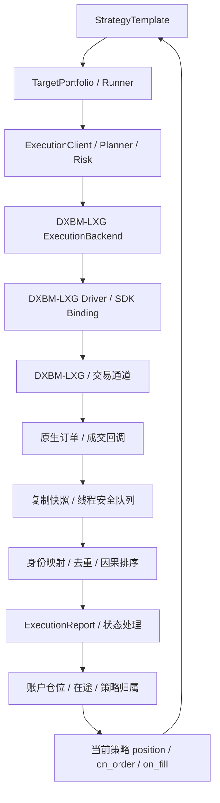

# DXBM-LXG 与 Bomber Python 策略框架对接说明

版本：v0.8，补充固定 MinVolume 及复杂订单通过限价落地的建议，双方评审草案  
日期：2026-10-09  
读者：DXBM-LXG 交易系统、C++ SDK、Python 绑定及策略框架开发者  
范围：接口分析、建议契约、开发分工与验收标准；本文不代表相关适配器已经实现。

**开始本期实际接线请阅读 [LXGBN SDK 接入与测试指南（2026-10-21）](LXGBN_SDK_INTEGRATION_GUIDE_2026-10-21.md)。** 新指南按已实现代码列出宿主接口、线程/回调/快照要求和测试例子；本文继续保存历史原生结构及建议能力，不把较早的四种订单能力建议扩大为本期全部实现。

## 2026-10-20：M02 宿主与 SDK 调用方向澄清

用户已确认 **LXGBN 即本文 DXBM-LXG，是 Windows 交易程序；本项目提供 Python SDK，由 LXGBN 的内嵌 Python 加载和调用**。项目不引用另一份 LXGBN SDK，也不因本次对接增加 Linux 调用端、HTTP 桥或独立交易进程。

宿主创建项目 SDK 会话，推送标准行情，转发三个原生回调，并在已有合法线程调度 `poll`。项目会话复用 StrategyTemplate/Runner/风控/OMS/归属；报撤单请求通过宿主注入的 `HostPort` 返回 LXGBN 交易核心。解释器、GIL、原生对象、连接和退出由宿主管理。本文后续提及的“SDK/绑定”原生字段及函数片段表示宿主侧接入语义，不表示框架加载外部厂商 SDK。

本期落地接口见 `bomber.framework.lxgbn` 和[宿主调用说明](../../scripts/integration/lxgbn/README.md)。首期仅测试绑定的 Normal 限价、投机、单策略/单绑定/单合约；CTP 复用已有实际链路，BN 延后。本文原 Market/FAK/FOK 等能力仍为后续接口评审内容，不表示本期全部启用。

§2.3 的业务执行方向继续成立，其中 Driver/SDK Binding 在本期实现为宿主注入端口及字段复制函数。§8.3 的 Windows 内嵌解释器/对象/GIL/ABI 约束必须现场确认。宿主交付序号与快照水位是项目 SDK 的接入契约，不是本文 C++ 结构体已经存在的新字段；不得用接收计数伪造原生事件完整性。§11.3 的公共链路实现和离线用例已有代码，真实 Windows/交易联调仍未验收。本文其余“待确认”项继续有效。

## 1. 对接目标与阅读约定

目标是让同一份 Python 策略通过运行配置选择模拟执行端或 DXBM-LXG 执行端，读取**当前策略的归属仓位**，并统一接收订单和逐笔成交事件。DXBM-LXG 负责连接交易通道、执行报单与撤单，并提供本次策略绑定范围内可查询、可恢复的交易状态。

首期接口建议冻结四种基础需求：普通限价单、市价单、FAK、FOK；默认采用 Normal 普通限价单，按单策略绑定分步联调各类订单。范围还包括明确开平负责方、受理/拒绝/部分成交/全成/撤销回报、当前策略仓位及该策略订单/成交恢复、交易连接与执行可用状态。多策略共享执行、跨策略合并订单、算法父子单、改单、条件单及组合执行可以后续扩展，须先声明能力。声明支持不等于每个交易所、合约和通道组合都可用。

**本版核心修正：**策略仓位查询不要求柜台确认策略归属；柜台一般只能确认账户事实，策略归属由策略账本与订单关联确定。账户资金、账户全量仓位及其他策略订单，不再作为 DXBM-LXG 策略对接接口的默认必需项。三个回调均建议显式回传同一个 clientOrderId，不仅在 Ack 中回传。

本版不删除当前框架内部的账户状态服务。是否复用该服务、是否需要额外账户查询，属于执行适配路径的单独约定，不能把策略仓位快照装成账户全量快照以满足旧接口。

**本次订单能力补充：**按最新对话，DXBM-LXG 默认限价，另支持 Market、FAK、FOK；Attribute 数值固定为 UnknownAttr=0、Normal=1、FAK=2、FOK=3、Market=4。截图还提供算法类型、HedgeFlag 与 Offset 的 Python 枚举暴露方案；其他枚举整数值尚未提供，不据此猜测。NT 原生模型可表达基础订单需求，框架尚需将相关执行约束映射至模拟/NT 路径；不要求 DXBM-LXG SDK 增加独立 TIF 参数，详见第 6.4 节。

**最新状态补充：**status_t 已提供 Blank、Submited、Acked、FullFilled、Rejected、Cancelled 六个名称，原生数值和准确转换条件尚需说明。截图未列出独立部分成交状态；适配层可结合稳定逐笔成交与活动/终态事实生成标准部分成交状态，详见第 3.6 节。

**委托号可选约定：**本次框架 Backend 接入不要求 DXBM-LXG 回传柜台/交易所委托号 venue_order_id，框架保留为空。关联、撤单、查询及恢复使用 clientOrderId 与 DXBM-LXG 原生订单 ID；DXBM-LXG 内部负责解析需要的柜台标识。具体条件见第 4.5 节。

**最新 CTP 参数补充：**SDK 已从 Attribute 设置 TimeCondition/VolumeCondition：Normal→GFD+AV，FAK→IOC+AV，FOK→IOC+CV，截图三分支均设置 MinVolume=1。调用方只选择 Attribute，不另传 time_in_force 或上述 CTP 字段；框架内部仍转换为 NT DAY/IOC/FOK。即时成交约束不表示必然成交，真实结果以成交和终态回报为准。

**最新开发建议：**开发者补充“内部默认 1、复杂订单建议通过限价单模拟”。结合已提供代码，本版将固定 1 记录为 MinVolume=1，不扩大为全部 CTP 字段或订单数量都是 1。复杂订单优先通过限价单落地记为建议，具体覆盖范围与实现负责方尚待明确；不改变已提供的 FAK/FOK 原生约束，见第 6.5 节。

本文使用以下标签区分证据与建议：

| 标签 | 含义 |
|---|---|
| 已知 | 来自本次提供的接口片段，或当前 Python 框架源码 |
| 建议契约 | 推荐双方落实的语义，尚未确认 DXBM-LXG 已支持 |
| 待确认 | 仅凭现有片段无法判断，需要 DXBM-LXG 开发者书面答复 |
| 框架待开发 | 当前框架尚需增加或调整的能力 |

所有建议接口名都是逻辑能力名称，不要求 DXBM-LXG 改名或使用同一种语言。已有 SDK 只要能提供等价语义，即可由适配层转换。代码示例用于说明契约，不是可直接编译的 DXBM-LXG SDK 实现。

## 2. 系统边界与接入位置

### 2.1 各方职责

| 层次 | 职责 | 状态范围 |
|---|---|---|
| Python 业务策略 | 行情处理、指标、信号、目标仓位；消费标准回报 | 当前策略目标与当前策略已归属仓位 |
| Runner / Portfolio | 策略目标归集、执行路由、策略归属 | 目标、订单冻结分配、策略归属；底层账户镜像单独保留 |
| Planner / Risk | 目标差额规划、约定范围的交易前校验 | 当前策略归属/预留及已配置的执行限制；底层净额执行另行处理 |
| DXBM-LXG 适配层 | 类型转换、订单关联、排队、去重、查询转换与恢复 | 原生状态与框架状态的映射 |
| DXBM-LXG | 通道连接、最终交易校验、报撤单、原生回报与查询 | 本次策略绑定的交易事实、原生策略账本及交易可用状态 |
| 柜台/交易所 | 最终订单、成交、持仓与结算事实 | 最终权威来源 |

DXBM-LXG 提供的**策略仓位**须注明策略标识、执行绑定范围、数据来源、快照时点/版本及查询是否完整。未完成初始化或尚未同步成交的策略缓存不能被视为完整策略仓位。这里的确认是策略账本完成初始化/恢复，不是“柜台确认当前策略仓位”。

登录正常、账户/通道可交易、风控是否允许接单属于独立的**执行可用状态**。状态正常不证明策略仓位已经恢复完整；策略仓位完整也不证明账户当前能接受新订单。资金查询和账户全量持仓查询只在双方明确选用的底层执行方案中增加。

### 2.2 策略仓位口径及 GAP-01 当前依据

当前 `StrategyTemplate.position(target_key)` 经 Runner 读取 `(strategy_id, target_key)` 对应的归属仓位，不读取整个账户净仓。GAP-01 已建立真实合约归属账本、发送前冻结的订单分配、成交去重后归属更新，以及回调内读取已更新仓位的路径。

依据当前 GAP-01 交接记录，本项已经按既定标准关闭：离线用例覆盖多策略归属，在线证据覆盖当前 EMA 首次成交及策略回调读取；不能扩大为 DXBM-LXG 已接入或在线共享账户全面验收。本版只是阅读这些证据，没有重新运行相关测试。

必须分清三种数量：

| 数量 | 含义 | 策略使用方式 |
|---|---|---|
| 策略目标 | 希望最终持有的仓位 | 由策略提交 |
| 策略归属仓位 | 已记入该策略账本的仓位；共享净额模式可含内部归属划转 | 由 `position(target_key)` 读取 |
| 账户净仓 | 所有策略及外部交易合并后的实际数量 | 仅底层执行/一致性用途，不作为当前策略仓位 |

例如策略 A 归属 +2、策略 B 归属 -1 时，账户净仓可能为 +1。A 必须查到 +2，B 必须查到 -1，不能都返回 +1。GAP-01 支持内部归属划转；这种划转不是柜台成交，不生成虚构成交 ID、成交价或手续费。

### 2.3 首期建议链路



新增组件可暂命名为 `DxbmLxgExecutionBackend`、`DxbmLxgDriver`、`DxbmLxgSdkPort`。正式命名可在实现时统一。业务策略不直接接收 `OrderMsg_t::ptr` 或 `ExecutionMsg_t::ptr`。

### 2.4 与 NautilusTrader 的关系：需要明确的架构决策

旧目标架构文档建议：策略订单经过 NT ExecutionEngine，由 Bomber Execution Client 调用交易系统，再将订单/成交报告回流 NT Cache 和 Portfolio。

当前 Python 框架默认使用 `StrategyTemplate + UnifiedStrategyRunner`；模拟端使用 Nautilus 回测内核，原生 CTP 在线路径的回报则进入框架状态机和 `PositionManager`。两者存在口径差异，已由 GAP-09 跟踪。

**首期建议采用当前框架主链接入 DXBM-LXG。** 这意味着 DXBM-LXG 回报更新框架状态，不自动意味着 NT Cache/Portfolio 也被更新。若项目要求 NT 原生状态完整同步，应另行实现 NT Execution Client 和标准状态报告路径，并定义镜像关系。

禁止同一个成交同时经两条路径各增加一次框架账户仓位。是否需要 NT 原生镜像，由框架方确认；DXBM-LXG 提供真实、完整的原生事实即可。

## 3. 当前已提供的 SDK 信息

### 3.1 最新回调签名与 Python 转发要求

```cpp
virtual void onOrderAck(int clientOrderId, OrderMsg_t::ptr) {};
virtual void onOrderFill(int clientOrderId, OrderMsg_t::ptr, ExecutionMsg_t::ptr) {};
virtual void onOrderFinished(int clientOrderId, OrderMsg_t::ptr) {};

// 绑定应按更新后的实际签名暴露，并在 Python override 中转发全部参数。
// pure_virtual 是否适用需按回调是否强制实现决定，见第 8.3 节。
```

根据最新对话与截图，本版采用以上三个回调都带 clientOrderId 的接口建议，调用示例修正为：

```cpp
onOrderAck(clientOrderId, orderMsg);
onOrderFill(clientOrderId, orderMsg, execMsg);
onOrderFinished(clientOrderId, orderMsg);
```

Ack 是两个参数，Fill 是三个参数，Finished 是两个参数。三个回调应回传发送前登记的同一个 clientOrderId；SDK 实际发布头文件与 Python 绑定仍需按此核对。原来 Ack 单参数调用示例属于已纠正的示例，不再作为待定重载问题。

### 3.2 订单结构

```cpp
typedef struct OrderMsg_t
{
    typedef std::shared_ptr<OrderMsg_t> ptr;
    long long ID;
    char PKey[100];
    char InstrumentID[bomber::api::LEN_INSTRUMENT_ID];
    bomber::api::dir_t Direction;
    price_t Price;
    abvolume_t VolumePlanned;
    abvolume_t VolumeSubmitted;
    bomber::api::hedge_flag_t HedgeFlag;
    abvolume_t VolumeTraded;
    abvolume_t VolumeCancelled;
    bomber::api::attr_t Attribute;
    bomber::api::offset_t Offset;
    bomber::api::status_t Status;
    timestamp_t TimestampSubmitted;
    timestamp_t TimestampAck;
    timestamp_t TimestampCancelled;
    strategy_id_t StrategyId;
    long long PortfolioId;
    long long AccountId;
    long long AlgoId;
    long long UserId;
    char errorMsg[bomber::api::LEN_ORDER_ERRORMSG];
    bool isAlgoOrder;
    std::string Inst() { return InstrumentID; }
} OrderMsg_t;
```

### 3.3 成交结构

```cpp
typedef struct ExecutionMsg_t
{
    typedef std::shared_ptr<ExecutionMsg_t> ptr;
    long long ID;
    long long OrderID;
    char InstrumentID[bomber::api::LEN_INSTRUMENT_ID];
    price_t Price;
    abvolume_t Volume;
    timestamp_t Timestamp;
    long long AccountId;
    bomber::api::hedge_flag_t HedgeFlag;
    bomber::api::dir_t Direction;
    bomber::api::offset_t Offset;
    long long AlgoId;
    long long UserId;
    long long PortfolioId;
    bool isAlgoOrder;
    strategy_id_t StrategyId;
} ExecutionMsg_t;
```

现有片段没有提供报单参数、返回值、完整枚举、策略仓位查询、策略范围全量订单/成交查询、执行可用状态、回调顺序及线程模型。本文不会把这些缺失能力视为已实现。

### 3.4 Attribute 固定数值约定

按最新对话，采用以下数值作为 DXBM-LXG 的订单属性协议。Python 枚举、报单参数、回报及保存/恢复的原生属性值应保持一致；实际 SDK 头文件和发布绑定仍需核验是否已经落实：

```cpp
enum OrderMsg_attr_t {
    OrderMsg_attr_t_UnknownAttr = 0,
    OrderMsg_attr_t_Normal = 1,
    OrderMsg_attr_t_FAK = 2,
    OrderMsg_attr_t_FOK = 3,
    OrderMsg_attr_t_Market = 4
};

typedef OrderMsg_attr_t attr_t;
static const attr_t Normal = OrderMsg_attr_t_Normal;
static const attr_t FAK = OrderMsg_attr_t_FAK;
static const attr_t FOK = OrderMsg_attr_t_FOK;
static const attr_t Market = OrderMsg_attr_t_Market;
static const attr_t UnknownAttr = OrderMsg_attr_t_UnknownAttr;
```

| 原生整数值 | Python 枚举成员 | 含义 |
|---|---|---|
| 0 | `OrderMsg_attr_t.UnknownAttr` | 未知属性，不能用于正常报单 |
| 1 | `OrderMsg_attr_t.Normal` | 普通限价属性；所示 CTP 路径为 GFD 当日有效 |
| 2 | `OrderMsg_attr_t.FAK` | FAK，建议标准映射到 IOC |
| 3 | `OrderMsg_attr_t.FOK` | FOK，标准映射到 FOK TIF |
| 4 | `OrderMsg_attr_t.Market` | 市价属性；参数与实现另行确认 |

已知系统默认限价并支持市价、FAK、FOK；最新所示 CTP 路径已明确 Normal=GFD+AV、FAK=IOC+AV、FOK=IOC+CV。FAK/FOK 的实际价格类型、市价是否为柜台原生市价，以及每个市场适用范围仍需说明。CTP 分支已明确的有效期不再重复列为待确认；其他通道不能未经核验沿用。

数值兼容规则：

- SDK 和 Python 绑定使用同一套固定值，适配器优先使用具名成员，记录必要的原生数值。
- 不把这些整数直接转换成 NT 的 OrderType/TimeInForce；两边枚举属于不同协议，使用显式映射。
- 0 和任何未定义值不能正常报单，不能自动回退成 Normal。收到未知回报保留原值，触发已约定的查询/冲突处理。
- 后续新增属性使用新的、未占用数值，已有数值不改动、不复用。变更执行语义或破坏兼容性时需要更新协议版本与迁移说明。
- 这些数值是单个属性标识，不是位标志；不得通过位运算组合 Market/FAK/FOK。

### 3.5 其他 Python 枚举暴露方案

截图说明 DXBM-LXG 可以暴露以下枚举。**暴露枚举只是类型定义，还需让 sendOrder 参数及 OrderMsg_t/ExecutionMsg_t 对应字段使用或转换到这些类型。** 仅导出枚举而没有可传入/可读取字段，不构成完整接口。

| 原生类型 | 截图中的 Python 类型/成员 | 本次用途及约定 |
|---|---|---|
| `EnumAlgoOrderType` | 当前命名 `OrderType`；成员 EnumDefault、EnumTWap、EnumVWap、EnumSimpleTWap、EnumHitMarket | 建议 Python 类型改名 `AlgoOrderType`，与普通订单类型和 Attribute 区分 |
| `HedgeFlag_type_t` | Speculation、Arbitrage、Hedge、Unknown | 通过具名映射表达投机、套利、套保；Unknown 不能自动按投机发送 |
| `OrderMsg_offset_t` | Open、Close、CloseToday、CloseYd、UnknownOffset | 分别映射 OPEN、CLOSE、CLOSE_TODAY、CLOSE_YESTERDAY；UnknownOffset 不能自动解释为 AUTO |
| `OrderMsg_attr_t` | Normal、FAK、FOK、Market、UnknownAttr | 采用第 3.4 节固定数值，按第 6.4 节转换类型与 TIF |
| Direction 对应原生枚举 | 尚未提供完整成员/数值 | 建议一并暴露，显式映射 BUY/SELL |
| `status_t` | Blank、Submited、Acked、FullFilled、Rejected、Cancelled | 最新截图已提供名称，映射见第 3.6 节；原生数值及状态定义待确认 |

以上 HedgeFlag、Offset、算法及 status_t 枚举的整数值尚未约定，不能照抄 NT、CTP 或 Attribute 的数值。SDK 中 dir_t、hedge_flag_t、offset_t、attr_t、status_t 等别名与绑定类型的对应关系需要在头文件中核对。

算法类型与订单属性分别传递：TWAP/VWAP 等是执行算法，Normal/Market/FAK/FOK 是实际订单属性，不能互相替代。EnumHitMarket 不自动等同 Attribute.Market，EnumDefault 也不自动等同 Normal；需要说明算法行为、默认算法含义及实际子单属性。

算法枚举可以先暴露供识别和后续扩展。首期普通订单接入不因此要求算法执行已经实现；启用算法需要单独验收父子单关联、回报层次、数量、撤销及恢复。

### 3.6 status_t 名称、标准映射及部分成交

最新截图提供以下 Python 绑定片段。原生整数值尚未提供，不按排列顺序猜测；以下是现有 SDK 拼写，尤其 `Submited` 不擅自改成另一个 Python 成员名：

```cpp
enum_<bomber::api::status_t>("status_t")
    .value("Blank", Blank)
    .value("Submited", Submited)
    .value("Acked", Acked)
    .value("FullFilled", FullFilled)
    .value("Rejected", Rejected)
    .value("Cancelled", Cancelled);
```

以下是**建议语义映射**，不是仅凭名称认定 SDK 已保证对应状态：

| 原生状态 | 建议标准状态/处理 | 需要 SDK 明确的条件 |
|---|---|---|
| Blank | 保留原始状态，视为未明确初始化的候选，不生成受理或终态 | 是否是新建空状态、无效值或查询未就绪；不能据此认定无真实订单 |
| Submited | SUBMITTED / 内部待确认 | 是本地登记、命令发送还是柜台收到；不直接等同 ACCEPTED |
| Acked | ACCEPTED 候选；有实际成交后由适配器维护部分成交 | 确认层次是否满足受理事实；是否仍表示部分成交后的活动订单 |
| FullFilled | FILLED 终态 | 是否固定实际订单全量成交；须补齐逐笔成交并核对数量，不凭该状态伪造成交 |
| Rejected | REJECTED 终态候选 | 是原订单报单拒绝，还是撤单/改单请求被拒绝；必须区分命令拒绝与原订单结束 |
| Cancelled | CANCELED 终态候选 | 是否撤销已确认完成；部分成交保留，释放真实未成交剩余；不能把撤单请求当成功 |

当前标准 OrderUpdateEvent 能表达 SUBMITTED，但旧 ExecutionReport/状态机路径尚无对应回报类型。适配 SUBMITTED 需要完善转换或按内部待确认记录，不能为了复用旧类型伪装成 ACCEPTED。

**部分成交不要求 SDK 必须新增 PartiallyFilled 枚举。** 若 SDK 仍使用 Acked 表示部分成交后的工作订单，适配器按去重后的实际成交和已确认的订单量维护：

```text
当前订单仍活动，并且 0 < 已处理的逐笔成交之和 < 固定订单量
    → 标准 PARTIALLY_FILLED
已处理的逐笔成交之和 = 固定订单量，并与原生事实相符
    → 标准 FILLED
已确认 Cancelled 且累计成交为部分量
    → 标准 CANCELED，保留累计成交；不能仍标为活动 PARTIALLY_FILLED
```

上例的“成交之和”来自 ExecutionMsg.ID 去重后的单笔 Volume，不重复累加 OrderMsg.VolumeTraded。OrderMsg 的累计量用于完整性核对；没有对应成交明细时查询补齐。迟到 Acked 不允许把已有部分成交/终态状态退回 ACCEPTED。

FullFilled 先于对应 Fill 到达时，先记录并建立终态完整性边界，不提前终结会忽略迟到 Fill 的旧状态机。Cancelled 含漏到成交时同样按第 7.5 节补齐。

截图未列出 EXPIRED、撤单待确认或独立命令拒绝状态，不假定这些场景不存在。Normal 到期、FAK/FOK 未成交自动终止、撤单失败的实际 Status/错误码/回调需说明；若共用 Cancelled/Rejected，应保留可区分的原因，避免把正常未成终止、报单拒绝与撤单失败混为一类。

首期可使用这六个名称开展适配设计，前提是提供上述准确语义、状态转移和原生数值，并满足逐笔成交及恢复契约；不要求 SDK 为匹配 NT 枚举而简单改名或新增状态。

## 4. 身份与关联契约

### 4.1 身份字段与可选委托号

| 身份 | 含义 | 推荐作用域 |
|---|---|---|
| `client_id / backend_id` | 框架中的执行端实例 | 运行配置中的唯一实例 |
| `account_id` | 账户的标准标识 | 含交易系统/经纪商命名空间 |
| `strategy_id` | 框架业务策略标识 | 框架部署范围 |
| `client_order_id` | 框架订单标识 | 重启及重放期间保持唯一 |
| SDK `clientOrderId` | 发送前登记、所有三个回调原样回传的报单关联参数 | 策略/执行绑定/会话范围由双方冻结 |
| `OrderMsg_t.ID` | DXBM-LXG 原生订单 ID | 由 SDK 说明唯一范围 |
| `venue_order_id`（可选） | 柜台/交易所委托标识；本次可以不回传 | 不提供时为空；如提供，按柜台定义组合命名空间 |
| `ExecutionMsg_t.ID` | 原生逐笔成交 ID | 由 SDK 说明唯一范围 |
| `event_id` | 某条状态事实的稳定标识 | 同一事实重放保持相同标识 |

`client_id` 与 SDK 的 `clientOrderId` 不是同一个概念。`OrderMsg_t.ID` 在确认之前不能被当成交易所委托号；`PKey` 同样不能凭名称推断。

### 4.2 订单关联表

建议在发送前或 SDK 能提供的最早安全时点，建立以下记录：

```text
client_order_id
sdk_client_order_id
native_order_id
venue_order_id（可选；未回传或未知时为空）
client_id / account_id / instrument_id
framework_strategy_id / native_strategy_id
order_quantity / side / position_effect
request_id / allocation_token / allocation_legs
session_id / trading_day / 原生 ID 命名空间
parent_order_id（如适用）
发送结果与恢复状态
```

框架侧 `allocation_token / allocation_legs` 是策略归属资料，可以在本地关联表保存，不要求 SDK 直接支持任意 Python metadata。回报必须能通过稳定订单 ID 找回这些资料。

如果 SDK 分配 `clientOrderId`，但可能在 `sendOrder()` 返回前同步触发回调，需要提供预分配 ID、调用者请求键回传或其他可靠关联方式。不能依赖“方法返回以后再建表”避免竞态。

SDK 的 `int clientOrderId` 需要说明位宽、溢出处理、重启后是否归零。框架字符串 ID 不应被直接截断或用不检查冲突的哈希转换成整数。

### 4.3 为什么三个回调都回传 clientOrderId

只在 Ack 中回传，理论上可在 Ack 时建立 `native_order_id → clientOrderId` 表，再通过 Fill 的 OrderID 和 Finished 的 ID 查表。但这依赖 Ack 必然先到、映射未丢失、重启已经恢复及父子单关联完整，现阶段不应把这些条件当成 SDK 保证。

建议三个回调都显式携带 clientOrderId，使每种回报均可独立关联发送前记录。即使 Fill 或 Finished 先于 Ack 到达，也能定位原请求；仍需按照生命周期协议处理，不代表可以直接忽略因果顺序。

clientOrderId 是订单关联键，不是成交 ID，也不是回报去重 ID。一张订单的多笔 Fill 使用同一个 clientOrderId，每笔 ExecutionMsg.ID 必须不同且重放稳定。Ack/Finished 同样需要稳定事件身份或状态去重。SDK 内部自动创建的子单应同时有明确父子映射，不能仅靠复用父 clientOrderId 区分多张实际子单。

未知 clientOrderId 不能凭回调中的 StrategyId 猜测归属。SDK 生成/内部订单应使用明确关联协议；首期不支持的外部订单不得冒充当前策略订单。

### 4.4 去重要求

成交去重键必须包含原生成交 ID 的真实唯一范围。例如，如果 ID 仅在交易日与账户内唯一，则至少保留交易系统实例、账户、交易日和成交 ID；如果还需要交易所或原生订单 ID，也要纳入。

当前标准 `FillEvent` 的去重键含客户端、账户、客户端订单 ID 与 trade ID。若原生 ID 会跨日重复，适配器必须把交易日等范围编码进稳定 trade ID，并持久化映射。

不能使用“价格 + 数量 + 时间”作为可靠成交去重键：同一时刻可能存在两笔完全相同的真实成交。也不能在重连时给同一成交重新生成随机 ID。

### 4.5 venue_order_id 可不回传的条件

本次采用框架 Backend 主链接入，`venue_order_id` 是可选资料，不是 SDK 必须回传的字段。当前标准 ExecutionIdentity 允许该字段为 None；未提供时保持 None，不以 0、空白占位或伪造交易所号补齐。

省略该字段时，必须满足以下关联和恢复能力：

1. Ack、Fill、Finished 都回传发送前登记的同一个 clientOrderId，能找到原请求及冻结的策略分配。
2. OrderMsg_t.ID 与 ExecutionMsg_t.OrderID 的关联、唯一范围和会话/交易日命名空间明确；查询及重放可恢复相同订单身份。
3. 撤单和查询接受双方约定的 clientOrderId 或 DXBM-LXG 原生订单键，不要求框架传入交易所委托号；SDK 内部负责柜台标识解析。
4. 断线/重启后可以恢复上述映射，并查询活动单、终态及恢复期间成交；不能因映射仅存内存而失去在途订单。
5. ExecutionMsg_t.ID 具有明确唯一范围、重放稳定，可独立完成逐笔成交去重。没有 venue_order_id 不得影响成交识别。

OrderMsg_t.ID 继续存为 native_order_id，PKey 按其已确认定义保存，不为了填满标准字段而把它们冒充交易所委托号。其他身份、数量、成交明细和查询完整性要求仍适用。

SDK 若后续自愿提供真实委托号，可以补充保存为审计资料；其晚到或始终缺失不能阻止本次已满足上述条件的框架路径运行。只有所选具体通道/新增功能确实要求框架持有该标识时，才另行调整契约。

此可选约定不自动覆盖未来 NT 原生 ExecutionClient 路径。若后续接入 NT Cache/Portfolio，应针对该路径单独定义订单标识映射和所需报告，不在本次协议中虚构真实交易所委托号。

## 5. 字段映射与数据类型

### 5.1 OrderMsg_t 映射

| 原生字段 | 标准用途/保存位置 | 待确认与校验 |
|---|---|---|
| `ID` | `native_order_id`、关联表 | 唯一范围、跨会话稳定性 |
| `PKey` | 原始关联资料；定义确认后再映射 | 组成、编码、是否委托号或父单键 |
| `InstrumentID` | `instrument_id` 的原生代码 | 通过主数据补交易所，不可只按代码猜 |
| `Direction` | BUY / SELL | 提供 dir_t 全部枚举及值 |
| `Price` | 委托价 | 单位、精度；不能替代逐笔成交价 |
| `VolumePlanned` | 原始计划数量 | 是否父单/算法计划量，是否会变化 |
| `VolumeSubmitted` | 候选标准订单量 | 是否实际单张订单的固定数量，是否动态累计 |
| `HedgeFlag` | hedge_flag、持仓明细与 metadata | 提供全部枚举，不能无条件默认投机 |
| `VolumeTraded` | 候选订单累计成交量 | 累计还是增量、父单还是子单，需确认 |
| `VolumeCancelled` | 已取消量/原始状态资料 | 是否包含未提交计划量、拒单量 |
| `Attribute` | Normal/Market/FAK/FOK 映射为订单类型与 TIF | 固定值为 1/4/2/3；0 为 UnknownAttr，其他值未知；数值见第 3.4 节，语义见第 6.4 节 |
| `Offset` | OPEN/CLOSE/CLOSE_TODAY/CLOSE_YESTERDAY | 明确各交易所 CLOSE 的实际语义 |
| `Status` | 标准生命周期状态 | 六个名称已提供；建议映射见第 3.6 节，准确语义、转移及整数值待确认 |
| `TimestampSubmitted` | 提交业务时间 | 来源、单位、时区、零值含义 |
| `TimestampAck` | 确认业务时间 | Ack 层次与时间来源 |
| `TimestampCancelled` | 候选撤销完成时间 | 是请求时间还是撤销成功时间 |
| `StrategyId` | 原生策略标识、框架映射 | 不是默认与框架 strategy_id 相等 |
| `PortfolioId / AlgoId / UserId` | 审计与算法归属资料 | 作用域、默认值、是否参与权限 |
| `AccountId` | 标准 account_id 映射 | 多账户及真实柜台账户对应关系 |
| `errorMsg` | reason / 原始错误资料 | 编码、是否有独立错误码 |
| `isAlgoOrder` | 父子单路由/能力校验 | true 的准确含义 |

**数量选择规则：**首期标准 `order_quantity` 必须对应一张可识别、数量固定的实际订单。只有确认 `VolumeSubmitted` 满足此条件后才能直接映射。当前状态机不允许同一 client_order_id 的订单量随回报变化。

普通单未成部分的数量守恒关系可定义为：

```text
原始订单量 = 已成交量 + 已撤销量 + 活动剩余量 + 其他终止量（若适用）
```

只有 SDK 明确每个量的含义和覆盖范围后才能计算。不得通用地使用 `VolumePlanned - VolumeTraded - VolumeCancelled` 当作活动剩余量。

### 5.2 ExecutionMsg_t 映射

| 原生字段 | 标准用途 | 要求 |
|---|---|---|
| `ID` | trade_id | 同一成交重放稳定；唯一范围明确 |
| `OrderID` | 关联原生订单 | 指向父单还是实际子单必须明确 |
| `InstrumentID` | instrument_id | 与关联订单、主数据一致 |
| `Price` | 单笔 fill_price | 实际成交价，不能用订单价替代 |
| `Volume` | 单笔 filled_quantity | 必须确认是增量成交量 |
| `Timestamp` | 成交业务 ts_event | 单位、时区、精度、来源明确 |
| `AccountId` | account_id | 与订单身份一致 |
| `Direction / Offset / HedgeFlag` | 成交方向、开平、套保资料 | 与订单对应；差异需解释或报冲突 |
| `StrategyId` | 原生策略关联 | 与本地关联表核对，不单凭该字段分配 |
| `AlgoId / UserId / PortfolioId` | 审计/归属资料 | 保留原值 |
| `isAlgoOrder` | 算法成交分类 | 避免父子单重复累计 |

原生结构尚未包含手续费和币种。框架 `FillEvent` 可暂保存 `commission=None`、`commission_currency=None`；未知费用不能补成零。真实费用、费用修订或结算费用如需接入，应提供独立查询/事件。当前事件约束不支持负手续费；如未来场景存在返佣，须单独扩展契约。

### 5.3 时间、价格、数量与字符串

| 项目 | 建议契约 |
|---|---|
| 价格 | 提供 price_t 真实定义、缩放系数及 tick size；转换不丢精度 |
| 数量 | 提供 abvolume_t 定义与单位；期货手数是否要求整数 |
| 时间 | 对外推荐 UTC epoch 纳秒，SDK 使用其他单位可明确转换 |
| 业务时间 | 记录事件在原系统发生的时间 |
| 接收时间 | 单独保存适配器收到事件的时间，不冒充交易所业务时间 |
| 未知时间 | 明确缺失标记；不能把零解释为有效业务发生时间 |
| 交易日 | 独立字段或会话资料提供，不能由自然日期直接推导夜盘交易日 |
| 字符串 | 明确 UTF-8/GBK 等编码；字符数组按长度边界读取 |
| 枚举 | 显式映射；未知值记录原值并中止相应订单继续处理/触发对账 |

若 SDK 不提供某个终态的业务时间，双方需约定使用可识别的估计时间，并标注 `timestamp_source`；不能无标记地拿 TimestampAck 当作全成/过期发生时间。

## 6. 订单命令契约

### 6.1 报单：DXBM-LXG 适配请求信息

```text
DxbmLxgSubmitRequest（建议适配 DTO，实际 SDK 签名另行核对）
  request_id / client_order_id
  account_id / instrument_id / strategy_id
  side / quantity / price
  attribute（Normal / FAK / FOK / Market）
  position_effect / hedge_flag
  portfolio_id / algo_id / user_id（如适用）
```

**调用 DXBM-LXG 时不需要独立的 time_in_force 参数。** 选择 Attribute 已表达 Normal、FAK、FOK 的执行约束；SDK 根据 Attribute 设置 CTP 的 TimeCondition、VolumeCondition、MinVolume。上述 CTP 字段不要求调用方填写，FAK/FOK 也不要求 Python 发送后再定时撤单。

框架内部及 NT 订单仍可使用 order_type + time_in_force 表达同样语义，由适配器映射为 SDK Attribute；这是内部规范化表示，不是 DXBM-LXG 报单接口的额外参数要求。对外请求与内部模型分开，避免要求 SDK 重复传入两套可能互相冲突的属性。

SDK 可以使用自己的 C++ 参数和结构体，适配层负责转换。当前 OrderIntent 没有一等字段完整承载 TIF/原生 Attribute、HedgeFlag、账户或 request_id；框架侧需要以明确的中立契约、类型化适配请求及装配/关联记录补齐。这里的框架待开发项不要求 DXBM-LXG 增加独立 TIF 参数。

报单返回值建议区分：

| 结果 | 语义 | 框架动作 |
|---|---|---|
| 确定未发送/本地拒绝 | 未进入交易系统执行链，无真实订单 | 记录原因，释放本次预留 |
| 已接收待异步确认 | SDK 接收命令，交易所未必受理 | 保持待确认/在途，等待回报 |
| 发送结果不确定 | 可能已发送，但响应丢失或超时 | 保留未知订单，查询恢复 |

方法返回成功不等于交易所受理。方法抛异常也不必然意味着没有真实订单。

**幂等建议：**相同 request_id 或 client_order_id 重试不得创建第二张订单；同键不同内容应拒绝并报告冲突。若 SDK 不支持幂等重试，则适配器不盲目重发，先查询确认旧请求结果。只有确定旧请求未产生订单或旧单已经结束，才能按新业务决策发送新订单。

### 6.2 撤单

撤单至少需要稳定订单关联、账户范围、请求 ID 与结果说明。调用方可能只有 client_order_id；适配器应转换为 SDK 接受的 clientOrderId 或原生订单键。按第 4.5 节省略 venue_order_id 时，DXBM-LXG 内部解析柜台撤单所需标识，不要求框架提供交易所委托号。

- 撤单请求接收，不等于订单已经撤销。
- 活动剩余量只在撤销成功回报或权威查询确认后释放。
- 撤单失败应返回原因，订单继续保持原有活动状态。
- 撤单过程中收到成交属于正常竞态，须先记真实成交，再计算可释放剩余量。
- 重复撤单与订单已结束时撤单应有明确返回语义。
- `cancel_strategy()` 仅撤销可信关联到该策略/执行请求的订单，不凭原生 StrategyId 推断可撤销整个账户。

当前公共 Backend 端口提供的是策略级取消。若需要向业务策略开放逐单撤单，框架需增加对应命令入口；不能假定 SDK 暴露 cancelOrder 后策略接口已自动支持。

### 6.3 getOrder 与改单

`getOrder` 需说明接受的 ID 类型、是否线程安全、返回是否即时快照，以及不存在/查询失败/尚未受理的区别。本次查询应能使用约定的 SDK 关联键，不以框架持有 venue_order_id 为前提。返回原始可变对象时，适配层需立即复制。

逐单 getOrder 不能替代全量活动订单查询。改单为可选能力；若不支持，应明确拒绝。不能把“撤单 + 新单”悄悄宣称为原地改单，因其会产生新的订单 ID 和竞态。

### 6.4 基础订单范围、NT 映射及框架调整

#### 6.4.1 对“NT 要支持哪些订单”的答复

本次 DXBM-LXG 对接建议支持：**普通限价、市价、FAK、FOK**。默认使用普通限价；四种需求分别验证后启用对应能力。无需要求 DXBM-LXG 为本次接入实现 NT 的全部订单类型。

NT 原生 OrderType 包括 MARKET/LIMIT，以及止损、触价、跟踪止损等其他类型；TimeInForce 独立定义 GTC、DAY、IOC、FOK 等。所示 SDK CTP 代码以 IOC+AV 实现 FAK（立即成交可成交部分，取消其余），以 IOC+CV 实现 FOK（立即全部成交，否则零成交并终止）。DXBM-LXG 接口使用 Attribute，NT 内部使用类型与 TIF，适配器完成转换。

本次首期不要求 STOP_MARKET、STOP_LIMIT、触价单、跟踪止损、GTD、开/收盘单、post-only、冰山单或 OCO。未来若启用，需另行声明能力、触发方及恢复方式，不能静默转为普通限价单。

#### 6.4.2 建议映射表

| 业务需求 | DXBM-LXG Attribute（固定值） | NT 订单类型 | NT TIF | 量价与执行要求 |
|---|---|---|---|---|
| 普通限价 | Normal（1） | LIMIT | DAY（所示 CTP 为 GFD） | 必须提供有效限价；未成交剩余可挂单至取消或当日有效期结束 |
| 市价 | Market（4） | MARKET | 按 SDK 支持的市价有效期配置 | 是否需要 Price、保护价及剩余处理需确认；不能用订单价替代成交价 |
| FAK | FAK（2） | 若为限价 FAK，则 LIMIT | IOC | 可零成、部分成交或全成；立即终止未成交剩余；若为限价，必须有价格 |
| FOK | FOK（3） | 若为限价 FOK，则 LIMIT | FOK | 最终累计全量或零成交；不能以部分成交后撤剩余代替 FOK |
| 未知属性 | UnknownAttr（0）或未定义值 | 不映射成可发送订单 | 不猜测 | 请求拒绝；回报保留原值并进入查询/冲突处理 |

若 DXBM-LXG 的 FAK/FOK 使用市价，应在能力矩阵显式声明相应 MARKET + IOC/FOK 组合，不能按表中限价形式强制填价。Attribute 是单一枚举，不能假定 `Market | FAK` 位运算有效，也不能假定 SDK 支持两种属性同时指定。

所示 CTP 路径 Normal 已设置 GFD（当日有效），框架/NT 对应 DAY，不再要求调用方额外传 DAY。NT 工厂默认 GTC，适配器需在内部显式转换为 DAY，并使用已配置的交易日/交易时段处理，不能按自然日午夜简单结束夜盘订单。其他通道若语义不同，应单独声明能力，不把 GFD 当作全系统默认。

市价需要确认是交易所原生市价、对手价/最优价，还是系统内部用保护限价执行。若内部改为保护限价，应明确价格来源、保护范围、剩余处理、实际子单及回报属性；只有双方明确接受的行为才能作为所声明市价能力。不得将无限追价、涨跌停价或 Price=0 自动视为已确认的市价参数协议。

#### 6.4.3 类型与生命周期应分开

框架内部规范化订单及 NT 网关应分别保存以下资料；这不是 DXBM-LXG SDK 的必填参数列表：

```text
order_type: LIMIT / MARKET
time_in_force: 已声明支持的 DAY / GTC / IOC / FOK 等
price: LIMIT 必需；MARKET 是否使用保护价需独立约定
native_attribute: 适配器映射结果 Normal / Market / FAK / FOK
```

FAK/FOK 不新增为标准 OrderType。原生 SDK 用一个 Attribute 合并表达类型和成交约束，适配层负责拆解或组合；类型、内部 TIF、原生属性都保存到发送记录和恢复检查点。发送至 DXBM-LXG 时使用 Attribute，不发送一个额外 time_in_force。

FAK 例：报 10 手，实际成交 3 手，剩余 7 手立即终止。标准链路记录真实的 3 手 Fill，再按原生终态释放 7 手；不等待策略手动撤单，不生成剩余量成交。

FOK 例：报 10 手，最终要么累计成交 10 手，要么成交 0 手并终止。全量可能拆成多笔真实成交回调，不能要求“一张 FOK 只允许一条 Fill”。多笔回调合计最终 10 手是可接受的；最终 3 手成交后取消 7 手与 FOK 契约冲突，应保存真实成交、报告冲突并核查。

流动性不足引发的 FAK/FOK 正常未成终止，与风控/参数/柜台拒单是不同原因。Finished 的具体 Status 及 reason 需由 SDK 提供；不能仅凭成交为零就判成 REJECTED，也不能把立即取消统一当作 EXPIRED。

FAK/FOK 由 SDK/柜台按声明语义执行。用普通单发送后由 Python 定时撤单不能保证 IOC 的时效或 FOK 的全部成交约束，不作为等价实现。对保留目标的再次下单是新请求、新订单、新的 clientOrderId；原 FAK/FOK Finished 不代表策略目标已达成，也不能由适配器自动循环重报。

#### 6.4.4 当前框架的实际支持边界

| 层次 | 已有能力 | 本次需要补齐 |
|---|---|---|
| NT 原生模型与订单工厂 | MARKET/LIMIT，可传 IOC/FOK 等 TIF | 不需要为这四类基础需求修改 NT 核心模型 |
| 当前 `OrderIntent` | MARKET/LIMIT 和价格；默认 order_type 为 MARKET | 框架内部补齐执行约束契约/校验，使模拟/NT 与 SDK Attribute 一致；默认政策与 Normal 对齐 |
| Planner/执行政策 | 目前主要从目标仓位生成订单 | 明确由执行政策选择限价、市价、FAK/FOK，不把选择藏在不校验的 metadata |
| 当前模拟/NT Gateway | 调用 market()/limit()，未传 TIF | 显式传 TIF，保存并报告真实类型/有效期 |
| DXBM-LXG Driver | 尚未实现；所示 SDK 已按 Attribute 设置 CTP 约束 | 内部类型+TIF 与 SDK Attribute 映射、参数校验、回报关联与恢复；不要求 SDK 增加 TIF 参数 |
| 当前原生 CTP 路径 | 转换器限定普通限价/GFD | 不是本次 DXBM-LXG 市价/FAK/FOK 已支持的证据；不绕过 DXBM-LXG 复用此限制 |
| 回测撮合/市场 Profile | 使用 NT 模拟内核 | 验证目标市场 IOC/FOK 行为，特别是全量可成交判断、盘口深度、成交量消耗与终态 |

OrderIntent 默认 MARKET 与 DXBM-LXG 默认 Normal 限价并不相同。必须发送明确订单意图与原生属性，不能省略 Attribute 后让 DXBM-LXG 自动把框架市价请求当限价。

框架内部可把 TIF 纳入中立模型，也可用类型化执行属性明确表示约束，再由模拟/NT 适配器转换为 TIF。无论哪种形式，规划、模拟、回报、持久化和能力校验都需理解该语义；DXBM-LXG Driver 只按约定传 Attribute。仅往 metadata 放入 IOC/FOK，而 Gateway 不读取它，仍不构成模拟/NT 能力实现。

NT 可以表达某种订单，不等于每个交易场所支持，也不等于当前 Profile 的成交精度已验收。只有 Bar 数据时无法精确重建即时盘口；FAK/FOK 的成交结果需要匹配数据粒度和撮合模型，不能承诺与真实通道逐笔完全一致。以上仅为源码核对和开发计划，本版没有运行撮合测试。

#### 6.4.5 请 DXBM-LXG 确认的订单问题

1. 所示 CTP 分支已确认 Normal=GFD、FAK=IOC+AV、FOK=IOC+CV；请核对固定 Attribute 值及分支已经落实至发布 SDK/Python 绑定，说明其他通道是否不同。
2. FAK/FOK 是否都是带限价，Price 是否必填？市价+IOC/FOK 是否有独立表达方式？
3. Market 是柜台原生市价还是系统转换？Price 的合法参数、保护机制和剩余处理是什么？
4. 四种属性分别支持哪些交易所/合约/通道、交易时段和开平组合？
5. FAK/FOK 无成交、部分成交（仅 FAK）与全成时，Status、Finished、错误码及回调顺序如何体现？
6. 所示普通单通过 CTP IOC+CV 请求全部成交；如扩展至算法或其他通道，是否仍保持单订单 FOK 约束，是否涉及跨子单执行？

#### 6.4.6 所示 CTP 代码的已知映射

| DXBM-LXG Attribute | CTP TimeCondition | CTP VolumeCondition | 截图 MinVolume | 框架/NT 内部语义 |
|---|---|---|---|---|
| Normal（1） | THOST_FTDC_TC_GFD = '3' | THOST_FTDC_VC_AV = '1' | 1 | 当日有效，允许任意可成交量；DAY |
| FAK（2） | THOST_FTDC_TC_IOC = '1' | THOST_FTDC_VC_AV = '1' | 1 | 立即成交可成交部分，取消剩余；IOC |
| FOK（3） | THOST_FTDC_TC_IOC = '1' | THOST_FTDC_VC_CV = '3' | 1 | 立即全部成交，否则零成交并终止；FOK |

上述 CTP 字段由 DXBM-LXG 设置；整数 Attribute 与 CTP 字符型枚举是不同协议，不能混用。FOK 的全部成交约束来自 IOC+CV，不能把截图 MinVolume=1 解读成“允许只成交 1 手后终止”。

本次补充“默认 1”按所示三个分支的 MinVolume=1 记录，调用方不需要再传最小成交量。它不表示 VolumeTotalOriginal 固定为 1，也不表示所有 TimeCondition/VolumeCondition 都取 '1'；总报单量仍来自订单 quantity，其他约束由 Attribute 的对应分支设置。

截图同时显示 LimitPrice 读取订单价格、VolumeTotalOriginal 读取订单数量；但未显示 OrderPriceType 的设置，所以实际限价/市价形式仍按完整代码核验。所示 switch 未展示独立 Market 分支，不能据此推断市价参数已确认；default 分支采用 Normal/GFD，调用入口或适配器须确保未知属性不会落入默认普通单。

“立即完成”表示成交时效与未成处理方式，不保证请求一定成交；FAK 可能零成、部分成交或全成，FOK 可能全成或零成终止。策略仓位仍仅按真实成交更新。

### 6.5 复杂订单通过限价单落地的建议

开发者建议“通过限价单模拟复杂订单”。本版记录为优先评审的实现方向，不声称具体复杂订单已经支持，也不将 SDK 基础订单能力缩减为仅 Normal。需要明确所指的是止损/触价/跟踪单、算法单、市价的保护限价实现，还是其他订单。

- 例如止损/触价需求可由约定的框架执行器或 DXBM-LXG 在条件满足后发送真实限价子单。触发逻辑的负责方、触发价格来源及限价生成规则需单独冻结；首期不要求 SDK 增加一套尚未使用的复杂参数。
- 支持 FAK/FOK 的所示 CTP 路径继续使用原生 IOC+AV/IOC+CV；限价价格类型与这些约束可以并存。不能把普通 Normal 单加软件撤单称为等价 FOK，也不能因采用限价就丢弃 IOC 约束。
- 若 Market 通过保护限价实现，按第 6.4 节明确保护价、剩余处理和实际订单关系，不静默修改请求含义。
- 模拟的是高级订单的触发/执行行为，真实成交仍以限价子单的 Fill 为准；触发或发送限价单不代表成交，更不直接增加策略仓位。
- 若启用该方案，应保留原始意图与真实子单关系、clientOrderId、归属冻结及恢复资料，明确停机/重启后的触发与活动订单处理。具体算法、追价或再次报单规则需在相应能力设计中明确。

复杂订单范围、执行负责方与验收条件由 Q26 进一步确认；未确认前保持已有四种基础属性契约，普通限价为默认。

## 7. 回调语义与生命周期

### 7.1 onOrderAck

待确认 Ack 的层次：本地 SDK 接收、DXBM-LXG 风控通过、柜台接收或交易所受理。适配器只根据已确认层次生成对应状态。

最新原生 Acked 名称已提供，但名称本身不能替代确认层次说明。Submited、Acked 以及回调函数 onOrderAck 的含义分别核对，不能假定回调名与 Status 必然一一对应。

建议行为：

1. 校验 clientOrderId、订单 ID、账户、合约及本地发送资料。
2. 建立或补充原生 ID 映射。
3. 按 Status 和错误资料判断受理或拒绝；Ack 不应一律转换为 ACCEPTED。
4. 如果 Ack 只表示本地命令接收，保存提交状态，继续等待真正受理事实。
5. Ack 若带非零累计成交量，只作漏报核对，不凭其生成成交。

当前标准 OrderUpdateEvent 要求 ACCEPTED 的 cumulative_filled 为零。迟到 Ack 已含成交时，需按真实因果信息转换，不把带成交量的 Ack 直接构造成 ACCEPTED。

### 7.2 onOrderFill(clientOrderId, orderMsg, execMsg)

建议确认每次调用对应一笔真实成交。处理步骤：

1. 通过显式 clientOrderId 定位发送前关联；从不可变快照读取本笔成交 ID、订单 ID、数量、价格和时间。
2. 校验与本地订单身份一致；未知关联进入查询恢复流程。
3. 使用稳定原生成交键去重。
4. 使用 ExecutionMsg_t.Volume 作为成交增量。
5. 累计已接受的逐笔成交，判断 PARTIALLY_FILLED 或 FILLED。
6. 核对 OrderMsg_t.VolumeTraded，但不重复增加成交。
7. 按执行方案更新底层镜像及预留，完成当前策略归属更新后，再通知业务策略；回调内 `position(target_key)` 返回该策略最新仓位。

若订单快照是较新的可变对象，其累计量可能已经包括后续成交。因此只有 SDK 保证快照与本笔成交对应的时点时，才能要求该回调的累计量即时相等；否则用查询水位与完整成交集核对。

### 7.3 onOrderFinished(clientOrderId, orderMsg)

Finished 表示生命周期结束，不代表全部成交。应依据 Status 及已确认成交资料转换：

处理前先用 clientOrderId 定位原订单，并核对原生 ID。不能要求 Finished 必须通过此前 Ack 才能找到策略关联。

原生 FullFilled/Rejected/Cancelled 的终态含义按第 3.6 节确认，尤其 Rejected 是否可能描述撤单失败；撤单被拒绝不能使原工作订单进入 REJECTED 终态。

| 原生事实 | 标准语义 | 处理 |
|---|---|---|
| 全部成交 | FILLED | 必须已收到/补齐对应逐笔成交 |
| 未成或部分成交后撤销 | CANCELED | 成交只计一次，释放未成交剩余 |
| 未受理且报单被拒绝 | REJECTED | 保存错误原因，释放未发送/未受理预留 |
| 有效期结束 | EXPIRED | 需明确原生支持及框架扩展 |
| 算法停止但子单仍活动 | 父算法结束 | 不能直接认定所有实际订单结束 |
| 状态含义未知 | 待对账 | 不猜测全成或撤销，不开放新增风险 |

Finished 内累计量多于已收到逐笔成交之和时，应查询缺失成交。不能用差额与 OrderMsg_t.Price 伪造成交。

### 7.4 当前框架回报数量约定

| 对象 | 数量字段 | 含义 |
|---|---|---|
| `ExecutionReport` | `filled_quantity` | 本次增量，当前状态机将其累加 |
| `OrderUpdateEvent` | `cumulative_filled` | 订单累计成交量 |
| `FillEvent` | `quantity` | 单笔增量 |
| `FillEvent` | `cumulative_filled` | 可选累计量，未知时为空 |

当前 ExecutionReport 与生命周期状态机支持受理、拒绝、部分成交、全成、撤销。标准 OrderUpdateEvent 还定义 SUBMITTED/EXPIRED，但旧回报转换路径没有完整支持这两类状态。若 DXBM-LXG 实际提供提交/过期事件，需扩展转换与状态处理；不能将 EXPIRED 默认伪装成 CANCELED。

### 7.5 推荐事件顺序与典型例子

正常全成：

```text
报单 5 手 → Ack 受理
→ 成交 E1：2 手，成交价 P1
→ 成交 E2：3 手，成交价 P2
→ Finished：全成，累计 5 手

标准成交增量：2、3
订单累计成交：2、5
Finished 不再产生第三笔成交
```

部分成交后撤销：

```text
报单 10 手 → Ack 受理 → 成交 E1：3 手
→ 撤单请求 → 撤销成功/Finished：累计成交 3，确认撤销剩余 7

单策略归属变化：仅真实成交 3 手
在途变化：先释放成交的 3，再释放撤销的 7
```

危险乱序：

```text
撤销 Finished：累计成交 3 手
→ 随后才收到该 3 手的逐笔成交 E1
```

当前状态机进入终态后忽略后续回报，不能直接接受上例顺序。双方需选择并验证：

- SDK 保证同一订单的成交先于相应终态通知；适配器保持该因果顺序。
- 或适配器缓存终态、查询/补齐截至终态的成交后再交给状态机。
- 如无法建立完整性边界，框架扩展终态后迟到成交处理与恢复流程。

不能依靠固定延迟等待几毫秒证明成交齐全。不能仅按时间戳排序，因相同时间戳和不同时间源不一定表达因果顺序。

## 8. 回报线程、序号与绑定要求

### 8.1 线程模型

DXBM-LXG 应说明回调是否来自单一线程、是否按账户/订单串行，以及 sendOrder/cancelOrder/getOrder 的线程限制。

建议 SDK 回调只完成有界数据复制与入队，由指定执行事件线程消费。业务策略回调不直接在柜台线程运行。行情与执行事件应通过明确调度进入 Runner，避免并发策略回调和重入发送。

队列需要容量、溢出处理、延迟监控与断线状态。订单/成交不能静默丢弃；无法投递时应关闭新增风险、记录恢复需求并通过查询恢复。

### 8.2 事件序号与重放

如 SDK 有原生 event_seq，需说明范围（全局/账户/订单）、是否连续、是否跨重启延续、是否能作为查询水位。

适配器可生成本地接收序号用于调度与日志，但必须标注其来源。接收序号不能证明原生业务顺序，也不能在重放时替代稳定事件 ID。当前状态机按订单忽略不大于 last_sequence 的回报；不当重编号会导致重复成交或漏记迟到成交。

订单状态与逐笔成交的去重应分别处理。SDK 即使重复推送 Ack/Finished，也不能让其导致两次释放或两次策略完成通知。

### 8.3 C++ 对象生命周期与 Python 绑定

- `shared_ptr` 保证对象存活，但不保证对象不可变；回调后是否继续修改对象，必须说明。
- 如对象会复用/更新，SDK 应提供快照或让适配器在回调期间完成复制。复制期间也需有稳定读取保证。
- Python 绑定应注册结构体、shared_ptr 转换与枚举；字符数组建议暴露为受控字符串访问器。
- 按第 3.4/3.5 节暴露 Attribute、Offset、HedgeFlag、AlgoOrderType，并补齐 Direction/Status；同时暴露报单参数及订单/成交对应字段。
- Attribute 整数值与原生协议一致；其他枚举数值不猜测。算法类型建议使用 AlgoOrderType 名称，避免与 NT/框架 OrderType 混淆。
- C++ 原生线程进入 Python 前必须正确处理 GIL；锁和 GIL 的获取顺序需避免死锁。
- Python 异常不得未经处理穿过原生 SDK 边界；记录异常并进入明确故障/恢复状态。
- `IPyStrategyWrap` 必须按实际签名转发全部参数至 Python override。
- `args("i")` 不负责修正参数数量或转换类型；需结合实际绑定验证可调用签名与参数名。
- 基类有默认空回调而绑定使用 pure_virtual，需要明确 Python 是否强制实现这些方法。如果是可选回调，应实现有定义的默认行为。
- 回调接收对象、解释器与 SDK 的生命周期必须明确；解除回调并确认事件线程退出后才能销毁对象/解释器。

发布时需确认 OS、CPU 架构、CPython 版本、Boost.Python 版本、编译器/运行库及 SDK 二进制兼容性。Windows 内嵌 CPython 场景还需明确解释器及事件循环的所有者，退出时先停止新增命令、处理活动订单政策、排空/保存事件，再释放 SDK 和 Python。

## 9. 开平、持仓与算法的职责

### 9.1 开平转换只能有一个负责方

建议双方选择并记录其中一种模式：

| 模式 | 框架 Planner | DXBM-LXG |
|---|---|---|
| A：框架明确开平（条件性方案） | 在具备所需真实持仓/冻结资料时规划 OPEN、CLOSE_TODAY、CLOSE_YESTERDAY | 保持明确语义执行，并做最终校验 |
| B：DXBM-LXG 负责转换（策略边界优先评审） | 产生当前策略的约定目标/通用意图，不重复今昨拆分 | 管理底层账户可平/冻结与最终开平，回传实际订单映射 |

在“框架查询当前策略仓位、DXBM-LXG 管理底层交易”的边界下，优先评审模式 B，但它只有在 SDK 支持约定请求语义与实际订单映射时才可选择。若 sendOrder 强制要求明确 Offset，不能假定传 AUTO 即可。模式 A 可由双方另行选用，届时明确所需底层资料及权限；不因此把全账户管理扩大为策略接口职责。

策略的逻辑归属不能直接证明柜台可平量，尤其在共享净额执行中。DXBM-LXG 必须做最终交易校验；框架不能凭“该策略归属 +2”推断柜台一定有可平多仓 2 手。

### 9.2 策略仓位查询的必要维度

DXBM-LXG 的策略仓位查询应按策略/执行绑定范围提供真实合约明细或等价的可恢复账本，至少说明 strategy_id、合约与交易所、已归属数量、数据来源、版本/快照时点及完整性。若该系统本身以多空、今昨、HedgeFlag 记录策略仓位，应保留这些维度。

概念接口示例，非现有 SDK 声明或已实现框架类型：

```text
getStrategyPositions(strategy_id, execution_binding)
  → strategy_id / binding_id
    revision / snapshot_boundary / initialized / complete
    positions[{instrument_id, owned_quantity, ...已声明明细}]
```

`owned_quantity` 是策略归属，不是目标，也不是“当前归属 + 未成交预留”。策略活动订单与归属预留单独查询/恢复。空列表只有在查询成功、初始化完成且范围完整时才表示确认该策略空仓。

当前标准 `AccountPositionSnapshot` 和 `AccountPositionEvent` 是账户语义，不能用来承载上述策略快照。策略快照及其恢复接口需要新增类型或明确适配扩展，带完整策略绑定键，避免覆盖别的策略。

### 9.3 策略账本来源与共享净额的限制

业务策略查询以框架 `PositionAttributionLedger` 为统一读口径，成交状态机去重后按发送前冻结分配更新，不直接以全账户净仓代替。

DXBM-LXG 策略快照可用于初始化、恢复与核对，但不能在每次 Fill 后再把同一笔成交累计一次。若系统仓位账本和框架账本不一致，先查清覆盖边界与订单归属，再恢复；不能随意覆盖。

首期一策略一绑定时，可建立原生 StrategyId 与框架 strategy_id 的一对一映射。使用当前 GAP-01 多策略净额时，一张外部单可能对应多个 allocation_legs，并有不经柜台的内部划转；原生订单中的单个 StrategyId 不足以表达全部归属。

因此共享净额场景必须另行冻结其中一种协议：

- 框架继续拥有完整策略归属，DXBM-LXG 只提供真实执行事实与可恢复订单/成交；DXBM-LXG 的单策略标签不被当作完整框架归属快照。
- DXBM-LXG 提供与框架一致的分配/内部划转账本，并交换可恢复的归属记录；由一方主导记账，另一方镜像核对。

若 DXBM-LXG 只支持独立策略账本，适配层需限制或调整合并执行，不能把其他策略分配到的仓位记入本单提交策略。仅在三个回调增加 clientOrderId 不能解决跨策略合并归属。

人工单、其他策略交易、强平及未知归属事件不能自动归到当前策略。属于 DXBM-LXG 内部账户管理范围的事件由其处理；确实改变当前策略归属的操作，应提供明确的策略账本变更与恢复依据。连接/账户状态正常不能替代这些归属资料。

### 9.4 算法父子单

`isAlgoOrder`、`AlgoId`、VolumePlanned 与 VolumeSubmitted 提示可能有算法订单，但目前无法判断层次。需回答：

1. OrderMsg 是算法父单、实际子单还是两者共用？
2. ExecutionMsg.OrderID 指向哪一层？
3. 同一成交会不会在父单和子单各回调一次？
4. 父算法停止后，子单是否自动撤销，如何证明全部已结束？
5. Planned/Submitted 是否在执行过程中增加？
6. 如何查询父子关系、已提交子单和未完成计划量？

建议首期关闭算法父单接入，只处理真实普通订单。后续以实际子单为订单状态与成交核算单位，父单维护计划/算法状态；每笔真实成交只计一次。若 SDK 只提供父单成交汇总，没有稳定子单与成交明细，需另行设计聚合订单模型，不能直接套用当前固定订单量状态机。

## 10. 查询、启动与重连恢复

### 10.1 所需查询能力

| 逻辑能力 | 必要资料 | 首期要求 |
|---|---|---|
| 当前策略仓位/归属恢复 | 策略与绑定键、真实合约、账本版本/时点、初始化/完成标记 | 必需；快照或可恢复账本的等价能力 |
| 单订单查询 | clientOrderId/原生键、策略范围、状态、数量、错误资料 | 必需 |
| 当前策略活动订单 | 本策略绑定范围的工作订单、剩余量、查询边界 | 必需；不能要求框架管理其他策略订单 |
| 当前策略成交查询/可靠重放 | 稳定成交 ID、clientOrderId/订单关联、单笔量价时间 | 必需；共享净额按第 9.3 节处理 |
| 执行可用状态 | 登录/连接、交易是否可用、拒绝原因、会话、交易日 | 必需；不是全账户资金/仓位查询 |
| 账户全量持仓/冻结查询 | 账户多空、今昨、套保、可平/冻结资料 | 条件性底层扩展，仅选用需要该资料的执行方案时 |
| 账户资金查询 | 权益、可用、保证金等 | 非策略对接默认要求；由 DXBM-LXG 管理或另行约定 |
| 合约主数据 | 交易所、步长、乘数、数量单位/限制 | 可由 SDK 或外部已审核主数据提供 |

当前策略的成交查询必须覆盖所承诺恢复期间的订单，包括已经终止的订单。只有“当前活动订单的成交”不足以修复断线期间已经全成的订单。若只能查询当日成交，应声明跨日恢复限制及外部归档来源。

**当前实现限制：**现有 LiveExecutionBackendPort.reconcile 返回账户净仓快照，BackendExecutionClient/受控样板仍依赖底层账户对账。GAP-01 修正的是策略查询和归属闭环，并未删除这些执行入口。DXBM-LXG 策略范围的快照不能原样塞进该接口。

适配开发需明确选择：复用原路径并单独配置必要的内部账户服务，或新增/调整策略范围的执行状态与恢复路径。前者不把账户查询暴露成业务策略仓位；后者是实际框架待开发项。本文不声称仅改文档即可让现有端口无改动接受策略快照。

### 10.2 查询结果完整性

查询协议需区分：成功且为空、失败、超时、未完成分页。建议每次查询提供 request_id、strategy_id、执行绑定/时间过滤范围、页号或游标、初始化及完成标记与可用的水位/快照时点。AccountId 可以保留为路由/身份校验资料，不改变查询的策略范围。

本策略全量快照必须完成后才应用。查询失败不能转换成策略空仓或无活动订单。分页中断不能应用为全量结果。查询范围不包含其他策略时应明确标记；其他策略订单既不能被算作本策略在途，也不能在本策略停机时一并撤销。

### 10.3 启动流程

```text
加载本地关联表/检查点
→ 注册回调并缓冲增量事件
→ 连接、登录、必要的结算确认
→ 核验执行可用状态，查询当前策略仓位/账本、活动订单与恢复区间成交
→ 建立查询与增量事件的完整性边界
→ 去重合并、恢复订单/在途/策略归属
→ 校验数量与状态
→ READY，开放约定交易能力
```

快照与缓冲事件的合并必须使用可解释的边界。例如，策略归属快照已包含某笔成交时，不能再把该成交作为快照之后的增量增加策略仓位。理想方案是 SDK 提供快照水位与事件序号；没有水位时，双方需定义暂停/串行查询、重查稳定性或其他可验证方案。框架内部账户镜像若保留，也应独立遵守相应边界，不能从单策略快照推导全账户快照。

框架单调 revision 可以用于拒绝过旧快照，但由适配器生成 revision 不代表原生快照具有一致性。

### 10.4 断线、未知订单与发送不确定

- 断线后阻止新增风险，并明确撤单是否还能通过剩余通道执行。
- 不确定报单保留发送关联和预留，不能当成确定失败释放后重复下单。
- 重连后查询旧会话相关订单与成交，而不是把客户端 ID 归零重新使用。
- 本地记录存在、活动查询中不存在的订单，需查终态与成交；“不在活动列表”不能直接等价于撤销。
- 查询发现本策略范围内的未知订单/归属冲突，保存事实并恢复关联；不凭名字或账户总量猜测策略归属。
- 其他策略及人工订单不会因为本策略启动被自动接管；若对当前策略执行产生影响，DXBM-LXG 应报告相应执行可用/拒绝或归属变更事实。
- 恢复完成条件包括本策略订单、成交、归属仓位、预留/在途一致及执行可用；不能只凭网络连接或账户状态正常解除闸门。

### 10.5 持久化要求

框架负责持久化标准关联与状态，SDK 需提供稳定身份和可恢复查询。建议保存：发送前请求资料、三个回调共享的 clientOrderId、原生 ID 映射、成交去重集合或可靠重放水位、订单状态、策略归属及快照边界、父子关系及会话资料。

发送前记录、发送后回报与策略归属检查点应保证同代一致性。当前 RuntimeStateManager 有 CTP 专用 Driver/账本保存入口，DXBM-LXG 需要新增对应检查点或通用扩展，不是只保存一个 OrderMsg 就完成恢复。

## 11. 能力声明与双方开发分工

### 11.1 DXBM-LXG 建议提供的能力矩阵

| 能力 | 请填写支持情况与限制 |
|---|---|
| Normal 普通限价单 | 所示 CTP 为 GFD+AV，当日有效；其他通道、适用市场与价格规则待说明 |
| Market 市价单 | 最新对话已声明；需填写原生/转换实现、Price 参数与剩余处理 |
| FAK / IOC | 所示 CTP 为 IOC+AV，无须独立 TIF 参数；价格类型、适用组合与终态待说明 |
| FOK | 所示 CTP 为 IOC+CV，无须独立 TIF 参数；价格类型、适用组合及失败终态待说明 |
| UnknownAttr | 不可发送；未知回报保留原值并处理冲突 |
| 明确开平/平今/平昨 | 截图已提供 Open/Close/CloseToday/CloseYd/UnknownOffset；整数值及各交易所限制待确认 |
| 投机/套利/套保 | 截图已提供 Speculation/Arbitrage/Hedge/Unknown；整数值及持仓维度待确认 |
| 逐单撤单/批量撤单 | 关联键、失败回报、幂等性 |
| 改单 | 原地改单还是撤后重报 |
| 算法父子单 | 算法枚举可暴露；执行与关系查询、数量层次、成交回报层次单独验收 |
| 请求幂等 | 键范围、保存期限、重复请求行为 |
| 策略仓位与成交重放 | 策略/执行绑定范围、交易日、分页、初始化与完成标记 |
| 原生序号/快照水位 | 范围、重启连续性 |
| 策略隔离与执行可用状态 | 当前策略数据范围、账户/通道是否可交易；影响当前策略的归属变更 |
| 断线恢复 | SDK 自动恢复范围及调用者责任 |

框架只发送声明支持的能力。缺失能力不能通过静默降级改变订单含义。

### 11.2 责任分工

| 工作项 | DXBM-LXG 开发者 | 框架开发者 |
|---|---|---|
| SDK 定义 | 提供完整头文件、枚举、返回语义、示例 | 核对字段及能力 |
| 原生回报 | 三个回调都回传 clientOrderId；提供稳定成交 ID、真实状态、顺序说明 | 发送前关联、排队、转换、去重与因果处理 |
| 报撤单 | 明确接收/失败/不确定，提供关联能力 | 构造请求、发送前登记、处理结果 |
| 开平转换 | 明确最终开平/账户可平校验的系统职责 | 按选定模式配置 Planner；不由策略归属猜柜台可平量 |
| 策略范围查询 | 提供策略仓位/订单/成交及完整性边界 | 对应 GAP-01 账本核对、恢复与交易闸门 |
| 执行可用状态 | 提供登录、交易可用及拒绝原因 | 独立于策略仓位恢复检查 |
| Python 绑定 | 维护 SDK 绑定可调用性及二进制兼容 | 实现接入对象和异常处理 |
| 状态保存 | 说明原生 ID 与历史资料保留期限 | 保存关联、状态、归属与水位 |
| 联调资料 | 提供脱敏回报录制与受控测试环境 | 编写契约/状态/恢复验证 |
| NT 原生镜像 | 提供同一套真实事实 | 决策并实现额外 NT Execution Client（如需要） |

SDK 已有等价查询或事件时优先复用，不要求重写交易核心。若现有 SDK 缺少完整性能力，应由双方明确增加接口或限制上线范围。

### 11.3 框架侧具体调整清单

| 调整 | 当前依据/限制 | 计划交付 |
|---|---|---|
| 新增 DXBM-LXG Backend/Driver | 当前没有本交易系统适配器 | SDK 接入、事件队列、请求及回报转换 |
| 订单 ID 与原生策略映射 | SDK 整数 ID 与框架字符串 ID 不同 | 发送前关联、三个回调直接绑定、持久化命名空间 |
| 单笔成交与终态协调 | 状态机累加成交增量，终态后忽略后续回报 | 成交去重、漏报检测、终态完整性协议；必要时扩展状态机 |
| 生命周期扩展 | 旧 ExecutionReport 路径没有 SUBMITTED/EXPIRED | 只在已确认 SDK 能力需要时扩展，保持真实语义 |
| 四种基础订单与执行约束 | 中立 OrderIntent/Gateway 尚未完整传递约束；所示 SDK 已由 Attribute 设置 CTP 字段 | 框架内部类型/TIF 与外部 Attribute 映射，补齐模拟和持久化；不要求 SDK 多传 TIF，不靠 Python 定时撤单 |
| 策略仓位查询与恢复 | GAP-01 已提供本地策略归属；原生 reconcile 仍是账户语义 | 新增策略范围快照/账本恢复适配，不冒充全账户快照 |
| 开平与底层状态依赖 | 现有 CTP Planner 依赖账户今昨账本，不能无条件套用 | 冻结 DXBM-LXG 开平负责方；必要底层资料独立约定 |
| 查询恢复 | 现有受控样板主要核对已知活动订单，冲突转人工处理 | 本策略终态/历史成交补齐、关联恢复、快照与增量合并 |
| 恢复检查点 | 现有部分保存入口绑定 CTP Driver | DXBM-LXG 检查点或通用 Backend 检查点扩展 |
| 装配与运行配置 | 现有构建函数针对具体执行端 | DXBM-LXG 策略绑定、身份路由、能力与配置校验 |
| 运行准入 | ControlledLiveExecutionClient 是受控 DEMO 样板 | 明确测试/实盘环境准入策略；不能直接把 DEMO 条件当生产准入 |
| 逐单命令（可选） | 当前策略以目标仓位为主，Backend 主要提供策略级取消 | 如业务需要，增加显式逐单下单/撤单/查询入口 |

GAP-01 的策略归属闭环已实现，不作为本次从零重做项。DXBM-LXG 的原生策略快照适配、策略范围执行恢复、未知订单、终态后漏到的成交以及快照/成交重复核算，仍需落实；不能因账户/通道状态正常而跳过。

### 11.4 分阶段交付建议

1. **接口冻结：**完成 Q01～Q26，确认策略仓位、三个回调 ID、四种基础订单映射、数量/状态、开平负责方与查询完整性边界；复杂订单如首期不启用则明确后续范围；双方评审后形成 v1 契约。
2. **离线适配：**使用脱敏日志和假 SDK 验证转换、同步回调竞态、重复/乱序、数量守恒；无真实报单。
3. **只读联调：**连接 DXBM-LXG，验证当前策略仓位/订单/成交查询及执行可用状态，保持报单入口关闭；其他底层查询只按已选方案验证。
4. **受控订单联调：**先 Normal 普通限价，再按已确认能力验证 Market、FAK、FOK；核对量价、剩余处理、类型/TIF 及受理、拒单、部分成交、撤销、超时与明确开平，限制绑定、合约与数量。
5. **恢复验收：**验证断线、进程重启、终态订单补齐、外部成交和交易日切换；达到第 12 节关闭条件。
6. **扩展能力：**多账户、算法父子单、改单、条件单及 NT 原生镜像按独立能力验收，避免混入普通单首期闭环。

## 12. 验收场景

每个场景都应保留原生输入、发送前关联表、标准输出和最终状态，核对当前策略归属、预留/在途及事件次数。底层账户镜像如属于选定执行路径，再独立核对；不把整个账户仓位当作策略仓位。先通过离线录制/假 SDK 验证，再进入受控交易环境。

| 编号 | 场景 | 预期结果 |
|---|---|---|
| T01 | 普通报单受理 | ID 关联完整，产生一次受理，保持正确在途 |
| T02 | 本地确定拒绝 | 无真实订单，释放预留，原因可见 |
| T03 | 异步柜台拒单 | 一次拒绝终态，无伪造成交 |
| T04 | 5 手分 2/3 手成交 | 两笔真实成交，累计 5；逐笔价格保持 |
| T05 | 一次全部成交 | 本策略归属更新一次，Finished 不重复成交 |
| T06 | 部分成交后撤单 | 成交与释放量守恒；剩余在途归零 |
| T07 | 未成交撤单 | 无仓位变化，仅释放在途 |
| T08 | 撤单失败 | 工作订单继续存在，失败原因可见 |
| T09 | 撤单与成交竞态 | 不漏成交、不释放过量、不重复完成 |
| T10 | 重复 Ack/Fill/Finished | 事件幂等，仓位和在途只改变一次 |
| T11 | 同时刻同价同量不同成交 ID | 两笔都计入，不按量价时间误去重 |
| T12 | Finished 先于最后成交 | 缓冲/补齐或扩展处理，不漏记成交 |
| T13 | Fill 先于 Ack | 通过 clientOrderId 找到发送前记录，独立关联并保持真实生命周期 |
| T14 | 回调在 sendOrder 返回前到达 | 可正确关联，无回报丢失 |
| T15 | 发送超时但实际已有订单 | 进入不确定/恢复，禁止盲目重复下单 |
| T16 | 相同幂等键重复请求 | 不创建第二单；或明确不支持并走查询 |
| T17 | 策略查询成功为空与查询失败 | 成功且完整才确认策略空仓，失败不覆盖已有归属 |
| T18 | 分页查询中断 | 不应用不完整全量快照 |
| T19 | 查询期间收到新成交 | 快照/增量合并不重复增加仓位 |
| T20 | 断线期间订单全成并结束 | 可由历史成交/终态查询恢复 |
| T21 | 带活动单重启 | 恢复关联和在途，未对账不增仓 |
| T22 | 终态订单不在活动列表 | 查询终态/成交，不能直接推断已撤 |
| T23 | 人工单/其他策略成交 | 不自动记入/接管当前策略；DXBM-LXG 按内部职责处理影响 |
| T24 | 交易日切换/ID 重用 | 命名空间与去重持续正确 |
| T25 | 合约/账户/方向冲突 | 记录冲突，停止相关继续执行并对账 |
| T26 | 平今/平昨及 HedgeFlag | 选定模式下明确转换，正确冻结和释放 |
| T27 | 回调对象后续被修改 | 已入队快照保持原值 |
| T28 | 队列溢出/Python 异常 | 不静默丢失事实，进入恢复状态 |
| T29 | 不支持的 Attribute/状态 | 明确拒绝或冲突，不静默转换 |
| T30 | 算法父子单（扩展阶段） | 实际成交只计一次，父结束不误清子在途 |
| T31 | 到期/IOC/FOK 等终止（声明支持时） | 保留真实终止语义，成交明细完整 |
| T32 | SDK 停止与解释器释放 | 无销毁后回调，无遗留事件线程 |
| T33 | A 策略 +2、B 策略 -1、底层净额 +1 | 策略分别读取 +2/-1；不都返回账户 +1 |
| T34 | 执行可用但策略账本未初始化/未恢复 | 不视为策略恢复完成，不用账户正常替代归属完整 |
| T35 | Ack/Fill/Finished 的 clientOrderId 一致性 | 同单回传同一键；身份冲突可检测；每笔成交另有稳定 trade_id |
| T36 | FAK 部分成交后立即终止 | 成交增量正确、剩余立即释放，策略仓位不计入未成量 |
| T37 | FAK 零成交 | 正常未成终态可区分拒单，无虚假成交、无残留在途 |
| T38 | FAK 全部成交 | 全部量只计一次，Finished 不重复生成 Fill |
| T39 | FOK 无法全部成交 | 零成交并终止，释放全部预留，保留真实原因 |
| T40 | FOK 全成分多笔 Fill | 全部真实成交 ID 保留，最终累计等于订单量，不要求单一 Fill |
| T41 | FOK 最终部分成交后撤余 | 作为契约冲突报告；真实成交不丢弃、不伪造补全 |
| T42 | 类型/TIF 的发送、模拟、查询与重启恢复 | LIMIT/MARKET、IOC/FOK、原生 Attribute 不丢失、不静默变 Normal |
| T43 | 不支持的类型/TIF/市场组合 | 发送前明确拒绝，不降级为普通挂单 |
| T44 | Market 的参数与实现 | 按已确认的原生/转换协议处理价格、保护和剩余；实际成交价来自 Fill |
| T45 | Normal 有效期及默认值差异 | 正确区分 DAY/GTC；框架默认 MARKET 不被 SDK 默认 Normal 静默替代 |
| T46 | Attribute 固定数值与跨协议映射 | SDK/Python/保存恢复保持 0/1/2/3/4；显式映射 NT，不按相同整数误转 |
| T47 | 枚举及参数/字段可用性 | Python 可传对应报单参数并读订单/成交字段；0/未知值不会静默回退默认 |
| T48 | 算法类型与订单属性区分 | AlgoOrderType 与 Attribute 独立；EnumHitMarket 不被当作 Market；未接入算法明确拒绝 |
| T49 | 六个原生状态与 Python 成员名称 | 保留 Submited/FullFilled 原生拼写；按已确认语义映射，不猜原生整数值 |
| T50 | 部分成交时原生仍为 Acked | 标准状态为 PARTIALLY_FILLED；迟到 Acked 不退回 ACCEPTED；撤销后保留成交终结 |
| T51 | 撤单拒绝与报单拒绝区别 | 撤单失败不使原订单终结；原报单拒绝才释放对应未成交预留 |
| T52 | 始终不回传 venue_order_id | 标准字段保持 None；以 clientOrderId/原生键完成回报关联、撤单、查询、重启恢复和成交去重；不伪造交易所委托号 |
| T53 | SDK 报单只传 Attribute，不传独立 TIF | Normal/FAK/FOK 分别由 SDK 设置 GFD+AV/IOC+AV/IOC+CV；框架模拟/NT 映射 DAY/IOC/FOK，不重复传入冲突约束 |
| T54 | 复杂订单转限价执行（仅声明启用时） | 触发/价格规则及子单关联明确；只按真实 Fill 更新策略仓位；保留原生 FAK/FOK 约束及恢复资料 |

首期关闭条件：普通单核心及策略查询/回调关联场景通过；声明支持的能力都通过相应场景；策略范围查询覆盖与恢复窗口书面明确；未支持能力被入口校验拒绝；双方确认订单/成交/策略仓位的一致性边界。T33 在共享净额方案声明支持时验收，首期独立策略绑定至少验证策略隔离。

## 13. 请 DXBM-LXG 开发者回复的资料与问题

建议直接按编号回复，附真实 SDK 声明、脱敏样例与限制说明。

| 编号 | 需要的资料/答复 |
|---|---|
| Q01 | sendOrder/cancelOrder/getOrder 的完整声明、返回值、异常和线程限制 |
| Q02 | 确认三个回调均按截图带 clientOrderId；Ack 的确认层次及拒单路径 |
| Q03 | onOrderFinished 触发条件；是否保证逐笔成交先于终态 |
| Q04 | Attribute 固定值按第 3.4 节核对 SDK；提供 Direction 完整枚举；status_t 六个名称的实际数值/定义及完整范围，HedgeFlag/Offset/算法枚举真实数值 |
| Q05 | price_t/abvolume_t/timestamp_t/strategy_id_t 的真实定义和单位 |
| Q06 | ID/PKey/clientOrderId/ExecutionMsg.ID 的唯一范围、分配方及重启行为；不回传 venue_order_id 时，确认撤单/查询接受的关联键及恢复映射能力 |
| Q07 | VolumePlanned/Submitted/Traded/Cancelled 的含义、层次及是否动态变化 |
| Q08 | OrderMsg 与 ExecutionMsg 是否不可变快照，回调后的对象是否复用/修改 |
| Q09 | 每次 Fill 是否一笔成交；有无汇总成交、成交更正或撤销机制 |
| Q10 | 交易所、交易日、事件序号如何取得；venue_order_id 可不回传，如提供则说明真实来源及命名空间，不作为本次必需接口 |
| Q11 | 当前策略范围活动订单、单单终态和成交明细查询：过滤、分页、完成标记、覆盖期限 |
| Q12 | 策略仓位快照和实时回报如何建立一致边界，有无水位或暂停/串行机制 |
| Q13 | 当前策略仓位查询的结构、来源、初始化/完整性；执行可用状态独立如何提供；账户资金不作为默认必需接口 |
| Q14 | 开平转换由哪方负责；SDK 是否接受通用 CLOSE/AUTO/目标请求 |
| Q15 | 发送超时、同步失败、幂等重试及撤单失败的真实行为 |
| Q16 | 回调线程、可重入性、GIL/异常约束、连接/重连事件 |
| Q17 | isAlgoOrder/AlgoId/父子单关系；成交在哪一层回传 |
| Q18 | 人工/其他策略/强平对当前策略的影响如何报告；策略查询/撤单权限范围 |
| Q19 | Python 枚举与报单参数/对象字段的暴露方式；AlgoOrderType 命名；绑定版本、shared_ptr、OS/CPython/编译器兼容矩阵 |
| Q20 | 至少提供受理、拒单、部分成交、全成、部分成交撤单和重连的脱敏日志 |
| Q21 | DXBM-LXG 策略账本是否与 GAP-01 归属一致；跨策略合并订单/内部划转由哪方主导、如何恢复 |
| Q22 | 所示 CTP 的 Normal/FAK/FOK 映射已提供；核验发布版本、OrderPriceType/Price 参数及其他通道差异；不要求独立 time_in_force |
| Q23 | Market 是柜台原生市价还是系统转换；Price 参数、保护范围及剩余处理 |
| Q24 | 各 Attribute 支持的市场/合约/开平组合；确认所示 IOC+AV/IOC+CV 在目标通道的支持及 FAK/FOK 未成终态与顺序；算法扩展另行核验 |
| Q25 | Blank/Submited/Acked 的含义和确认层次；部分成交后的 Status；FullFilled/Cancelled 与 Fill 顺序；Rejected 是否可能表示撤单/改单请求失败；过期/自动终止如何表示 |
| Q26 | “复杂订单通过限价单模拟”覆盖哪些订单，由框架执行器还是 DXBM-LXG 实现；触发/限价/剩余处理及父子单恢复规则；所述默认 1 与截图 MinVolume=1 是否同一字段 |

建议样例日志保留事件类型、接收顺序、全部相关 ID、Status、四类订单数量、逐笔量价、账户/策略/合约/交易日和时间来源；不要包含密码、认证令牌或其他密钥。

双方确认记录：

| 决策项 | 当前建议 | 确认结果/负责人/日期 |
|---|---|---|
| 执行主链 | 框架 Backend 主链；NT 镜像另行决定 | 待填写 |
| 首期订单能力 | 单策略绑定，冻结 Normal/Market/FAK/FOK；默认 Normal，分步验收 | 名称/系统支持已由最新对话提供，参数与市场组合待填写 |
| 框架内部类型与 TIF | 所示 CTP 的 Normal→DAY、FAK→IOC、FOK→FOK；价格类型另核验 | 映射已依据截图记录，框架适配待开发/验收 |
| DXBM-LXG 报单约束参数 | 只选 Attribute，不额外传 time_in_force/TimeCondition/VolumeCondition/MinVolume | 所示代码已由 SDK 内部设置；发布版本与目标通道待核验 |
| 固定 MinVolume | 所示三个分支均为 1，调用方不另传；总报单量不受此固定值替代 | 按截图记录；对话中的默认 1 按此解释，见 Q26 |
| 复杂订单落地 | 优先评审通过限价子单实现高级触发/执行行为，保留基础属性与真实成交语义 | 开发者建议已记录，具体范围/负责方待确认 |
| Attribute 固定数值 | UnknownAttr=0、Normal=1、FAK=2、FOK=3、Market=4 | 按最新对话纳入协议；SDK/绑定实现待核验 |
| Python 枚举暴露 | Attribute、Offset、HedgeFlag、AlgoOrderType、status_t，补齐 Direction 及对应参数/字段 | 状态名称已补齐；类型命名、准确语义与其他数值待核验 |
| status_t 状态映射 | Blank/Submited/Acked/FullFilled/Rejected/Cancelled；部分成交由真实成交+活动事实维护 | 按最新截图记录，数值/转移/命令拒绝语义待说明 |
| 策略仓位读口径 | 当前策略 GAP-01 归属；原生快照只在明确边界恢复/核对 | 待填写 |
| 回调关联 | Ack/Fill/Finished 都回传同一 clientOrderId | 按最新截图建议，待 SDK 版本核对 |
| venue_order_id | 本次可不回传，标准字段保持 None；DXBM-LXG 内部解析柜台标识 | 已按本次边界纳入协议，关联/撤单/查询/恢复能力待验收 |
| 开平转换负责方 | 优先评审 DXBM-LXG 承担底层转换/校验，依据 SDK 能力决定 | 待填写 |
| 终态与逐笔成交完整性 | 因果保证或终态缓冲+权威补齐 | 待填写 |
| 原生 ID / 去重范围 | 依据 SDK 定义显式命名空间 | 待填写 |
| 查询/增量合并边界 | SDK 水位或双方可验证替代协议 | 待填写 |
| 恢复资料保留窗口 | 必须覆盖承诺的重启/重连期间 | 待填写 |
| 部署环境与绑定版本 | 固定发布兼容矩阵 | 待填写 |

## 14. 框架源码与架构参考

以下相对链接用于当前项目内评审；本文正文已描述所需语义，DXBM-LXG 开发者无须先获取全部仓库。

| 文件 | 作用 |
|---|---|
| [ARCHITECTURE_FIXED.md](../architecture/ARCHITECTURE_FIXED.md) | 系统目标架构；第 19/21/22 节涉及订单回流、进程内接入、多执行端 |
| [ARCHITECTURE.md](../architecture/ARCHITECTURE.md) | 原始目标讨论；部分当前实现描述已演进 |
| [STRATEGY_ARCHITECTURE.md](../architecture/STRATEGY_ARCHITECTURE.md) | 当前策略与 Backend 分层、双向执行契约 |
| [ARCHITECTURE_GAPS_2026-10-09.md](../audits/ARCHITECTURE_GAPS_2026-10-09.md) | 缺口跟踪；GAP-09 为 NT 与框架状态口径 |
| [HANDOFF_GAP01_2026-10-09.md](../HANDOFF/gaps/HANDOFF_GAP01_2026-10-09.md) | GAP-01 策略归属、冻结分配、内部划转与当前验收边界 |
| [execution/ports.py](../../bomber/framework/trader/execution/ports.py) | Backend、Planner 最小协议 |
| [execution/contracts.py](../../bomber/framework/trader/execution/contracts.py) | OrderIntent、ExecutionReport、账户净仓快照 |
| [execution/events.py](../../bomber/framework/trader/execution/events.py) | 标准身份、订单/成交、资金/持仓/活动订单事件 |
| [execution/order_state.py](../../bomber/framework/trader/execution/order_state.py) | 回报幂等、增量成交与终态处理 |
| [execution/live/client.py](../../bomber/framework/trader/execution/live/client.py) | 回报更新账户/在途/归属后分发策略事件 |
| [execution/live/controlled.py](../../bomber/framework/trader/execution/live/controlled.py) | 当前受控样板的账户/活动订单恢复与交易闸门 |
| [execution/live/backend.py](../../bomber/framework/trader/execution/live/backend.py) | 可复用的 Backend/Driver 结构；不是 DXBM-LXG 已有实现 |
| [execution/attribution.py](../../bomber/framework/trader/execution/attribution.py) | 发送前策略归属计划、关联及成交分配 |
| [execution/simulation/gateway.py](../../bomber/framework/trader/execution/simulation/gateway.py) | 当前 NT Gateway 调用 market/limit，但未传 TIF |
| [execution/ctp/native_order.py](../../bomber/framework/trader/execution/ctp/native_order.py) | 当前独立 CTP 转换器的限价/GFD 限制，不代表 DXBM-LXG 能力 |
| [CTP ThostFtdcUserApiDataType.h](../../bomber/framework/market/native/ctp/binding/include/ctp/ThostFtdcUserApiDataType.h) | 本项目 CTP 头文件对 IOC/GFD 与 AV/CV 的定义；与本次截图一致 |
| [NT enums.rs](../../../../code1/nautilus_trader/crates/model/src/enums.rs) | 本工作区 NT 原生 OrderType 与 TimeInForce 定义 |
| [NT factories.pyx](../../../../code1/nautilus_trader/nautilus_trader/common/factories.pyx) | NT market/limit 工厂可接受 TIF，默认 GTC |
| [execution/ctp/planner.py](../../bomber/framework/trader/execution/ctp/planner.py) | 当前明确开平规划参考 |
| [persistence.py](../../bomber/framework/trader/persistence.py) | 检查点保存与恢复；包含 CTP 专用部分 |
| [template.py](../../bomber/framework/trader/template.py) | 业务策略标准 on_order/on_fill 入口 |

本文 v0.8 仅修订对接评审文档；未修改 SDK、策略框架、交易配置或既有架构文档。
