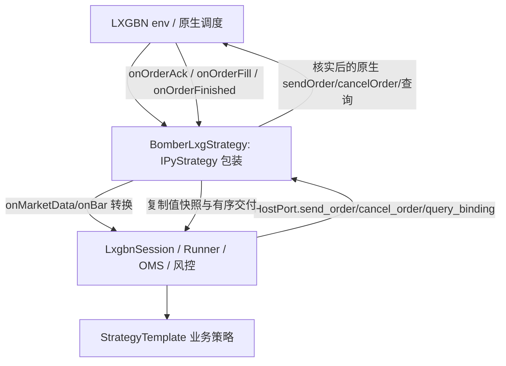

# LXGBN 导出库、策略例子与 Bomber SDK 的集成分析

日期：2026-10-29。输入：`3rd/lxgbn/stgWrapper.cpp`、`IndexFutStg/StrategyIndexFut.py`、`lib/iPyStrategy.pyx` 和随附 Windows 二进制。对照：[当前 SDK 接入指南](LXGBN_SDK_INTEGRATION_GUIDE_2026-10-21.md)、[原生接口历史说明](DXBM_LXG_INTEGRATION_SPEC.md)、`bomber.framework.lxgbn` 的现有实现。

本次只做静态分析和检查工具准备；没有运行厂商策略、加载配置、连接数据库、启动 LXGBN 或报撤单。Windows `.pyd` 无法在当前 macOS 环境直接验收；二进制证据见 [静态检查记录](../evidence/live/M02_LXGBN_VENDOR_STATIC_20261029.json)。

同日后续：用户授权先完成不依赖原生签名的工作后，已实现 [stg_wrapper_adapter.py](../../scripts/integration/lxgbn/stg_wrapper_adapter.py) 的命令关联、函数注入、字段转换、回调桥和 Bar 值复制，以及真实 SDK 配合原生形状替身的回归。[组件使用说明](../../scripts/integration/lxgbn/STG_WRAPPER_ADAPTER.md) 列出装配方法及未确认事实。

**重编译后更新：主 pyd 已替换为新哈希 `089dae4773e4034cbb9c8714c0b8eb2406b084030d9935fbb584df0bc9ede7d0`。** 六个报撤单/回调 Python 名称和 EnumNTDirectOrder 均已出现，回调 C++ 符号新增整数参数，发送符号也新增整数参数。此前“缺少这些名称/旧回调”的发现针对旧哈希，不再直接套用于新文件。静态对照见 [新库检查记录](../evidence/live/M02_LXGBN_VENDOR_REBUILT_20261029.json)；实际 Python 签名、字段、返回语义和线程仍需 Windows 检查，枚举尾空格尚在。

## 1. 结论

**集成位置已经明确：用一个继承 `stgWrapper.IPyStrategy` 的薄包装，持有现有 Bomber SDK 会话。策略算法继续使用 StrategyTemplate，原生报撤单回到包装层。** 不需要 HTTP 服务、另一个策略引擎或新的通用插件体系。

但当前交付还不能证明能直接接上现有 M02。主要有四个缺口：

1. **旧库导出不一致的主要静态症状已在重编译后修正。** 新主 pyd 已找到 sendOrder/cancelOrder/getOrder、三个回调和 EnumNTDirectOrder；回调符号与 2/3/2 形态一致，但仍须在 Windows 导入后读取真实成员、签名及返回语义，不据此判定全部 ABI 已验收。
2. **例子的 sendOrder 调用不能表达当前 SDK 完整命令。** 样例只有合约、方向、数量、时间、OrderType、整数 ID；没有显式限价、开平、Normal、投机参数。缺失 IPyStrategyWrap.h，无法判断是否有可用重载及 EnumNTDirectOrder 的真实语义。
3. **Order/Trade 字段完整性仍未确认。** 提供的 cpp 中尤其缺成交时间、成交合约/账户/投机属性、订单属性/拒绝原因，以及原生绑定身份和命名空间验证。新 pyd 出现 attribute 等名称，但不能用模块级字符串证明某个类已暴露该字段，须读取实际 Order/Trade 属性。
4. **未见一致的策略归属/活动单/交付边界查询，也未见 owner 定时调度入口。** getOrder 单单查询、启动成功和本地回调计数不能替代这些能力。

因此建议先做导出面确认，再做单合约只读接入；先不要改弱 Bomber 的快照/身份要求去迁就样例。此判断不推翻此前 Bomber wheel 在干净 Windows 3.12 环境的导入及数值验证；本次新增的是另一侧的原生接线问题。

## 2. 这批文件分别说明什么

| 材料 | 已确认事实 | 使用方式 |
| --- | --- | --- |
| [stgWrapper.cpp](../../3rd/lxgbn/stgWrapper.cpp) | Boost.Python 模块 stgWrapper，导出 IPyStrategy、Order、Trade、行情和产品类型 | 原生 Python 接口参考；不包含实际方法定义及线程实现 |
| [StrategyIndexFut.py](../../3rd/lxgbn/IndexFutStg/StrategyIndexFut.py) | 直接继承 rp.IPyStrategy；initialize(name, env) 后订阅；三个订单回调定义为 2/3/2 参数，但函数体为空 | 确认包装形态，不把空回调当成交易闭环 |
| [iPyStrategy.pyx](../../3rd/lxgbn/IndexFutStg/lib/iPyStrategy.pyx) | 继承同一原生基类，额外读取 YAML 并连接 DolphinDB | 不是 Bomber 接入的必需基类，不为一次对接增加 DDB 连接 |
| stgWrapper.pyd | PE x64，导入 python312.dll，有 PyInit_stgWrapper | 平台方向吻合；真实 Python 导出和加载仍待 Windows 确认 |
| iPyStrategy.cp312-win_amd64.pyd | PE x64，导入 python312.dll，有 PyInit_iPyStrategy | 仅证明包装扩展目标版本，不能补足 stgWrapper 的缺失方法 |
| stgWrapper.pyd.bk | 依赖 python36.dll、debug MSVC/UCRT 及 debug qpid DLL | 属于旧依赖组合，不替换当前 3.12 主库 |
| CTABarTestDll.dll | 依赖 python36.dll、stgWrapper64Bit.dll 和 debug 运行库 | 不应混入本次 3.12 接入链 |

主 stgWrapper.pyd 的直接依赖还包括 VCRUNTIME140_1.dll、qpid、MySQL、ZeroMQ、OpenBLAS 等。包中未见 VCRUNTIME140_1.dll 不等于目标系统缺失，它可能由已安装的运行库提供；须在干净 Windows 进程核实。包中同时有 python312.dll 与 python36.dll，不能把整目录 DLL 覆盖到宿主或 Python 目录。按已确认的 CPython 3.12 x64 依赖集合部署，保持宿主既有解释器。

样例主程序自行调用 `rp.Start(conf)` 获得原生运行环境，然后 initialize 策略；这说明样例的进程入口是 Python 脚本。用户此前确认的 LXGBN 内嵌 Python 调用方向继续适用：实际宿主已提供 env 时复用它，**不要在内嵌入口再次调用 Start 创建另一份交易环境**。两种启动形态都可以采用同进程包装层，须由 LXGBN 确认现场采用哪一种生命周期。

## 3. 旧库与重编译新库对照

以下保留的是重编译前旧主文件 `IndexFutStg/lib/stgWrapper.pyd` 的静态证据：

```text
SHA256: 21d0121eda22439d1fdd31e330b3e83531ac77e5c2100daf7bb7540bd0f8d5c4
PE machine: 0x8664 (AMD64)
Python import: python312.dll
Module export: PyInit_stgWrapper
```

cpp 第 293—298 行声明 Python 导出 onOrderAck/onOrderFill/onOrderFinished/sendOrder/cancelOrder/getOrder；第 86 行有 EnumNTDirectOrder。但旧主 pyd 未找到这些名称的以 NUL 结尾的 Python 字符串。旧库包含同名 **C++ 修饰符号**，不能因此推断 Python 上可调用：

```text
?onOrderAck@IPyStrategy@@UEAAXV?$shared_ptr@UOrderMsg_t@common@bomber@@@std@@@Z
?onOrderFill@IPyStrategy@@UEAAXV?$shared_ptr@UOrderMsg_t@common@bomber@@@std@@V?$shared_ptr@UExecutionMsg_t@common@bomber@@@3@@Z
?sendOrder@IPyStrategy@@QEAAHV?$basic_string@DU?$char_traits@D@std@@V?$allocator@D@2@@std@@W4OrderMsg_dir_t@api@bomber@@_J_KW4EnumAlgoOrderType@56@@Z
```

按 MSVC 符号形态推断，前两项是旧式只传对象的回调，sendOrder 似乎是返回 int 的五参数版本；这与样例的 2/3/2 回调及六参数报单不一致。**这是静态推断，不替代对实际 Python 类型/Boost.Python 签名的检查，也不能据此编造新调用。**

新库大小为 3,319,296 字节（旧库 3,268,096），仍为 AMD64、导入 python312.dll，含 PyInit_stgWrapper。新库六个 Python 名称均已找到，相关符号如下：

```text
?onOrderAck@IPyStrategy@@UEAAXHV?$shared_ptr@UOrderMsg_t@common@bomber@@@std@@@Z
?onOrderFill@IPyStrategy@@UEAAXHV?$shared_ptr@UOrderMsg_t@common@bomber@@@std@@V?$shared_ptr@UExecutionMsg_t@common@bomber@@@3@@Z
?onOrderFinished@IPyStrategy@@UEAAXHV?$shared_ptr@UOrderMsg_t@common@bomber@@@std@@@Z
?sendOrder@IPyStrategy@@QEAAHV?$basic_string@DU?$char_traits@D@std@@V?$allocator@D@2@@std@@W4OrderMsg_dir_t@api@bomber@@_J_KW4EnumAlgoOrderType@56@H@Z
```

新增的 H 参数与整数 clientOrderId 的预期形态吻合；sendOrder 符号形态与样例六参数相符。仍未看到独立价格/开平参数对应的新增形态，不能据此把完整 OrderCommand 直接绑定进去。原生返回 int 的意义、同步回调及参数单位须继续核实。

另一个源码问题：cpp 导出名写成 `"OrderMsg_attr_t "` 和 `"status_t "`，末尾含空格。若按此源码编译，常规 `rp.status_t` / `rp.OrderMsg_attr_t` 访问可能不匹配。应在原生源码去掉尾部空格并发布匹配产物，而非长期在业务代码散布 getattr(...带空格...) 兼容分支。原生枚举值仍从实际导出读取，不凭名称猜整数。

### Windows 确认操作

已准备 [wrapper_surface_probe.py](../../scripts/integration/lxgbn/wrapper_surface_probe.py)。它只导入指定目录 stgWrapper 并读取方法 docstring、类字段、枚举和文件哈希，不调用 Start、initialize、构造策略或交易方法，也不读取厂商配置。原生库导入自身是否做初始化由原生实现决定，所以先在独立测试进程运行。

将脚本复制到 Windows 的 `D:\bomber\scripts\integration\lxgbn`，下面 lib-dir 按厂商包实际部署位置替换（此路径是建议位置）：

```cmd
"C:\Users\86151\.conda\envs\py312\python.exe" -I "D:\bomber\scripts\integration\lxgbn\wrapper_surface_probe.py" --lib-dir "D:\lxgbn\IndexFutStg\lib" --output "D:\lxgbn-test\wrapper-surface.json"
```

输出 PRESENT 只说明六个必需名称存在；还需检查 doc 中参数和返回值。MISSING/BLOCKED 或 DLL 导入失败时保存 JSON 的具体 error。未找到可靠文档时请 LXGBN 提供同版 `IPyStrategyWrap.h`、`IPyStrategy` 声明/实现、回调转发以及对应构建标识。不要为探查签名实际调用 sendOrder/cancelOrder，也不要运行原样策略例子，因为该例子会创建交易环境和数据库连接。

## 4. 最小集成结构

建议原生入口为一个 `BomberLxgStrategy(rp.IPyStrategy)`，内部组合一个标准策略和一个 `LxgbnSession`，只增加必要字段转换与端口映射。



已新增可选接线模块 `scripts/integration/lxgbn/stg_wrapper_adapter.py` 和真实库形状的离线测试 `tests/test_lxgbn_wrapper_adapter.py`；实现限于已知字段与显式依赖注入，尚未实现具体 rp.IPyStrategy 子类的现场初始化/其他 pure_virtual 回调，也不猜测原生报撤单重载。框架业务策略、公共 OMS、归属和 Planner 不另起一套实现。若将来要随 wheel 分发，再将稳定适配模块放进 framework；普通 SDK 导入不强制 import Windows stgWrapper。

包装层职责：

- 持有 SDK 对象和原生 env；不对同一个对象做 IPyStrategy/StrategyTemplate 多继承。
- 用宿主真实绑定创建 Binding，维护 SDK 整数 ID、request_id 和原生单号的映射；同一绑定只运行一份会话。
- onMarketData/onBar 复制并转换成标准行情，送入会话 owner 调度；其他 pure_virtual 回调根据真实声明提供 override，未订阅类型可以不处理，但不能猜其参数。
- SDK 发出 OrderCommand 后调用核实的原生普通单 API，并准确转换发送结果；在原生发送前建立关联，不能等返回后才登记。
- 三个订单回调按 2/3/2 参数转发 SDK；策略通知仍由 SDK 产生 on_order/on_fill，不能双重更新仓位。
- 结合真实查询与回报交付提供一致 BindingSnapshot，接管轮询/停止顺序。

不采用样例的 sendTargetPos/sendTargetVol 作为现有 M02 的便捷替代：Bomber 已完成目标差额、价格、风险和订单冻结分配，再调用另一层目标引擎可能产生二次拆单、不可追踪父子单和重复归属。如果改走目标 API，需要重新定义执行责任和恢复，是另一项设计，而不是薄适配。

## 5. 逐项接口匹配与最小补充

### 5.1 sendOrder / cancelOrder / getOrder

样例第 103 行：

```python
self.sendOrder('IM2701', Buy, vol, time, orderType, clientOrderId)
```

不能直接改成 `self.sendOrder(...)` 就视为实现 HostPort：

| Bomber 要求 | 当前材料 | 结论/需确认 |
| --- | --- | --- |
| SDK 发送前分配 client_order_id | 样例第六参数是 ID；新二进制已增加整数参数，旧库是五参数形态 | 静态匹配改善；仍要完整声明和请求 ID 原样回传语义，不能用“通常异步”规避同步回调竞态 |
| price=已规划 Decimal 限价 | 样例没有 price 参数 | 确认重载或补一个明确接收 price 的普通单入口；不能用内部追价代替固定限价 |
| OPEN/CLOSE、Normal、Speculation | 导出对应部分枚举，但样例未传，属性枚举名还有尾空格 | 要落实到真实发送参数/语义；导出枚举不等于发送支持 |
| 单请求与原生单一一关联 | EnumNTDirectOrder 已在重编译新库出现 | 确认其真实实现是否会再拆单/算法执行；本期不接算法父子单 |
| queued / 确定未发送 rejected / unknown | 无返回语义文档，例子忽略返回 | int 是订单 ID、请求受理码还是错误码不能猜；超时或入队后错误归 unknown，保留在途 |
| cancel_order(int SDK ID) | cpp 导出 cancelOrder，二进制 C++ 符号有 int→bool 形态 | 核对其 int 是哪种 ID、False 的含义和同步回调；结果不能伪造撤单终态 |
| 查询绑定全量事实 | getOrder 只见逐单方法 | 单独 getOrder 不能证明没有其他活动单、策略已恢复或查询已完整 |

建议 LXGBN 优先给出一个明确、有限的普通单契约，等价接收已分配的请求 ID、合约、买卖、固定手数、限价、开平、Normal 和投机。这是需要落实的语义清单，**不是声称当前已经有某个特定函数签名**。无需为了 M02 开放全账户资金或完整交易管理 API。

### 5.2 回报字段

cpp 第 236—263 行给出了真实 Python 名称，与历史结构体大写字段不能直接混用：

| SDK 值字段 | 当前 Order/Trade 导出 | 处理结论 |
| --- | --- | --- |
| native_order_id | `Order.Id` / `Trade.orderId` | 可建立稳定字符串关联；确认唯一范围和生命周期 |
| trade_id | `Trade.tradeId` | 可作原始逐笔键；需核实重复重放保持同 ID |
| 合约 | `Order.GetInst()`；Trade 未见合约 | 订单可映射；成交至少经真实 OrderID 关联验证，最好补暴露原始合约以独立核验 |
| side | 两者 direction | 用 rp.OrderMsg_dir_t.Buy/Sell 显式映射，不硬编码未知整数 |
| 固定委托量 | volumePlanned / volumeSubmitted | 确认哪一个表示实际单固定总量；不能取未提交计划量或随状态变化的值 |
| 累计/单笔量 | Order.volumeTraded / Trade.volume | 分别映射 cumulative_filled 和 quantity，核实手数单位 |
| 成交价格 | Trade.price | 可映射 Decimal，核实单位和精度 |
| 开平 | 两者 offset | Open→OPEN、Close→CLOSE、CloseToday→CLOSE_TODAY、CloseYd→CLOSE_YESTERDAY；不要把 CloseYd 当成原生整数定义 |
| status | Order.status | 六个状态名称与 SDK 对应；枚举类名尾空格需修正 |
| hedge_flag | Order.hedgeFlag；Trade 未见 | 订单有来源，成交缺独立来源；可补暴露或明确订单关联保证，不能无条件填 Speculation |
| attribute | Order 未见 | 补暴露真实属性，或用可信固定普通单路径+已保存命令且能证明无转换的关联；不能只因配置写 Normal 就通过回报校验 |
| binding 身份 | Order.strategyId/portfolioId；Trade.strategyId | 未见 accountId、交易日/原生命名空间，Trade 无 portfolioId；需要原生绑定上下文/关联注册表的真实保证，不能给任何回报套同一个 Binding |
| ts_event | Order 有三个 timestamp；Trade 未见时间 | 成交事件时间缺口最直接，优先补 Trade.Timestamp 的 Python 暴露并确认单位；不能用回调接收时间冒充成交时间，重复成交的时间事实应稳定 |
| reason / rejection_of | Order 未见 errorMsg、拒绝类型 | 补拒绝原因和报单/撤单拒绝区分，不能靠 status=Rejected 一律终结原订单 |
| 算法标记 | 未见 isAlgoOrder 等 | 确认普通单不走算法/父子单路径；必要时补暴露标记用于拒绝越界 |

“补字段”不必意味着每个值都新增到每个结构：账户/绑定可以来自已验证的原生绑定句柄，成交身份可以由可信 OrderID 关联校验；但前提要明确且可测试。首期优先少量只读字段暴露和单一原生绑定查询，不虚构内容、不删掉 SDK 校验。

### 5.3 两个通知的具体接法

在实际回调签名确认后，薄包装实现以下形态（示意，未替代真实 Boost override）：

```python
class OrderCallbacks:
    def onOrderAck(self, clientOrderId, orderMsg):
        return self.session.onOrderAck(clientOrderId, orderMsg)

    def onOrderFill(self, clientOrderId, orderMsg, execMsg):
        return self.session.onOrderFill(clientOrderId, orderMsg, execMsg)

    def onOrderFinished(self, clientOrderId, orderMsg):
        return self.session.onOrderFinished(clientOrderId, orderMsg)
```

复制函数读取上述实际小写字段，验证身份后返回 OrderSnapshot/FillSnapshot；一次 Fill 的两份快照共用一个 delivery_sequence。SDK 返回 False 时宿主记错、保留事实并停止新增执行；回调 True 只表示入队，随后 poll 才生成策略 `on_order(OrderUpdateEvent)` 和 `on_fill(FillEvent)`。

原生 cpp 的 `args("i")` 不是 C++ 函数声明，不能仅凭它推断运行时到底有几个参数。必须核对 IPyStrategyWrap 的 override 是否把全部 clientOrderId/order/exec 转发，并确认 GIL、异常截获和原生对象存活期。

### 5.4 查询/快照缺口

现有 SDK 的 start、authorize、finish_stop 都检查 BindingSnapshot，包含：策略归属净仓、当前活动 SDK ID、初始化/完整性、执行可用、普通单能力、版本、交付水位。当前导出没有对应的组合查询，也未见已暴露的策略持仓方法。

原生二进制内部出现数据库/仓位符号不等于 Python 提供了可靠查询。不能让适配器自己从回调累加一个“宿主仓位”，再用它验证同一批回调产生的 SDK 账本；那无法发现启动前历史委托或漏回报。

建议 LXGBN 从已有策略状态提供一个只读绑定快照（实际名称由原生方确定），附版本和已交付水位。交付序号可由接线层维护，但需要与原生一致快照和有序回调交付一起设计；不是给每个回调加一就证明完整。首次测试可选择真实新建、无历史、无归属、无活动单的绑定，须由宿主确认事实，而非硬编码零值。非零持仓及活动/未知订单接管继续受现有恢复边界限制。

### 5.5 调度/GIL/停机

样例只展示 onMarketData/onBar，没有普通定时回调、断线通知、停止通知及所属线程说明。只在行情到达时 poll，会导致无行情期间撤单/成交滞留，也无法可靠完成两阶段退出。

优先使用 LXGBN 已有的同线程 dispatcher/timer 驱动 start/authorize/on_market/poll/begin_stop/finish_stop；如果已有合法事件循环，就复用它。原生线程可调用三个 onOrder* 进行值复制入队；行情线程若不是 owner，需在宿主边界复制后投递给 owner。不要仅为方便启动一个 Python 线程调用全部方法，原生 sendOrder/cancelOrder 的线程约束尚未确认。

还需确认外层等待/事件循环是否释放 GIL：原生回调等待 GIL，而 owner 持有 GIL 阻塞等待原生请求，会形成死锁。源码 stgWrapper.cpp 只列导出，无法证明 IPyStrategyWrap 已正确处理。finish_stop 成功后解除回调再释放对象，不直接用 rp.exit 代替回报收尾。

## 6. 行情、产品及样例自身需要修正的地方

| 问题 | 证据及处理 |
| --- | --- |
| 合约编码 | 样例用 IM2701，Bomber 用 IM2701.CFFEX；用已确认主数据映射实际合约/交易所，不猜交易所或把主连字符串当实盘合约 |
| Bar 时间字段 | cpp 导出 timeStamp，样例 onBar 使用 timestamp；需要修正大小写 |
| 未限定枚举 | 样例 import stgWrapper as rp，却在 onBar 裸用 Buy/EnumNTDirectOrder；应使用真实导出的限定成员，且先确认该库确有 EnumNTDirectOrder |
| 时间单位 | MarketData.exchangeTSMicro 名称及样例除 1000000 提示可能为微秒；只是线索，不能统一乘 1000 前不确认时区/epoch。Bar 和订单/成交也要分别确认 |
| Tick 成交量 | MarketData.volume 是否日累计未知；不能直接当 TradeTick 的逐笔 size，也不能凭 lastPrice 每次生成一笔真实成交 |
| 首期行情选择 | 可先用真实 Bar（make_bar，显式 BarType/周期及历史标记处理）或一级 QuoteTick；bidPrice/bidVolume/askPrice/askVolume 是否数组需在类型/实际值确认后取对应档位，不假定标量 |
| 价格元数据 | Product.tickSize/qtyTick/minOrdQty、Instrument.multiplier 可复用；区分最小跳价和显示精度；固定绑定订阅不能悄悄自动换月 |
| 样例业务交易路径 | onMarketData 每隔一段时间读取 CSV 并 sendTargetVol，会与 Bomber 目标执行并行；接入用新包装类，不保留这条原样发送路径 |
| 空回调 | onOrderAck/Fill/Finished 直接 return，只是接口演示，必须真正转发 SDK |
| 批量回调 | onBatchBar 定义在类外，不能据此认为覆盖了 pure_virtual；其他 onIVData/onGreeksData/onBatchBars 同样需核对是否可能触发 |
| 数据库依赖 | IndexFutStrategy.__init__ 会读取配置并查询数据库，iPYStrategy 会连接 DDB；最小接入测试不继承这些有外部副作用的业务基类，只直接继承 rp.IPyStrategy |
| Windows 加载路径 | 样例使用相对 ./lib，依赖工作目录；接入改用确定绝对路径和宿主 DLL 部署规则，不用 sys.path 来代替 DLL 搜索配置 |
| 多合约样例 | 主入口订阅 IM2606/ag2606，onBar 却硬编码 IM2701；现有 M02 仅单合约，首期先统一为一个实际测试合约 |

## 7. 建议实施顺序及改动归属

| 顺序 | 谁改/做什么 | 通过条件 |
| --- | --- | --- |
| 1 真实导出确认 | Windows 运行 wrapper_surface_probe，LXGBN 提供同版声明和发布库 | 六个方法真实存在，2/3/2 回调和 preallocated ID 可用；明确全部参数/返回语义 |
| 2 原生最小补齐 | LXGBN 修正枚举尾空格，补普通限价参数/缺失快照事实、绑定只读查询和合法 dispatcher | 保留现有 SDK 契约即可完成标准报撤单/查询，不需虚构字段 |
| 3 薄包装和离线回归 | 已实现可选 adapter 组件、真实字段名映射、Bar 值复制和 ID 表；原生函数及事实来源待注入 | 与厂商对象导出形状相同的替身回归已通过，缺失字段/错误类型显式失败；不代表真实 pyd 已验收 |
| 4 只读实机 | 安装已通过的 Bomber wheel，在实际宿主运行探针，再启动真实空绑定但不授权/不输出目标 | 实际导入路径正确，行情可进策略、查询水位一致，报撤单次数为零 |
| 5 一手测试闭环 | 测试账户显式授权，Normal/投机，完整转发回报 | ID 对应、实际量价开平和归属正确；先 on_order 后 on_fill；撤单真实收尾 |
| 6 故障与恢复 | 重复成交、未知返回、断线、游标缺口、部分成交撤单及无活动单恢复 | 不重发未知单，不重复归属，不提前退出；保存原生事实和检查点 |

没有改公共执行核心，也没有修改厂商 C++/pyd。adapter 中不依赖签名的部分已完成；真实接口确认后再填写具体原生调用。若字段只是在 Boost.Python 暴露层缺失，可由 LXGBN 重新构建 stgWrapper，无须因此重编 Bomber wheel。若以后修改 Bomber 包内适配模块，才按原有完整 wheel 流程发布。

## 8. 下一步最需要的结果

先拿到 `wrapper-surface.json` 和与该哈希一致的 `IPyStrategyWrap.h` / 原生报撤单与回调实现。还需要明确一次性列出：

1. sendOrder 是否支持 SDK 预分配整数 ID、固定限价、开平、Normal/投机，何时可能同步回调，以及返回/超时语义。
2. cancelOrder/getOrder 参数是 SDK ID 还是原生 ID；query_binding 可从哪项原生能力取得策略范围事实及边界。
3. 真实 Order/Trade 全部字段和枚举映射，成交时间/属性/账户身份如何可靠取得，固定委托量使用哪个字段。
4. initialize 后回调可能何时开始、是否会交付历史事件；owner 定时调度、断线通知和 GIL/退出如何工作。

先解决这些具体缺口即可推进，不扩大到全账户风控重写、算法交易、多策略合并或 BN。此前 D5/GAP10 的整体状态仍以实际链路和验收证据为准。
