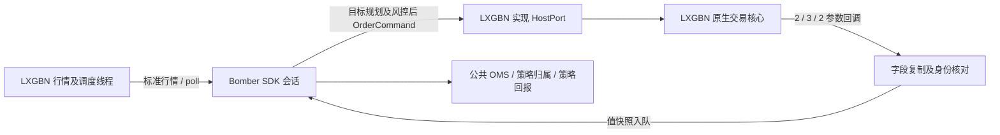

# LXGBN Windows 内嵌 Python 接入 Bomber SDK

日期：2026-10-21。读者：LXGBN（DXBM-LXG）交易程序、Python 绑定和联调开发者。

本文按已经实现的 SDK 编写。Bomber 是被调用方，LXGBN 是 Windows 宿主：**LXGBN 在自己的内嵌 Python 中加载 Bomber、推送行情和回报，并接收 SDK 发出的报撤单请求。** SDK 不创建独立交易进程，不登录或关闭 LXGBN，不加载另一份厂商 SDK。

历史原生结构、接口讨论见 [DXBM_LXG_INTEGRATION_SPEC.md](DXBM_LXG_INTEGRATION_SPEC.md)。该文件中的 Market/FAK/FOK、算法单等讨论不能作为本期已实现能力。本文接口与源码不一致时，以本期交付源码为准，不自行猜测原生接口或字段。

## 1. 本期交付和已验证范围

| 项目 | 内容 |
| --- | --- |
| SDK 安装包 | `bomber-1.230.0-cp312-cp312-win_amd64.whl`，当前构建为标准精度 |
| Python 入口 | `bomber.framework.lxgbn` |
| 已验证环境 | 独立 Windows / CPython 3.12.15 / AMD64 / 64 位 / 非 debug |
| 已完成 | 新建 venv 仅安装 wheel，所有导入检查及 TradeTick、QuoteTick、批量 Tick、CustomBar 数值检查通过；模块均来自 venv 的 site-packages |
| 宿主侧待验 | 实际内嵌环境、原生字段映射、GIL/线程、绑定快照及真实报撤单回报 |
| 首期执行范围 | 测试环境；一个策略、一份绑定、一个合约；整数手数；Normal 普通限价；投机；OPEN/CLOSE |

CTP 继续复用已有链路，BN 不纳入本轮。单绑定测试通过不代表多账户、多执行端的 GAP10 或整项 D5 已验收。

随 wheel 一并交给接入方的外部文件：

| 文件 | 用途 |
| --- | --- |
| [environment_probe.py](../../scripts/integration/lxgbn/environment_probe.py) | 导入和解释器信息；只用标准库 |
| [native_value_probe.py](../../scripts/integration/lxgbn/native_value_probe.py) | 真实原生行情模型量价、精度和纳秒时间戳检查；与 environment_probe.py 放同目录 |
| [sdk_acceptance_example.py](../../scripts/integration/lxgbn/sdk_acceptance_example.py) | 八个无柜台示例；内存宿主 + 真实 SDK；直接使用已安装 wheel |
| [embedded_example.py](../../scripts/integration/lxgbn/embedded_example.py) | 宿主装配入口参考 |

wheel 已包含两个 market Cython 扩展，LXGBN 安装端不再执行 setup.py，也不需要为安装 Bomber wheel 准备 Rust/Cython 编译工具。运行时依赖仍须安装完整。

## 2. 双方工作分工



LXGBN 开发者需要完成以下接入代码，而非重写策略或 SDK 订单状态机：

1. 将 wheel 及运行依赖部署到实际内嵌解释器的包搜索目录。
2. 实现三个宿主方法：`send_order`、`cancel_order`、`query_binding`。
3. 实现原生订单/成交的字段复制函数，并转发三个回调。
4. 由同一个宿主线程驱动会话生命周期、标准行情和 `poll()`。
5. 提供一致的策略归属/活动单快照与交付水位，并保存原生事实供故障核对。

原生报单函数的名字、参数和返回码尚未在仓库中提供。以下 HostPort 是 **Bomber 已实现的调用契约**，不表示 LXGBN 原生核心已经存在同名函数；接入方负责绑定到现有实现。

## 3. 安装与内嵌环境检查

在与宿主内嵌解释器相对应的安装环境安装本期 wheel。不能因为独立 Conda 的 Python 可用，就假定 LXGBN 使用该 Conda 的 site-packages。若宿主没有独立 python.exe，按宿主已有的包部署机制准备同等内容，并用下面的内嵌代码验收。

本次验证包位于：

```text
D:\lxgbn-test\release-20261021\wheel\bomber-1.230.0-cp312-cp312-win_amd64.whl
```

不要在已加载原生模块的运行中替换文件；安装后正常重启测试宿主。在 **LXGBN 的内嵌脚本入口**运行：

```python
import runpy

scripts = r'D:\bomber\scripts\integration\lxgbn'
env = runpy.run_path(scripts + r'\environment_probe.py')
report = env['collect_report']()  # 验收安装包，不注入源码目录
env['write_report'](report, r'D:\lxgbn-test\embedded-environment.json')
print('embedded imports:', report['windows_imports_ready'])

values = runpy.run_path(scripts + r'\native_value_probe.py')
report = values['collect_report']()
env['write_report'](report, r'D:\lxgbn-test\embedded-native-values.json')
print('embedded values:', report['native_values_ready'])
```

要求两项为 True，并核对报告中的解释器、位数和全部模块路径都属于预期部署。两个探针均不创建交易会话或发送订单。版本号相同不能替代 DLL、原生对象及宿主线程验证。

## 4. 绑定身份与三个宿主方法

### 4.1 Binding

```python
from bomber.framework.lxgbn import Binding

binding = Binding(
    account_id='实际测试账户标识',
    binding_id='实际单策略执行绑定标识',
    strategy_id='probe-strategy',
    trading_day='实际交易日',
    source_session='实际原生订单和成交ID命名空间',
    instrument_id='实际测试合约.交易所',
    environment='test',
)
```

这些示意字符串需要替换成真实值。`strategy_id` 必须等于策略实例的 `strategy_id`；同一会话的行情订阅只能使用绑定合约。`source_session` 用来区分真实原生 ID 的命名空间，不能每次启动随机生成，也不能为了让旧检查点通过而任意修改。

同一绑定只允许一个活动 SDK 会话，状态文件单独配置并由宿主保证独占。现有 SDK 不提供跨进程抢占/锁服务。

### 4.2 HostPort 的函数签名

```python
from bomber.framework.lxgbn import OrderCommand, SubmitResult, BindingSnapshot

class LxgHostPort:
    def send_order(self, command: OrderCommand) -> SubmitResult:
        # 接入 LXGBN 实际报单接口；关联必须在调用原生发送前建立。
        raise NotImplementedError('由 LXGBN 实现原生报单映射')

    def cancel_order(self, client_order_id: int) -> None:
        # 从已登记关联定位原生单；不能查询整个账户然后猜测撤单对象。
        raise NotImplementedError('由 LXGBN 实现按 SDK ID 撤单')

    def query_binding(self) -> BindingSnapshot:
        raise NotImplementedError('由 LXGBN 提供一致的绑定范围查询')
```

这是待实现的骨架，不能直接用于交易。SDK 会在发送前登记订单并写入检查点；宿主也须在原生发送前建立其关联，以支持发送函数返回前同步到来的回调。

### 4.3 报单命令与返回值

| OrderCommand 字段 | LXGBN 接入要求 |
| --- | --- |
| `client_order_id: int` | SDK 预分配的正整数；三个回调原样返回；不是原生订单 ID |
| `request_id: str` | SDK 完整请求关联键，形如 LXG-会话标识-整数；宿主保存，与 binding 一起记录 |
| `binding` | 校验账户、策略、执行绑定、合约及原生命名空间 |
| `side` | `BUY` / `SELL`，显式映射原生 Direction 枚举 |
| `quantity: Decimal` | 固定实际委托手数，首期正整数；不能误用 VolumeTraded 或剩余量 |
| `price: Decimal` | 普通限价价格，按合约跳价和单位校验 |
| `position_effect` | `OPEN` / `CLOSE`；宿主承担通用 CLOSE 到真实平今/平昨等通道语义的转换 |
| `attribute` | 固定为 `1`，原生 Normal；本期没有额外 TIF 参数 |
| `hedge_flag` | 固定 `Speculation`；不要猜测其原生整数值 |

SDK 当前规划价格：参考价加一跳买入，参考价减一跳卖出，再按跳价向相应方向对齐。例：参考价 3500、跳价 1，则买限价 3501、卖限价 3499；不代表可以跳过宿主的价格、交易时段和交易所最终校验。

`send_order` 返回以下之一：

| 返回 | 精确语义 | SDK 行为 |
| --- | --- | --- |
| `SubmitResult('queued')` | 宿主已接收，后续以真实回报为准 | 保持在途，不视为成交或受理确认 |
| `SubmitResult('rejected', reason)` | **确定未发送到交易路径**，例如发送前本地校验失败 | 形成拒单事实；订单释放在途，本期拒单会关闭授权 |
| `SubmitResult('unknown', reason)`、异常或其他返回 | 是否已发送无法确认，包括入队后超时 | 关闭闸门，保留 PENDING/关联/在途，禁止自动重发 |

不能把超时、原生接口返回不明或回报尚未到达写成 rejected；不能在发送后再分配 client_order_id。取消返回 None 只说明方法返回，必须等待 Cancelled 或实际其他终态。

### 4.4 query_binding 快照

返回 `BindingSnapshot`，包含：

| 字段 | 要求 |
| --- | --- |
| `binding` | 与会话完全相等 |
| `revision` | 非空、能定位真实查询版本/时点的标识 |
| `boundary` | 此一致快照对应、已经交付 SDK 的最后一个回调序号 |
| `owned_quantity` | 当前策略绑定合约的已归属净仓，Decimal 整数，正多负空；不是账户全量净仓 |
| `active_order_ids` | 该绑定活动单的 SDK 整数 ID 元组；非空即阻止首期空闲启动/授权/退出 |
| `initialized`、`complete` | 初始化和查询完整性已确认 |
| `ready` | 真实执行可用状态已确认，不能仅用登录成功代替 |
| `normal_limit`、`generic_close`、`acked_is_accepted` | 对实际绑定已核实支持普通限价、通用平仓和 Acked 受理语义 |

上述六个布尔字段默认 False，**当前实现连 start() 都要求全部为 True**。只读启动指尚未授权发送，不表示忽略查询完整性或虚报能力。能力或事实尚未确定时先完成环境与接口联调，不把 True 当作占位符。

全新检查点只适合策略归属为 0、没有活动单且尚无交付事件的全新测试绑定，初始 boundary=0。非零归属不能通过新建会话直接灌入账本；有历史绑定按第 8 节恢复限制处理。

## 5. 三个回调、字段复制及交付序号

### 5.1 原生回调转发签名

```python
def onOrderAck(self, clientOrderId, orderMsg):
    return self.session.onOrderAck(clientOrderId, orderMsg)

def onOrderFill(self, clientOrderId, orderMsg, execMsg):
    return self.session.onOrderFill(clientOrderId, orderMsg, execMsg)

def onOrderFinished(self, clientOrderId, orderMsg):
    return self.session.onOrderFinished(clientOrderId, orderMsg)
```

参数数量为 **2 / 3 / 2**。`clientOrderId` 是发送时的同一个 Python int，不使用 bool、字符串或原生订单号替代。Fill 必须带真实 execMsg；Finished 不合成成交。

会话通过 `CallbackCopies(order=copy_order, fill=copy_fill)` 调用 LXGBN 提供的复制函数。复制期间原生对象必须仍然有效且内容一致；复制结果只含独立的值，不保留裸指针、借用字符串或随后会被原生线程修改的对象。

### 5.2 订单与成交复制结果

`copy_order(raw)` 返回 `OrderSnapshot`；`copy_fill(raw)` 返回 `FillSnapshot`。完整字段定义见 [lxgbn.py](../../bomber/framework/lxgbn.py)。

| 值快照字段 | 原生来源/处理要求 |
| --- | --- |
| 两者 `binding` | 核对原始 AccountId、StrategyId、InstrumentID 及实际绑定上下文后返回；不能不检查原始身份就填配置 |
| `native_order_id` | 订单 ID；成交的 OrderID 必须指向同一原生订单；转换成非空稳定字符串，不与成交 ID 混用 |
| `side` | 显式枚举映射为 BUY/SELL，订单和成交一致 |
| 订单 `quantity` | 固定实际委托量；VolumePlanned/VolumeSubmitted 的最终口径由 LXGBN 确认，不能随剩余量变化 |
| 订单 `cumulative_filled` | 截至该订单事实的累计成交手数，不能取单笔成交量 |
| 订单 `status` | 下表六个状态之一，保留拼写 `Submited` |
| 订单 `attribute`、`hedge_flag` | 1 / Speculation，按真实原生字段校验 |
| 订单 `reason`、`rejection_of` | Rejected 必须标明 `order` 或 `cancel`；无法判断保持 unknown 并停止联调 |
| 成交 `trade_id` | ExecutionMsg.ID 等稳定逐笔成交键，按实际唯一范围确认；不同成交不能因量价时间相同而复用 |
| 成交 `quantity`、`price` | ExecutionMsg.Volume / Price 的真实单笔值，转成 Decimal；整数手数，价格为有限正数 |
| 成交 `position_effect` | 实际 OPEN/CLOSE/CLOSE_TODAY/CLOSE_YESTERDAY；必须与请求的开/平意图一致 |
| 两者 `ts_event` | 真实事件时间转成非负整数 Unix 纳秒；确认原始时区、单位和事件对应时间字段，不能统一套用 TimestampAck |
| 两者 `delivery_sequence` | 宿主交付序号，见下一节；不是 OrderMsg/ExecutionMsg 已有字段 |

Python 原生枚举、字符串编码、价格/手数单位、稳定 ID 的唯一范围、时间单位及查询实际接口仍需 LXGBN 侧明确。除 Normal=1 外，不凭截图推测其他枚举整数值。

| OrderSnapshot.status | 当前 SDK 处理 |
| --- | --- |
| `Blank` / `Submited` | 已交付事件，推进游标；不视为受理 |
| `Acked` | 在宿主确认其语义后产生 ACCEPTED |
| `FullFilled` | 全成终态声明；必须与真实逐笔成交累计一致 |
| `Cancelled` | 撤销终态声明；等待应到成交补齐后释放剩余在途 |
| `Rejected` + `order` | 报单拒绝，不生成成交，关闭授权 |
| `Rejected` + `cancel` | 记录撤单失败，原工作单继续存在，不能改成 REJECTED 或释放在途 |

### 5.3 交付序号与一致快照边界

一个 SDK 回调调用对应一个交付事件。**onOrderFill 的订单和成交快照用同一个序号，只推进一次。** 按实际交付顺序串行化，SDK 要求下一项恰好为当前游标+1。重复成交的再次正常交付可以有新序号，但必须保留同一 trade_id 和同一成交内容，以便去重。

例：Ack=1、成交 E1=2、重复 E1=3、Finished=4；在这些事件都交付完成后，绑定查询可返回 boundary=4。SDK poll 消费后游标也为 4。

这组序号描述宿主到 SDK 的有序交付，不能证明柜台/原生事实完整。宿主须把真实策略归属、活动单、查询版本和事件交付边界建立一致关系：查询覆盖的事件均已成功交付，不能返回未来状态却配较早 boundary；绑定查询和回调交付之间不能漏事件。一个普通接收计数器加上几个 True 不满足此契约。

若多个原生线程同时回调，需要在宿主边界协调序号分配、值复制、交付顺序和快照查询。复制函数没有独立的 sequence 参数，宿主应通过自己的回调上下文提供该次序号；不能在 copy_order 和 copy_fill 中各自加一。另一种做法是在宿主包装层先复制出两个值快照，再用 identity 复制函数转交 SDK；此时包装层必须自己捕获复制异常并调用 on_disconnect 锁闭会话，不能让异常穿过 C++ 回调边界。示例脚本采用已规范化值快照，仅供 SDK 测试。

### 5.4 回调返回值和异常

`onOrder*` 返回 True 仅表示复制、基本校验和有界入队成功，**不表示 OMS 已处理成功或订单成交**。后续 poll 仍可能发现游标、内容或账本错误。

返回 False 表示转换、身份、未知 ID 或队列容量等故障，SDK 已锁闭执行闸门。宿主须记录错误及原生事实，停止新增交易并进入只读核对。不要忽略返回值，也不要通过重试报单、清空队列、删除检查点或直接清除 failure 绕过故障。

## 6. 完整装配及线程调用顺序

下面使用宿主已提供的 `binding`、`host_port`、`copy_order`、`copy_fill`，不是 LXGBN 原生函数的实现。

```python
from bomber.framework.lxgbn import CallbackCopies, create_session
from bomber.framework.market.basic.base import DataType, InstrumentId
from bomber.framework.trader.contracts import DataBinding
from bomber.framework.trader.execution.risk import RiskLimits
from bomber.framework.trader.template import StrategyTemplate

class ProbeStrategy(StrategyTemplate):
    def __init__(self, strategy_id):
        super().__init__(strategy_id)
        self.desired = None  # 只读启动期间不输出交易目标

    def on_trade_tick(self, data_key, tick):
        if self.desired is not None:
            self.set_target('main', self.desired, tick.ts_event)

    def on_fill(self, event):
        print('fill:', event, 'owned:', self.position('main'))

instrument = InstrumentId.from_str(binding.instrument_id)
strategy = ProbeStrategy(binding.strategy_id)
session = create_session(
    strategy=strategy,
    binding=binding,
    host=host_port,
    copies=CallbackCopies(order=copy_order, fill=copy_fill),
    data_bindings=(DataBinding('tick', 'lxg', instrument, DataType.TRADE_TICK),),
    target_key='main',
    price_increment='1',  # 替换成绑定合约真实最小跳价
    risk_limits=RiskLimits(max_order_quantity=1, max_abs_position=1),
    state_file=r'D:\lxgbn-test\states\probe-binding.json',
    max_orders=20,
    queue_capacity=4096,
)
```

构造完成后按此顺序接线：

1. 将 session 的三个回调接到该绑定的原生回调；未启动前不得交付订单回调。
2. **同一宿主线程**调用 `session.start()`。它查询绑定并保存检查点，启动策略，但尚未授权发送；`on_start` 只做初始化。
3. 使用该线程转发只读标准行情，并定期调用 `session.poll()`。没有行情时也需要 poll，避免回报滞留。
4. 确认宿主事实和空闲状态一致后，在测试绑定调用 `session.authorize()`。此时仍不自动产生订单。
5. 测试策略可设置 `strategy.desired = 1`，在下一次真实行情调用 `session.on_market('lxg', tick)` 后输出目标。该值表示目标净仓 +1，不表示每次买一手。
6. 原生线程转发真实 Ack/Fill/Finished；宿主调度线程继续 poll，消费回报并更新策略归属。

标准行情由 `make_trade_tick` / `make_quote_tick` 或相应真实原生类型构造，不能直接传一个含 price 字段的普通对象。例如在测试绑定使用 LXGBN 已复制的真实行情：

```python
from bomber.framework.market.basic.base import InstrumentMeta, make_trade_tick

meta = InstrumentMeta(instrument, price_precision=0, size_precision=0)
tick = make_trade_tick(instrument, price=last_price, size=last_size,
                      trade_id=market_trade_id, ts_event=exchange_timestamp_ns,
                      ts_init=receive_timestamp_ns, meta=meta)
session.on_market('lxg', tick)
session.poll()
```

此处 last_price 等变量来自宿主，精度按合约真实配置；行情 trade_id 与委托成交 trade_id 不是同一业务 ID。`feed_id='lxg'` 与 DataBinding 一致；行情事件本身的 instrument_id 决定合约路由。

生命周期、authorize、on_market、poll、begin_stop、finish_stop 都由同一个宿主线程调用，且不允许重入。原生回调可以在其他线程到达，但只入队；宿主须正确取得 **所属解释器的 GIL**，保证对象生命周期。不能在 send_order 同步回调里再调用 poll，也不能从策略 on_fill 内递归驱动会话。

SDK 不创建定时线程。由 LXGBN 现有定时器/事件循环安排 poll，频率按回报延迟和队列容量确定；会话构造默认 queue_capacity=4096。max_orders 是累计保留订单数上限，包括历史终态订单，并非仅活动单数；首期不自动清理历史或重置预算。

## 7. 停止与失联

正常停止是两阶段操作：

```python
session.begin_stop()  # 关闭新增执行，向当前活动单发送撤单请求

# 宿主继续转发实际订单/成交回报，仍由原调度线程调用：
session.poll()

# 确认撤单/成交事实完整、无活动单且快照一致后再调用：
session.finish_stop()
# 成功后解除原生回调，再释放 session/绑定/解释器。
```

`finish_stop` 如报仍有活动单，继续接收实际回报和 poll 后再判断；不能伪造 Cancelled。begin_stop 不把现有持仓平掉，正常停止也可以保留已核对的策略归属仓位。

失联或宿主交易不可用时调用 `session.on_disconnect(reason)`，停止新增执行。故障锁存后普通 poll 可能直接报错；不能据此销毁原生事实或假定未决委托已撤。保留检查点、订单关联、回报和查询结果，按只读恢复流程核对。

## 8. 检查点和恢复边界

- 发送前已经保存 SDK ID、请求关联、PENDING 和冻结分配；发送返回不确定时保留未决状态，禁止重发。
- `session.start(resume=True)` 只允许同一 binding、交易日、source_session 的检查点恢复。
- 首期仅自动恢复已知订单全部终态、无活动单、游标及归属一致的检查点；恢复后仍须显式 authorize。
- 活动单、丢失回报、未知发送、换日或换原生命名空间，不在本期自动接管范围；需宿主只读查询/重放方案核对后双方评审。现有接口不是一个可直接向故障实例重放后继续交易的通用恢复服务。
- 反手先平当前仓位，确认后需要后续策略目标更新才推进反向开仓，不在回调里自动重报。
- 策略指标窗口等额外状态由 `state_components` 传入支持 snapshot_state/restore_state 的既有组件；`execution_backend` 是 SDK 保留键。

## 9. 可直接运行的无柜台测试

在已经安装本期 wheel 的新环境运行，不加 PYTHONPATH、不注入源码目录：

```cmd
"D:\lxgbn-test\wheel-verify-20261021\Scripts\python.exe" -I "D:\bomber\scripts\integration\lxgbn\sdk_acceptance_example.py"
```

须先将新脚本复制到上述外部 scripts 目录，不需重新打包 wheel。脚本只连接内部 MemoryHost，调用真实 SDK/Runner/OMS/持久化和已安装的行情工厂，不调用 LXGBN 交易核心，也不发送真实委托。

| 用例 | 操作及断言 |
| --- | --- |
| 01 只读启动 | start 后推行情，不授权且无目标；宿主报单次数为 0；正常停止 |
| 02 全成、去重、回调线程 | 参考价 3500，目标 +1，得到 BUY/OPEN/3501/Normal/Speculation；其他线程交付成交；poll 前仓位不变，重复成交后仓位只加一次 |
| 03 部分成交及退出 | 目标 +2，成交 1；begin_stop 请求撤剩余单，提前 finish_stop 失败；Cancelled 后成功退出，归属保留 +1 |
| 04 已终态检查点恢复 | +1 全成、停止后用同一 MemoryHost/状态文件恢复；归属 +1，默认未授权；授权后目标 0 生成 SELL/CLOSE，新整数 ID 为 2 |
| 05 未知发送 | send_order 返回 unknown；PENDING/在途/状态文件保留，授权关闭，只调用一次发送 |
| 06 游标缺口 | 第一次回调序号给 2；入队后 poll 检出缺口并关闭闸门 |
| 07 错误调度线程 | 非 owner 线程调用 poll，被拒绝；owner 线程仍可正常停止 |
| 08 不完整绑定 | 默认 False 能力/完整性快照阻止 start，报单次数为 0 |

预期 `Ran 8 tests ... OK`。开发机已用受控行情类型运行八项流程测试通过；**新脚本尚需在 Windows 已安装 wheel 的真实原生行情模型上运行**，不能把开发机结果写成原生宿主验收。

MemoryHost 的序号、仓位、能力均是此合成测试自己的事实源，不能用于证明 LXGBN 原生查询完整。每个用例使用独立临时目录；故障用例结束会清理合成检查点，这种清理方式不用于真实交易状态文件。

## 10. LXGBN 实机测试清单

先完成无柜台例子和宿主环境检查，再按以下顺序在专用测试绑定联调。数量、合约和真实触发由宿主测试人员控制。

| 阶段 | LXGBN 操作 | 验收结果 |
| --- | --- | --- |
| A 内嵌部署 | 宿主执行两个探针 | True/True；记录解释器和已安装模块路径 |
| B 字段/线程 | 用真实绑定提供查询、字段复制、三个回调及 owner 调度 | 身份、枚举、单位、GIL、交付水位明确；未知值显式失败 |
| C 只读运行 | 全新空绑定 start，不 authorize、不输出目标，转发真实行情并 poll | 真实报单/撤单调用次数均为 0，查询一致，状态文件可读 |
| D 一手普通单 | 在测试绑定显式 authorize，目标 +1，转发真实行情 | 单次报单，整数 ID 全链路一致，受理/成交来自真实回报，归属只增加实际成交 |
| E 部分成交/撤单 | 控制产生部分成交，再 begin_stop | 真实取消请求；未确认前不能退出；确认后剩余在途释放且归属正确 |
| F 拒单/撤单拒绝 | 使用测试通道可控拒绝，不伪造成功 | 报单拒绝闭闸；撤单拒绝保留工作单，二者不混淆 |
| G 故障 | 测试发送不确定、失联、回报缺口、重复成交 | 无自动重发；稳定成交去重；未知事实保持待核对，不强行退出 |
| H 停止/恢复 | 无活动单且账本一致时停止并恢复同一检查点 | 不新增订单，ID/归属/游标保持；重新授权前不发送 |

每阶段保存：wheel 文件名和 SHA256、两份环境报告、绑定身份、原生枚举/单位表、命令与原生 ID 关联、查询 revision/boundary、原始回报及复制后的值快照、SDK 回调返回值、poll 异常、策略归属和检查点。记录拒绝/取消的原因，不能仅以“没有 Python 异常”作为通过。

## 11. LXGBN 开始接线前需确认的具体项

1. 内嵌 Python 版本/位数、包部署目录、回调执行线程及 GIL 取得方式。
2. 实际报单/撤单函数签名、返回码及 queued / 确定未发送 / unknown 的对应关系。
3. 三个回调是否按 2/3/2 参数传递同一个 clientOrderId；原生订单 ID、成交 ID 的唯一范围。
4. Direction、Offset、HedgeFlag、Status 的真实枚举映射；Normal=1 的发布绑定一致性；固定委托量到底取哪个字段。
5. 事件时间的时区、单位和各回调的时间来源；价格/手数单位及字符串编码。
6. 策略归属与活动单的实际查询 API、完整性条件、真实执行可用性、版本/交付水位的建立方式。
7. generic_close 的实际转换与限制，Acked 的实际受理含义，失联后原生事实保留和只读核对入口。

以上内容由 LXGBN 原生接入方落实；SDK 侧已提供契约、标准执行处理、检查点和示例。完成 A—H 的相应证据后再记录实机验收范围。
